# 设计方案：大华 NetSDK 接入与控制

| 项 | 内容 |
|---|---|
| 文档版本 | **v1.3（定稿）** — 全部拍板决议已落档；变更历史见附录 C |
| 架构师 | 高见远 |
| 上游依据 | `docs/PRD-大华SDK能力矩阵.md` 定稿（**45 功能点 = ✅4 + ⚠️1 + ❌40；P0=18 / P1=16 / P2=8** / Q1~Q8）<br/>※ P0 由 17→18：抓图**平台侧接收端点**从 P1 提升为 P0（验收口径：报警→平台收到图→能查到） |
| 现有契约 | `deviceaccess` 包 6 个文件（SPI + 注册表 + 上下文） |
| 现有实现 | `DahuaDeviceAccessProvider`(415 行) + `internal/DahuaSdk`(579 行) + `DahuaRegisterListener` + `internal/DahuaNativeLibrary` |
| SDK 事实来源 | `NetSDKLib.java`（907 个 `CLIENT_*`）+ `structure/`（3129 个结构体）+ **`enumeration/`（`NET_EM_CFG_OPERATE_TYPE` 400+ 配置枚举、`EM_NEW_QUERY_SYSTEM_INFO` 47 能力命令、`EM_PTZ_TASK_NAME`、`EM_PTZ_FUNCTION`）** |
| **现场事实** | **现网 `gb_device.source` 只有 `device`（3 台，全部 GB28181 接入）；没有任何大华 NetSDK 直连设备**。本方案是 **0 → 1 的新能力**，全部行为需在首批接入时逐环验证（见 §5.3） |
| 已拍板决议 | Q1 改向 HTTP 直传 · Q5 接受 L1 但限定兜底且失败即必修 · 能力位缺失走 JSON 解析(+2人日) · 能力位未知→只读+一键探测 · 门禁 G1~G4 |
| 下游 | 开发（按 §8 任务分解实施；开工前先过 §8.5 门禁） |

> **事实核实纪律（本文经验，团队共用）**：大华 SDK 的常量分散在**三处**，只 grep 一处必然误判「不存在」——
> ① `NetSDKLib.java`（`CLIENT_*` 方法、`CFG_CMD_*` 字符串）
> ② **`enumeration/NET_EM_CFG_OPERATE_TYPE.java`（`NET_EM_CFG_*` 数字枚举，400+ 项）**
> ③ `structure/*.java`（结构体）
>
> 凡本文标注「⚠️ 待确认」的，均为「命令字符串存在但结构体/枚举在本 SDK 版本缺失」，且**已给出兜底路径**，不是设计遗漏。


---

## 0. 结论先行

### 0.1 八条核心决策

| # | 决策 | 一句话理由 | 替代方案为何不选 |
|---|---|---|---|
| **D1** | **不膨胀 `DeviceAccessProvider`**，改为新增 10 个「细分能力接口」，由 `default <T> Optional<T> capability(Class<T>)` 探测 | 45 个功能点全塞一个接口，会让国标/海康实现写 40 个 `UnsupportedOperationException`，且前端无法区分「不支持」与「实现漏了」 | ①`instanceof DahuaDeviceAccessProvider` 会让上层绑死厂商；②每能力一个独立 provider bean 会让 Spring 注入点爆炸 |
| **D2** | **`StructCfgAccessor` 统一「读结构体 → 改字段 → 写回」骨架**（§3.0.1），把 40 个缺口里的大多数压到 1 套代码 | 相机配置 19 项、云台 11 子功能、抓图配置、巡航组、预置位、定时动作，**本质都是同一模式**：`CLIENT_GetConfig/GetNewDevConfig` → 改若干字段 → `CLIENT_SetConfig/SetNewDevConfig`。按「一个功能一个方法」铺会膨胀成几十个方法、每个都重复一遍读改写 | 泛化 `Map<String,Object>` 入参会让编译期校验全部丢失；每个功能独立实现会让「同时改两项就丢一项」的并发问题重复出现几十遍 |
| **D3** | 云台 11 个子功能在**契约层**用 **1 个 sealed `PtzCommand` + 1 个 `execute()`**；在**实现层**落到 `StructCfgAccessor` 或 `CLIENT_DHPTZControlEx2` | 11 个 SPI 方法 → 11 个 REST 端点 → 前端 11 个 API 函数，全是重复样板 | 泛化入参会让编译期校验全部丢失 |
| **D4** | 抓图直传**主路径 = 设备 HTTP POST**（`NET_EM_CFG_PICTURE_HTTP_UPLOAD=1609`）；FTP 降为老固件兜底 | 设备主动 POST 图片，平台只需一个接收端点：**不用部署 FTP 服务器、不用开被动端口段、能按事件类型过滤、能鉴权、能走 HTTPS** | 只做 FTP 会把「被动模式端口段」「目录权限」「文件名不可控」三个坑全踩一遍 |
| **D5** | 音频走 **独立会话接口 `AudioTalk`（open/write/close）+ WebSocket 桥**，不进同步 SPI | `CLIENT_StartTalkEx(lLoginID)` 是**会话级**而非通道级，且 `CLIENT_TalkSendData` 是持续数据流 | 塞进 `DeviceAccessProvider` 会逼出「方法里起线程」的怪物 |
| **D6** | **能力位是一门独立基础设施**（§3.0.2），不散落在各模块的 if 判断里 | 19 项图像参数在不同型号上开关不同。散落判断的结果是「UI 给出一堆点了就报错的项」——**错误的能力位比没有能力位更糟** | 只靠 `CLIENT_GetDevCaps` 覆盖不到图像项（`CFG_CAP_VIDEOINPUT_INFO` 结构体在本 SDK 版本缺失，见 §3.0.2） |
| **D7** | **Q5 结论：不做「平台内解 PS + 转封装」**；兜底方案是「SDK 取 PS 流 → RTP 打包 → 灌入 ZLM 已有的 GB28181 收流端口」，且**放在媒体服务侧、不进 `sdk-dahua`** | 复用国标入流通道，媒体服务侧一行解码逻辑都不用加；本模块只做透传 | 在 sdk-dahua 里解 PS 再封 FLV，工作量大 5 倍以上且彻底推翻共识。**判断依据与代价见 §5.2** |
| **D8** | **首批接入必须逐环验证**，不允许假设「RTSP 一路通」 | 现网无任何大华直连设备，**所有行为都是未验证假设**。Q5 的风险目前**无法用生产数据证伪** | 假设一路通 → 首批接入时在客户现场逐个环节试错，把 30 分钟的事拖成 3 天 |

### 0.2 五条必须提前拍板的硬约束

| 约束 | 事实 | 影响 |
|---|---|---|
| **同一设备同时只能有一路喊话** | `CLIENT_StartTalkEx(LLong lLoginID, ...)` 以**登录句柄**为参数；`CLIENT_StartTalkByDataType(LLong lLoginID, ...)` 同样 | 多值班员抢麦必须由平台侧加「设备级互斥锁 + TTL」，否则第二个人会静默顶掉第一个人 |
| **抓图回调 `CLIENT_SetSnapRevCallBack` 是全局的** | 签名 `(Callback, Pointer)`，无 loginId 入参，回调里才带 `lLoginID` | 必须按 `lLoginID → deviceId` 反查路由，不能按设备注册回调 |
| **报警回调 `fMessCallBackEx1` 也是全局的** | 同上，`CLIENT_SetDVRMessCallBackEx1` 一次设置全局生效 | 同上；且订阅本身是 per-login（`CLIENT_StartListenEx(lLoginID)`） |
| **抓图 HTTP 上传的鉴权只有 Basic** | `NET_UPLOAD_SERVER_INFO` 只提供 `szUserName`/`szPassword` + `bAuthEnable`，**没有自定义 Header 能力** | 平台接收端点必须支持 **HTTP Basic Auth**，不能用自定义 token header（见 §3.4.2 修正） |
| **`CLIENT_Reboot` / `CLIENT_AlarmAck` 在本 SDK 版本不存在** | 全文 grep 未找到这两个方法（仅注释提及） | 「云台重启」「告警确认」一期不做真实下发，只做前置提示与状态记录（§3.3.5） |

### 0.3 PRD 8 个待确认问题的架构侧回答

| # | 问题 | 架构答案 |
|---|---|---|
| **Q1** | 抓图存哪、怎么入库 | **已拍板**：改为「**设备 HTTP 直传**」为默认路径，FTP 降为老固件兜底。文件落**对象存储**，库里只存元数据。**不需要部署 FTP 服务器**。PRD 的「FTP 落地 + 目录监控」表述由产品经理同步修订 |
| **Q2** | 报警是否落库 | 独立表 `dahua_alarm_event`，热表 90 天 + 冷归档；带图（关联 `dahua_snapshot`）；Webhook 走平台统一事件总线 |
| **Q3** | 对讲音频编码 | **协商链**：`G711A(2) → G711U(4) → G726(5) → PCM(1) → ADPCM(21) → AAC(8)`，用 `CLIENT_QueryDevState(NET_DEVSTATE_TALK_ECTYPE)` 拿设备支持列表后择优；`NET_TALK_G711a=2` 已核实存在。打包周期固定 25ms（SDK 限制）。一期只承诺单工 |
| **Q4** | 巡航组要不要可视化 | 一期只做表单（`PtzCommand.Patrol` + 数字输入）。巡航组是**整体读写**（`CFG_CMD_PTZTOUR`），天然是表单形态；**预置位清单也能整体读出**（`CFG_CMD_PTZ_PRESET`），所以表单可以做得很好用 |
| **Q5** | 公网 RTSP 不可达怎么办 | **已拍板**：默认走 RTSP（L0）；**接受 L1 但限定为兜底**，且**必须先过 V3 验证才允许排期**；明确拒绝 L2。L1 只做 PS 透传、不破「不解析 PS」共识。判据见 §5.2.3，门禁见 §5.2.2 |
| **Q6** | 配置一键套用 | 做，成本极低：`StructCfgAccessor.patch` 已具备读改写，套用只是「读 A → 写 B」 |
| **Q7** | 发现结果自动入库 | 「发现即列清单，一键批量添加」。绝不全自动（组播域里可能有邻居设备）。**主动注册同理**：注册上来不自动建档，进待绑定清单 |
| **Q8** | 一端口多设备 / 白名单 | `CLIENT_ListenServer` 天然支持多设备复用同一端口（回调里带 SN）。白名单**必须 P0**，见 §3.1.3 |

---

## 1. 实现方案总览与框架选型

### 1.1 形态定位：大华 provider 作为 GB28181 的**并列实现**

```
                    ┌──────────────────────────────────────────┐
                    │  统一业务语义（设备 / 通道 / 点播 / 云台）    │
                    └───────────────┬──────────────────────────┘
                                    │
                 ┌──────────────────┴───────────────────┐
                 │                                      │
        ┌────────▼─────────┐                ┌───────────▼──────────┐
        │  GB28181 原生链路  │                │  deviceaccess 契约层   │
        │  SIP + RTP/RTP    │                │  （厂商无关 SPI）      │
        │  【主链路，不改】   │                └───────────┬──────────┘
        └──────────────────┘                            │
                                        ┌────────────────┴────────────────┐
                                        │                                 │
                              ┌─────────▼─────────┐            ┌──────────▼──────────┐
                              │   dahua（本期）     │            │ sdk-hikvision（未来） │
                              │  JNA → libdhnetsdk │            │                     │
                              └───────────────────┘            └─────────────────────┘
```

**为什么不做成 GB28181 的子模块**：国标是 SIP 信令 + 平台 20 位编码体系，大华直连完全没有 SIP、拿不到国标编码。两者只在「设备表 / 通道表 / 点播接口」这一层汇合。

**为什么国标不做成 provider**（现有契约注释已说明，此处补充架构视角）：国标链路已被生产验证，再包一层 SPI 只会多一次跳转并引入回归风险。因此 `DeviceAccessRegistry.provider(GB28181)` 返回 `Optional.empty()`，走平台原生分支 —— 这是**有意的空返回，不是遗漏**。

### 1.2 JNA 调用模型

```
┌────────────────────────────────────────────────────────────────────────────┐
│ JVM 业务线程池（Spring MVC / 定时任务）                                        │
│   │                                                                        │
│   │ ① 取会话：DahuaSdk.session(...)  ← 已在现有实现，扩展为「句柄池 + 探活」      │
│   │ ② 调用：DahuaCallGuard.call(desc, () -> sdk.CLIENT_Xxx(...))            │
│   │      ├─ 统一计时 / 计失败 / errno→中文 / 熔断                             │
│   ▼                                                                        │
│ JNA（com.sun.jna.User32 风格直接映射，NetSDKLib extends Library）             │
└──────────────────────────────┬─────────────────────────────────────────────┘
                               │ native call（同步、阻塞）
┌──────────────────────────────▼─────────────────────────────────────────────┐
│ libdhnetsdk.so / dhnetsdk.dll                                              │
│   ├─ 内部网络线程池（TCP 37777 / 注册端口 / 组播 5050+37810）                  │
│   └─ 回调线程（断线、重连、报警、抓图、音频、组播发现、注册）                      │
└──────────────────────────────┬─────────────────────────────────────────────┘
                               │ JNA callback
┌──────────────────────────────▼─────────────────────────────────────────────┐
│ ★ 原生回调线程（绝对不能在这里做重活）                                          │
│   只做三件事：① 拷贝出参结构体到 Java record ② 打一条 trace 日志 ③ 入队         │
│   DahuaEventPump.offer(DahuaEvent)                                         │
└──────────────────────────────┬─────────────────────────────────────────────┘
                               │ ArrayBlockingQueue（有界，256~4096）
┌──────────────────────────────▼─────────────────────────────────────────────┐
│ DahuaEventPump（单/少量线程，每个 provider 一个）                              │
│   ├─ 报警事件 → AlarmSubscriber 的 listener（Service 层注册）                 │
│   ├─ 抓图数据 → SnapshotPusher 的 sink（内存拷贝后落盘/对象存储）               │
│   ├─ 音频下行 → AudioTalk 的 sink（WebSocket 推送）                          │
│   └─ 注册事件 → DeviceRegisterTable.register(...)                          │
└──────────────────────────────┬─────────────────────────────────────────────┘
                               │ Spring 上下文内的普通调用
┌──────────────────────────────▼─────────────────────────────────────────────┐
│ 平台 Service 层（事务、落库、Webhook、MQ）                                     │
└────────────────────────────────────────────────────────────────────────────┘
```

**为什么回调必须转投递（4 条硬理由）**

| # | 理由 | 若不这么做 |
|---|---|---|
| 1 | 原生回调线程由 SDK 池管理，**阻塞它就阻塞整机所有设备的回调** | 一次 DB 慢查询（200ms）会让 100 台设备的报警延迟累计到 20 秒 |
| 2 | 回调里 `ThreadLocal` 无 Spring 上下文、无事务、无租户信息 | 直接调 Service 会抛 `NullPointerException` 或写脏数据 |
| 3 | 回调里抛异常 = **跨 JNA 边界的未捕获异常，可能直接 SIGSEGV** | 现有代码已用 `try/catch(Throwable)` 兜底，但兜住也只是打日志，业务全丢 |
| 4 | 报警风暴时回调会被高频触发 | 无界队列会 OOM；必须有界队列 + 丢弃策略 + 计数告警 |

**为什么用 `ArrayBlockingQueue` 而不是 Disruptor**：单机报警峰值量级是「每秒数十条」，Maven 模块已依赖 spring/slf4j/JNA，**不引入新依赖**是首要工程原则（现有 pom 只加了 JNA 5.13 + slf4j）。Disruptor 的收益要 10 万 TPS 才显现。

**队列满时的策略**：`offer()` 失败 → 累加 `droppedCount` → **按事件类型分级**：
- 报警事件：不丢，降级为「同步轻量处理」（只写 `dahua_alarm_event` 一行，不做联动），因为报警丢一条就是安全事故。
- 抓图数据：允许丢（`pRcvBuf` 由 SDK 持有，丢了下一张会来），但记 warn。
- 音频下行：允许丢（实时流），但要累计丢帧率暴露到指标。

### 1.3 会话池与句柄生命周期

现有 `DahuaSdk` 已实现「SN/`host:port` 双索引 + 断线标记失效 + 懒重登」，架构上**保留不动**，仅扩展三处：

| 扩展点 | 现状 | 需要补 |
|---|---|---|
| attach 句柄 | 无 | `Map<Long, AttachHandle>` 管理 `CLIENT_AttachSnap` / `CLIENT_StartTalkEx` / `CLIENT_StartListenEx` 的句柄，**与 login 句柄同生命周期**（logout 前必须先 detach） |
| 会话探活 | `valid()` 只读内存标记 | 加「低频探活」：`CLIENT_QueryDevState(NET_DEVSTATE_ONLINE=0x0035)` 每 60s 校验一次，防止 SDK 内部重连后标记未刷新 |
| 会话数上限 | 无 | `maxSessions` 可配置（默认 256），超限拒绝并给中文原因；大华设备侧对并发登录数有限制（部分型号 6~8） |

**登录句柄泄漏的三个典型原因**（设计必须防）：
1. `CLIENT_Logout` 前未 detach attach 句柄 → SDK 内部引用计数不归零。
2. 设备主动注册地址变更（换网）时旧会话未 `logout` → 现有 `serverSession` 已处理（`removeSession(oldKey)`）。
3. 进程被 `kill -9` → SDK 资源泄漏在设备侧，设备要等 TCP keepalive 超时才释放。**对策**：注册 `Runtime.addShutdownHook` 调 `DahuaSdk.shutdown()`（现有已实现，但需确认 Spring 优雅停机也触发）。

### 1.4 原生库加载与多平台组织

**结论：不需要任何新增原生库**。本期所有能力（发现、云台、抓图、对讲、配置、报警）都在 `libdhnetsdk.so` / `dhnetsdk.dll` 里，`libdhconfigsdk.so`（配置 SDK）按现有打包脚本已随附。**不引入 `ImageAlgLib`**（人脸/算法库，属算法域，PRD 明确不做）。

现有布局（已核实存在）：

```
sdk-dahua/
├── lib/
│   ├── linux64/   libdhnetsdk.so  libdhconfigsdk.so  libcrypto.so  libssl.so
│   ├── win64/     dhnetsdk.dll     dhconfigsdk.dll    libeay32.dll  ssleay32.dll  Infra.dll
│   └── netsdk-repo/com/...         (netsdk-3.061.jar 的 file:// 本地仓库)
├── src/main/resources/dynamic-lib-load.xml   (SDK 的 LibraryLoad 读取它决定加载哪个目录)
└── pom.xml  −Dnetsdk.platform=linux64|win64  (默认 linux64)
```

**多平台策略（沿用现有，不重做）**：

| 项 | 做法 | 原因 |
|---|---|---|
| 默认平台 | `linux64` | 生产是 Linux。默认 win64 的危害大得多（部署报 `Unable to load library`，看起来像路径问题，容易查偏） |
| 交叉打包 | `mvn install "-Dnetsdk.platform=win64"` | profile 按 `os.name` 自动激活，交叉时必须显式 `-D`（不是 `-P`） |
| 库缺失检测 | `DahuaNativeLibrary.available()` 主动探测 classpath | SDK 的 `LibraryLoad` 会**静默吞掉**提取异常，报错指向 `/tmp/libdhnetsdk.so` 误导排查 |
| 双平台同一 jar | **不做**（不把 win64 和 linux64 打进同一个 jar） | 体积翻倍（约 40MB），且 SDK 的 `LibraryLoad` 只认一个目录，多打没用 |
| 未来 mac64 | 目录已在 `resolvePlatformDir()` 里有分支，但**大华不提供 mac 版**，保持不探测 | — |

**降级策略**：`DahuaNativeLibrary.available() == false` 时全部大华能力**快速失败**（`DahuaUnavailableException`），且 `DeviceAccessRegistry` 给出可操作中文提示；**国标主链路完全不受影响**（`ObjectProvider` 延迟解析已保证）。

### 1.5 框架与库选型

| 用途 | 选型 | 版本 | 理由 / 替代方案 |
|---|---|---|---|
| 原生调用 | **JNA** | 5.13.0（现有） | 大华官方 SDK 就是 JNA 版本。**不能换 JNI/JNR**：官方 jar 里 `NetSDKLib extends Library` 已是 JNA 契约 |
| 结构体映射 | 大华 `structure/*` + `SdkStructure` | SDK 自带 | **禁止自己写结构体**：3129 个结构体字段顺序/对齐极其脆弱，写错一个字段就是内存踩踏 |
| 日志 | slf4j + logback（平台提供） | 现有 | — |
| JSON | sdk-dahua 用 Jackson 做剥壳/取值（`DahuaJson`）；平台侧用自己的 Jackson | — | 配置项是「完整响应包 + `params.table` 业务层」双层结构，手写字符串扫描难读且易错（字符串里的 `{}`、转义引号），统一用树模型处理。业务字段语义仍不固化到 POJO —— 字段名随机型变化，用树才能容纳 |
| 数据库 | 平台侧 MyBatis-Plus（现有） | — | provider **不写库**（契约注释明确） |
| 对象存储 | MinIO / S3 兼容 | 平台侧决定 | 抓图文件不进数据库 |
| 音频 | 浏览器 WebSocket（现有前端框架）+ JSSE 内置 | — | 不引 WebRTC 网关到一期（Q3） |
| 测试 | JUnit 5.10.2（现有） | — | 所有能力接口必须有「桩 provider」单测路径：`DahuaNativeLibrary.available()==false` 时也不崩 |

---

## 2. 分层与模块职责

### 2.1 分层图

```mermaid
graph TD
    subgraph L4["L4 REST Controller 层 · gb28181-platform-starter"]
        C1["ControlController<br/>/control/*"]
        C2["DeviceController<br/>/device/*"]
        C3["AlarmController<br/>/alarm/*"]
        C4["SnapshotIngestController<br/>/ingest/snap"]
        C5["TalkWebSocketHandler<br/>/ws/talk"]
    end

    subgraph L3["L3 平台 Service 层 · gb28181-platform-starter"]
        S1["DeviceAccessRegistry<br/>能力探测 + 实现路由"]
        S2["ControlService<br/>业务规则 / 权限 / 幂等"]
        S3["DahuaCapabilityService<br/>能力位缓存"]
        S4["DahuaSnapshotIngestService<br/>落地 + 元数据入库"]
        S5["DahuaAlarmIngestService<br/>标准化 + 风暴抑制 + 联动"]
        S6["AudioTalkBridge<br/>WS ↔ SDK 音频桥"]
        S7["RecordDownloadService<br/>任务队列 + 进度"]
        S8["DahuaDiscoveryService<br/>发现清单"])
    end

    subgraph L2["L2 契约层 · deviceaccess（厂商无关）"]
        K1["DeviceAccessProvider<br/>7 基础方法 + capability()"]
        K2["10 个能力接口<br/>Discovery / ChannelCatalog / CapabilityReporter<br/>PtzExtendedControl / SnapshotPusher<br/>AudioTalk / DeviceConfigurator<br/>AlarmSubscriber / RecordDownloader / DeviceRegistrar"]
        K3["DTO records / PtzCommand sealed / DeviceAccessException"]
    end

    subgraph L1["L1 实现层 · dahua（协议翻译）"]
        I1["DahuaDeviceAccessProvider<br/>实现全部能力接口"]
        I2["DahuaSdk<br/>会话池 + attach 句柄池"]
        I3["DahuaEventPump<br/>回调线程投递"]
        I4["DahuaConfigCatalog<br/>19 项参数 ↔ SDK 配置项"]
        I5["DahuaStructures<br/>结构体 ↔ DTO"]
        I6["DahuaErrorCode<br/>errno → 中文"]
        I7["DahuaNativeLibrary<br/>原生库探测"]
    end

    subgraph L0["L0 原生"]
        N1["libdhnetsdk.so / dhnetsdk.dll"]
    end

    L4 --> L3
    L3 --> L2
    L2 -.->|"capability() 探测"| L1
    L1 --> L0
    I1 --> I2
    I1 --> I3
    I1 --> I4
    I1 --> I5
    I1 --> I6
    I2 --> I7
```

### 2.2 每层「做什么 / 不做什么」

| 层 | 做什么 | **不做**什么（红线） | 判据 |
|---|---|---|---|
| **L4 Controller** | HTTP 契约、鉴权、参数基本校验（非空/范围）、统一信封、DTO ↔ VO | 不判断能力位；不做业务规则；不碰 SDK；不解析 SDK 结构体 | 删掉 Controller 后 Service 仍能被单测调用 |
| **L4' 入站端点（特例）**<br/>`SnapshotIngestController`<br/>`/api/v1/ingest/**` | **设备 → 平台的入站通道**：Basic Auth、Content-Type 分流、流式解析、幂等落盘入口 | **不是 UI API** —— 不参与 Sa-Token 登录态、不写操作日志、不套写权限守卫；不做图片处理（见 §3.4.2 边界） | 它虽在 Controller 包内，但语义是 **ingress** 而非 **API**。与普通 Controller 的唯一共同点是"接收 HTTP" —— 鉴权模型、错误响应、限流策略全部不同，不要按 UI 接口的规范去套 |
| **L3 Service** | 业务规则（能不能点、是否超限、幂等键）、事务、落库、能力位缓存、事件分发到 Webhook/MQ、任务调度 | **不出现任何 `com.netsdk.*` import**；不拼 RTSP URL（那是 provider 的事） | `grep -r "com.netsdk" gb28181-platform-starter/` 必须无结果 |
| **L2 契约** | 定义厂商无关语义、DTO、异常类型；能力接口的默认探测逻辑 | 不含任何厂商类型、不含 JNA `Pointer`、不含 Spring 注解 | `grep -r "netsdk\|jna" sdk-dahua/src/main/java/io/github/rurulalanana/deviceaccess/` 必须无结果 |
| **L1 实现** | JNA 调用、结构体填充/读取、errno→中文、超时折算、通道号编解码、回调转投递 | **不读写数据库**、不依赖 Spring 容器、不决定业务规则、不缓存设备元数据 | 可以用桩对象（stub）单测，不启动 Spring |
| **L0 原生** | — | — | — |

### 2.3 文件清单（新增 / 修改）

**A. 契约层 `sdk-dahua/src/main/java/io/github/rurulalanana/deviceaccess/`**

| 文件 | 类型 | 说明 |
|---|---|---|
| `DeviceAccessProvider.java` | 改 | 加 `default <T> Optional<T> capability(Class<T>)` |
| `DeviceCapability.java` | 新 | 能力位枚举（供前端渲染、供 `capability()` 快速判定） |
| `DeviceAccessException.java` | 新 | 统一运行时异常，带 `code`/`reasonZh`/`retryable` |
| `capability/DeviceDiscovery.java` | 新 | 局域网发现 |
| `capability/DeviceRegistrar.java` | 新 | 注册绑定 + 白名单 + 地址刷新 |
| `capability/ChannelCatalog.java` | 新 | 真实通道目录（名称/在线/型号/对讲/云台能力） |
| `capability/CapabilityReporter.java` | 新 | 型号能力位查询（横切） |
| `capability/PtzExtendedControl.java` | 新 | 云台统一入口 |
| `capability/PtzCommand.java` | 新 | `sealed interface` + 12 个 record 分支 |
| `capability/SnapshotPusher.java` | 新 | 抓图直传（4 条路径） |
| `capability/AudioTalk.java` | 新 | 喊话/对讲会话 |
| `capability/DeviceConfigurator.java` | 新 | 19 项图像参数读写 ± 一键套用 |
| `capability/AlarmSubscriber.java` | 新 | 报警订阅/布撤防 |
| `capability/RecordDownloader.java` | 新 | 录像检索 + 下载 |
| `model/`（若干 record） | 新 | DTO：`DiscoveredDevice`、`ChannelDetail`、`PtzCapabilities`、`PtzStatus`、`Preset`、`PatrolGroup`、`CapabilityReport`、`ImageParam`、`AlarmEvent`、`RecordSegment`、`DownloadTask`、`SnapPolicy` |

**B. 实现层 `sdk-dahua/src/main/java/io/github/rurulalanana/dahua/`**

| 文件 | 类型 | 说明 |
|---|---|---|
| `DahuaDeviceAccessProvider.java` | 改 | 实现 10 个能力接口；`listChannels` 改走 `ChannelCatalog` 真实目录 |
| `DahuaRegisterListener.java` | 改 | 加 SN 白名单校验、注册计数分类、`extra` 透传设备型号 |
| `capability/DahuaDiscovery.java` | 新 | `CLIENT_StartSearchDevices` + 多网卡选路 + 去重 |
| `capability/DahuaChannelCatalog.java` | 新 | `CLIENT_QueryDevInfo` + `CFG_CMD_VIDEOIN` + PTZ 能力位 |
| `capability/DahuaCapabilityReporter.java` | 新 | 配置项探测 + 失败缓存 |
| `capability/DahuaPtzControl.java` | 新 | `CLIENT_DHPTZControlEx2` / `CLIENT_AddSoftTourPoint` / `CFG_CMD_PTZTOUR` |
| `capability/DahuaSnapshotPusher.java` | 新 | `NET_EM_CFG_PICTURE_HTTP_UPLOAD` / `CFG_CMD_NASEX` / `CLIENT_AttachSnap` / `CLIENT_ManualSnap` |
| `capability/DahuaAudioTalk.java` | 新 | `CLIENT_SetDeviceMode` / `CLIENT_StartTalkEx` / `CLIENT_TalkSendData` / `CLIENT_StopTalkEx` |
| `capability/DahuaConfigurator.java` | 新 | 基于 `StructCfgAccessor` 的 19 项参数读写 |
| `capability/DahuaAlarmSubscriber.java` | 新 | `CLIENT_SetDVRMessCallBackEx1` / `CLIENT_StartListenEx` |
| `capability/DahuaRecordDownloader.java` | 新 | `CLIENT_FindFileEx` / `CLIENT_DownloadByTimeEx` |
| **`internal/cfg/StructCfgAccessor.java`** | **新** | **★ 统一「读结构体→改字段→写回」骨架（§3.0.1）** |
| **`internal/cfg/CfgSpec.java`** | **新** | `EmCfgSpec` / `CmdCfgSpec` 两种形态的配置项描述 |
| **`internal/cfg/DahuaCfgSpecs.java`** | **新** | **★ 全部配置项的集中注册表（也是能力位探测的输入清单）** |
| **`internal/capability/CapabilityProber.java`** | **新** | **★ 三级能力位探测引擎（§3.0.2）** |
| `internal/DahuaEventPump.java` | 新 | 回调线程 → 业务线程投递 |
| `internal/DahuaCallGuard.java` | 新 | 统一调用包装：计时/计数/errno/熔断 |
| `internal/DahuaErrorCode.java` | 新 | errno → 中文可操作原因 |
| `internal/DahuaStructures.java` | 新 | 结构体 ↔ DTO（byte[] ↔ UTF-8 字符串等） |
| `internal/DahuaSdk.java` | 改 | 加 attach 句柄池、探活、会话上限、`onEndpointChanged` 事件 |
| ~~`internal/config/DahuaConfigCatalog.java`~~ | **废弃** | 已被 `internal/cfg/DahuaCfgSpecs.java` 取代（原设计是「参数↔配置项」静态表，现在统一为 `CfgSpec` 注册表，同时服务读写与能力位探测） |

**C. 平台侧 `gb28181-platform-starter/src/main/java/io/github/rurulalanana/starter/`**

| 文件 | 说明 |
|---|---|
| `config/DahuaProperties.java` | 改：加 `discovery.*`、`snapshot.*`、`talk.*`、`alarm.*`、`configTimeout.*` |
| `service/DahuaCapabilityService.java` | 能力位缓存（TTL 24h + 手动刷新） |
| `service/DahuaDiscoveryService.java` | 发现 → 待添加清单 → 批量入库 |
| `service/DahuaSnapshotIngestService.java` | HTTP 接收 / FTP 目录扫描 → 对象存储 + 元数据 |
| `service/DahuaAlarmIngestService.java` | 标准化 + 去重 + 风暴抑制 + 联动 + Webhook |
| `service/AudioTalkBridge.java` | 设备级互斥锁 + WS ↔ SDK 桥 + TTL |
| `service/RecordDownloadService.java` | 任务队列 + 分片续传 + 配额 |
| `controller/SnapshotIngestController.java` | **P0**。`POST /api/v1/ingest/snap`，按 Content-Type 双路分流（form-data / x-mixed-replace）+ Basic Auth |
| `controller/support/StreamingPartReader.java` | **P0**。`x-mixed-replace` 流式 boundary 解析（标准 multipart 解析器对它无效） |
| `service/SnapTokenService.java` | **P0**。每设备独立密钥、常量时间比对、可轮换 |
| `controller/TalkWebSocketHandler.java` | `/ws/talk/{deviceId}/{channelCode}` |
| `controller/ControlController.java` | 改：`/control/ptz` 扩 `action`；加 `/control/ptzstatus`、`/control/snapshot` |
| `controller/DeviceController.java` | 改：加 `/device/discover`、`/device/discoveradd`、`/device/registerstatus`、`/device/capability` |
| `entity/` + `mapper/` | 8 张表的实体与 Mapper（见 §6） |
| `sql/V*__dahua_ext.sql` | Flyway 迁移脚本 |

---

## 3. 接口设计（按 7 大模块）

### 3.0 总原则：能力接口 + 能力探测

```java
// deviceaccess/DeviceAccessProvider.java（新增 default 方法）
/**
 * 取本实现的某类扩展能力。
 *
 * <p><b>为什么用「探测」而不是「注册」</b>：provider 只要 implements 了该接口
 * 就自动可用，零注册成本；国标侧不实现就自动返回 empty。
 * 这避免了 45 个功能点全塞进主接口导致的两难 —— 要么每个实现写一堆
 * {@code UnsupportedOperationException}，要么上层 {@code instanceof} 绑死厂商。
 *
 * @return 不支持该能力时返回 {@link Optional#empty()}（调用方据此给前端「不支持」而非「报错」）
 */
default <T> Optional<T> capability(Class<T> type) {
    return type.isInstance(this) ? Optional.of(type.cast(this)) : Optional.empty();
}
```

`DeviceCapability` 枚举（供前端一次性拿能力清单，避免 N 次探测）：

```java
public enum DeviceCapability {
    DISCOVERY,              // 局域网发现
    SERVER_MODE,            // 主动注册
    CHANNEL_DETAIL,         // 真实通道目录
    CAPABILITY_REPORT,      // 能力位查询
    PTZ_DIRECTION,          // 8方向+变倍
    PTZ_PRESET,             // 预置位
    PTZ_PATROL,             // 巡航组
    PTZ_LIMIT,              // 限位
    PTZ_AUTOPAN,            // 水平旋转
    PTZ_TRACE,              // 巡迹
    PTZ_SPEED,              // 云台速度配置
    PTZ_REBOOT,             // 云台重启
    SNAPSHOT_PUSH,          // 抓图直传
    SNAPSHOT_MANUAL,        // 平台主动取图
    AUDIO_TALK_SIMPLEX,     // 单工喊话
    AUDIO_TALK_DUPLEX,      // 双工对讲
    DEVICE_CONFIG,          // 相机配置
    ALARM_SUBSCRIBE,        // 报警订阅
    ALARM_ARM,              // 布撤防
    RECORD_SEARCH,          // 录像检索
    RECORD_DOWNLOAD         // 录像下载
}
```

**能力接口的关系（classDiagram）**

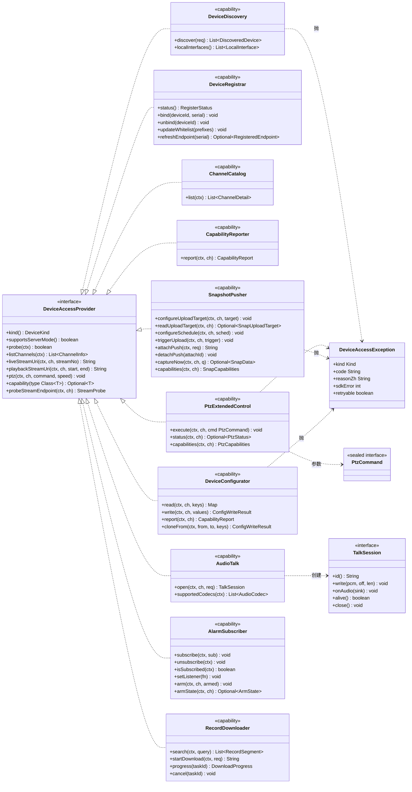

> **阅读方式**：一个实现类（`DahuaDeviceAccessProvider`）同时 `implements` 全部 10 个能力接口。调用方只用 `provider.capability(XxxCapability.class)` 取用，**不出现任何厂商类型**。

**统一异常模型**

```java
public class DeviceAccessException extends RuntimeException {
    public enum Kind { UNSUPPORTED, UNAVAILABLE, TIMEOUT, AUTH, PARAM, DEVICE_REJECT, CONFLICT }
    private final Kind kind;        // 语义分类
    private final String code;      // 如 DAHUA_E_1003
    private final String reasonZh;  // 面向运维的中文原因
    private final int sdkError;     // 大华 errno，-1 表示非 SDK 层失败
    private final boolean retryable;
}
```

**契约方法的三类返回约定**（与 PRD §6 一致）

| 类 | 约定 | 例 |
|---|---|---|
| 查询类 | 失败返回空集合 / `Optional.empty()` / `false`，**不抛** | `listChannels`、`capabilities`、`presets`、`registerStatus` |
| 控制类 | 失败**抛** `DeviceAccessException`，带中文原因；禁止静默成功 | `ptz`、`writeConfig`、`reboot`、`preset(GOTO)` |
| 异步类 | 返回句柄/任务 ID，结果走 listener | `subscribeAlarm`、`startDownload`、`openTalk` |

---

### 3.0.1 ★ 基础设施一：`StructCfgAccessor` —— 统一「读结构体 → 改字段 → 写回」骨架

#### 问题：40 个缺口里的大多数是同一个模式

产品经理的观察是对的。逐一清点：

| 功能 | 本质 | SDK 调用形态 |
|---|---|---|
| 相机配置 19 项 | 读 `NET_VIDEOIN_*` 结构体 → 改 1~3 个字段 → 写回 | `CLIENT_GetConfig` / `CLIENT_SetConfig`（枚举号） |
| 视角（镜像/翻转/旋转） | 读 `NET_VIDEOIN_IMAGE_INFO` → 改 3 个 bool/int → 写回 | 同上 |
| 背光（三选一互斥） | 读 `NET_VIDEOIN_BACKLIGHT_INFO` → 改模式 + 值 → 写回 | 同上 |
| 巡航组 | 读 `CFG_PTZTOUR_INFO`（64×64）→ 改一条路径 → 写回 | `CLIENT_GetNewDevConfig` / `SetNewDevConfig`（命令字符串） |
| 预置位 | 读 `NET_PRESET_INFO`（列表 + 到位超时）→ 改 → 写回 | 同上（`CFG_CMD_PTZ_PRESET`） |
| 开机/空闲/定时动作 | 读 `CFG_PTZ_AUTOMOVE_INFO` → 改 `emFuncType`/`stAutoHoming`/`stTimeSchedule` → 写回 | 同上（`CFG_CMD_PTZ_AUTO_MOVEMENT`） |
| 抓图上传目标 | 读 `NET_CFG_PICTURE_HTTP_UPLOAD_INFO`（64 服务器）→ 改一条 → 写回 | `CLIENT_GetConfig` / `SetConfig`（1609） |
| 抓图策略 | 读 `CFG_ENCODE_INFO` 的 `stuSnapFormat[]` → 改 → 写回 | `CLIENT_GetNewDevConfig`（`CFG_CMD_ENCODE`） |

**8 类功能、40 个功能点，同一套「读-改-写」。** 如果按「一功能一方法」铺：
- SPI 膨胀到 40+ 方法；
- 每个方法都要重复实现「申请 buffer → 调用 → 检查 errno → `read()` 回结构体 → 防御空指针」；
- **最致命**：每个方法各自独立读改写，两个运维同时改同一通道的不同参数时，**后写的会把先写的整段覆盖掉**（读改写竞态）。

#### 方案：泛型化 accessor + patch 语义

```java
// dahua/internal/cfg/StructCfgAccessor.java  —— 实现层内部骨架，不进契约
final class StructCfgAccessor {

    /** 一次配置操作的元数据：怎么读、怎么写、超时多久。 */
    sealed interface CfgSpec<T extends NetSDKLib.SdkStructure> {
        int channelOf();                 // 通道号，-1 = 与通道无关（设备级配置）
        int readTimeoutMs();
        int writeTimeoutMs();
    }

    /** ① 枚举号形态（CLIENT_GetConfig / CLIENT_SetConfig） */
    record EmCfgSpec<T extends NetSDKLib.SdkStructure>(
            int emCfgOpType,             // 如 NET_EM_CFG_VIDEOIN_COLOR = 1301
            Supplier<T> factory,         // 结构体工厂：T::new
            int channel,
            int readTimeoutMs, int writeTimeoutMs) implements CfgSpec<T> {}

    /** ② 命令字符串形态（CLIENT_GetNewDevConfig / SetNewDevConfig） */
    record CmdCfgSpec<T extends NetSDKLib.SdkStructure>(
            String command,              // 如 CFG_CMD_PTZTOUR = "PtzTour"
            Supplier<T> factory,
            int channel,
            int readTimeoutMs, int writeTimeoutMs) implements CfgSpec<T> {}

    /**
     * 读一份完整配置。失败抛 DeviceAccessException（含 errno + 中文原因）。
     */
    <T> T read(Session session, CfgSpec<T> spec) { ... }

    /**
     * ★ patch：读 → 按 mutator 改字段 → 写回。这是消除重复的关键。
     *
     * <p><b>为什么比 set(T) 更好</b>：调用方只声明「我要改什么」，不用关心的
     * 其它 39 个字段的当前值。彻底避免「构造一个只填了 3 个字段的新结构体
     * 直接写回 → 把其余 39 个字段全清成 0」这个灾难性错误
     * （大华的结构体是"整段覆盖"语义，不是"部分更新"语义）。
     *
     * @param mutator 就地修改结构体；返回值仅用于日志说明
     * @return 写回结果（含 needDeviceRestart）
     */
    <T> PatchResult patch(Session session, CfgSpec<T> spec, Consumer<T> mutator) {
        T cfg = read(session, spec);            // ① 读
        mutator.accept(cfg);                    // ② 改
        return write(session, spec, cfg);       // ③ 写
    }

    /** 整段覆盖写（仅用于"从无到有"建配置，如首次配置上传目标）。 */
    <T> PatchResult write(Session session, CfgSpec<T> spec, T cfg) { ... }

    /** 只读单字段的便捷方法。 */
    default <T, V> V get(Session s, CfgSpec<T> spec, Function<T, V> getter) {
        return getter.apply(read(s, spec));
    }
}

record PatchResult(boolean ok, boolean needDeviceRestart, int sdkError, String reasonZh) {}
```

**`patch` 解决的四个具体问题**

| 问题 | `patch` 如何解决 |
|---|---|
| **整段覆盖陷阱**：只填 3 个字段写回 → 其余 39 个字段被清零 | 先 `read()` 拿到完整现状，mutator 只改 3 个字段，其余原样写回 |
| **读改写竞态**（两人同时改不同参数，后者覆盖前者） | 加**通道级写锁**：`patch` 全程持 `(deviceId, channelOf, command)` 粒度的 `ReentrantLock`，同一配置项串行 |
| **型号差异导致的字段不存在** | `read` 失败 → 抛 `UNSUPPORTED` 并**写入能力位失败缓存**（§3.0.2 第 3 级），后续前端不再展示该项 |
| **`needDeviceRestart` 被丢弃** | `PatchResult` 强制携带，Service 层必须处理（返回前端或触发重启流程） |

**并发控制细节**（写进代码注释）：

```java
// 锁粒度必须是 (deviceId, channel, command)，不能是整个设备：
//   - 整设备锁会让"读通道1亮度"和"写通道2曝光"互相阻塞，19 项配置的批量读要串行到 10 秒以上
//   - 无锁会让并发的 patch 互相覆盖
private static final ConcurrentHashMap<String, ReentrantLock> CFG_LOCKS = new ConcurrentHashMap<>();

private static ReentrantLock lockFor(String deviceId, int ch, String cmdKey) {
    // key 不含 volatile 字段，锁对象数量上限 = 设备数 × 通道数 × 配置项数，实测 < 2000，不需回收
    return CFG_LOCKS.computeIfAbsent(deviceId + "|" + ch + "|" + cmdKey, k -> new ReentrantLock());
}
```

#### 🔍 边界评估：这个抽象会不会破坏「只管协议差异」？

**结论：不会，前提是它必须留在实现层。**

| 检查项 | 评估 |
|---|---|
| 是否暴露到 `deviceaccess` 契约包？ | **否**。`StructCfgAccessor` 在 `dahua/internal/cfg/`，契约层完全不感知 |
| 是否含厂商类型？ | **是**（`NetSDKLib.SdkStructure`、`CfgSpec.emCfgOpType`）。正因为含厂商类型，它**必须**在实现层 |
| 是否让 provider 承担了业务规则？ | **否**。它只负责「安全地读写一段设备配置」，不判断「能不能改」「该不该改」——那是 Service 层的职责 |
| 是否降低了可测试性？ | **提高**。`CfgSpec` 是数据，`read`/`write` 可被桩 session 替换；19 项参数变成 19 个 `CfgSpec` 常量，可被表驱动单测覆盖 |
| 是否让契约层也受益？ | **是（间接）**。因为有了 accessor，契约层的 `DeviceConfigurator.read/write` 只需 2 个方法就能覆盖 19 项，`PtzExtendedControl` 的 11 子功能里 6 个落到 `patch`，SPI 才没有膨胀 |

**一句话总结边界**：`StructCfgAccessor` 是**实现层的私有骨架**，它让「40 个缺口」在实现层收敛成「1 套读写 + 40 条 `CfgSpec` 声明 + 40 个 mutator」，而契约层仍然只暴露**语义化**的方法。两者层级不同，互不侵犯。

#### 副产品：`CfgSpec` 注册表就是「配置项目录」

```java
// dahua/internal/cfg/DahuaCfgSpecs.java —— 所有配置项集中一处声明
public final class DahuaCfgSpecs {
    // ── 图像（枚举号形态）──
    public static final CfgSpec<NetSDKLib.NET_VIDEOIN_COLOR_INFO> VIDEOIN_COLOR =
        new EmCfgSpec<>(NET_EM_CFG_VIDEOIN_COLOR /*1301*/, NET_VIDEOIN_COLOR_INFO::new, -1, 3000, 5000);
    public static final CfgSpec<NetSDKLib.NET_VIDEOIN_IMAGE_INFO> VIDEOIN_IMAGE =
        new EmCfgSpec<>(NET_EM_CFG_VIDEOIN_IMAGE_OPT /*1302*/, NET_VIDEOIN_IMAGE_INFO::new, -1, 3000, 5000);
    public static final CfgSpec<NetSDKLib.NET_VIDEOIN_BACKLIGHT_INFO> VIDEOIN_BACKLIGHT =
        new EmCfgSpec<>(NET_EM_CFG_VIDEOIN_BACKLIGHT /*1309*/, NET_VIDEOIN_BACKLIGHT_INFO::new, -1, 3000, 5000);
    // ... 曝光/日夜/补光/透雾/聚焦 ...

    // ── 云台（命令字符串形态）──
    public static final CfgSpec<CFG_PTZTOUR_INFO> PTZ_TOUR =
        new CmdCfgSpec<>(CFG_CMD_PTZTOUR /*"PtzTour"*/, CFG_PTZTOUR_INFO::new, 0, 5000, 8000);
    public static final CfgSpec<NET_PRESET_INFO> PTZ_PRESET =
        new CmdCfgSpec<>(CFG_CMD_PTZ_PRESET /*"PtzPreset"*/, NET_PRESET_INFO::new, 0, 5000, 8000);
    public static final CfgSpec<CFG_PTZ_AUTOMOVE_INFO> PTZ_AUTOMOVE =
        new CmdCfgSpec<>(CFG_CMD_PTZ_AUTO_MOVEMENT /*"PtzAutoMovement"*/, CFG_PTZ_AUTOMOVE_INFO::new, 0, 8000, 10000);

    // ── 抓图 ──
    public static final CfgSpec<NET_CFG_PICTURE_HTTP_UPLOAD_INFO> SNAP_HTTP_UPLOAD =
        new EmCfgSpec<>(NET_EM_CFG_PICTURE_HTTP_UPLOAD /*1609*/, NET_CFG_PICTURE_HTTP_UPLOAD_INFO::new, -1, 5000, 10000);
}
```

**这个注册表有额外价值**：它就是 §3.0.2 能力位探测的**输入清单**——「有哪些配置项需要探测」不用另写一份，直接遍历注册表。

---

### 3.0.2 ★ 基础设施二：能力位（`CapabilityReport`）—— 横切依赖，必须最先落地

#### 为什么必须是独立基础设施

产品经理的判断完全成立，且比 PRD 说的更严重：

> **错误的能力位比没有能力位更糟。** 前端拿到「这个型号支持锐度」的错误信号，就会渲染一个开关；运维点下去报错，会判定为「平台有 bug」，而不是「型号不支持」。这会摧毁运维对整套系统的信任。

所以能力位**不能**散落在各模块的 `if` 里，必须是：**一个独立的探测引擎 + 一份独立的持久化快照 + 一个统一的对外契约**。

#### 探测引擎：三级策略（每级都有确定的 SDK 依据）

**第 1 级：能力集查询（便宜、权威，覆盖已知的 8 类）**

已核实的完整命令枚举在 `enumeration/EM_NEW_QUERY_SYSTEM_INFO`（**47 个命令**）。用 `CLIENT_QueryNewSystemInfo(login, cmd, channel, buf, size, errRef, wait)` 调用：

| 命令字符串（已核实） | 结构体 | 结构体是否在本 SDK 存在 | 能回答什么 |
|---|---|---|---|
| `ptz.factory.instance` | `CFG_CAP_PTZ_ENABLEINFO` | ✅ 存在 | 该通道**有没有云台**（`bEnable`） |
| `ptz.getCurrentProtocolCaps` | `CFG_PTZ_PROTOCOL_CAPS_INFO` | ✅ 存在（**能力最全，见下**） | 云台**每个子功能是否支持 + 号段范围** |
| `encode.getCaps` | `CFG_ENCODECAP` | ✅ 存在 | 编码能力（决定抓图可用的分辨率/质量） |
| `alarm.getAlarmCaps` | `CFG_CAP_ALARM_INFO` | ✅ 存在 | 支持哪些报警类型（决定报警订阅清单） |
| `RecordFinder.getCaps` | `CFG_CAP_RECORDFINDER_INFO` | ✅ 内联存在 | 录像检索能力 |
| `speak.getCaps` | `CFG_CAP_SPEAK` | ⚠️ **结构体缺失** | 扬声器/喊话能力 → 降级到第 2 级 |
| `devVideoInput.getCaps` | `CFG_CAP_VIDEOINPUT_INFO` | ⚠️ **结构体缺失** | 19 项图像能力 → 降级到第 2 级 |
| `devVideoInput.getCapsEx` | `CFG_CAP_VIDEOINPUT_INFO_EX` | ⚠️ **结构体缺失** | 同上（扩展） |
| `recordManager.getCaps` | `CFG_CAP_RECORD_INFO` | ⚠️ **结构体缺失** | 录像能力 |

> **⚠️ 这是本方案最重要的一个技术债，必须让主理人知道**：`EM_NEW_QUERY_SYSTEM_INFO` 枚举里有命令字符串，但**4 个关键结构体（`CFG_CAP_VIDEOINPUT_INFO`/`_EX`、`CFG_CAP_SPEAK`、`CFG_CAP_RECORD_INFO`）在本 SDK 版本的 `structure/` 目录里不存在**。这意味着「19 项图像能力」无法通过强类型结构体读取，只能：
> - (a) 把 `CLIENT_QueryNewSystemInfo` 返回的 `byte[]` 当 **JSON 字符串**自己解析（大华新固件的能力集返回确实是 JSON），或
> - (b) 完全依赖第 2 级探测。
>
> **建议 (a)+(b) 组合**：先尝试 JSON 解析（容错解析，只取需要的 key），失败则退第 2 级。这条已列入 §8.5 的验证清单 **V1**。

**`CFG_PTZ_PROTOCOL_CAPS_INFO` 是本方案最幸运的发现**——它把云台 11 个子功能的能力位**一次全给了**（已核实全部字段）：

| 结构体字段（已核实） | 映射到 `PtzCapabilities` | 用途 |
|---|---|---|
| `bPan` / `bTile` / `bZoom` / `bIris` | `supportDirection` / `supportZoom` | 8 方向 + 变倍 + 光圈 |
| `bPreset` / `bRemovePreset` | `supportPreset` | 预置位设置 / 删除 |
| `bTour` / `bRemoveTour` | `supportTour` | 巡航组 |
| `bPattern` | **`supportTrace`** | **巡迹**（PRD P2 项，此处确认有明确能力位） |
| `bAutoPan` | `supportAutoPan` | 水平旋转 |
| `bAutoScan` | `supportLineScan` | 线扫 |
| `bSupportLimit` | `supportLimit` | **限位** |
| `bLight` / `bWiper` | `supportLight` / `supportWiper` | 灯光雨刷 |
| `bGetStatus` | `supportStatus` | 能否读云台状态（决定 `PtzStatus` 是否可用） |
| `wPresetMin` / `wPresetMax` | `presetMin` / `presetMax` | **预置位号段**（PRD 说「范围由型号决定」，这就是答案） |
| `wTourMin` / `wTourMax` | `tourMin` / `tourMax` | 巡航组号段 |
| `wPatternMin` / `wPatternMax` | `traceMin` / `traceMax` | 巡迹号段 |
| `wAutoScanMin` / `wAutoScanMax` | `autoScanMin` / `autoScanMax` | 线扫号段 |
| `wPanSpeedMin` / `wPanSpeedMax` | `panSpeedMin` / `panSpeedMax` | **速度范围**（不是固定的 1~8！） |
| `bSupportPresetTimeSection` | `supportPresetTimeSection` | 预置位是否支持时间段 |

**这直接解决了我 v1.0 里的一个错误假设**：我曾写「预置位范围默认 1~255，获取失败时标注可能不准」。实际上是**可以精确拿到号段上下限**的，不需要猜。

**第 2 级：配置项存在性探测（覆盖第 1 级够不到的项）**

```java
// 遍历 DahuaCfgSpecs 注册表，对每个 CfgSpec 尝试 read：
//   成功        → 该项可读（若写测试通过则可写）
//   失败 errno 表明"不支持"  → 该项不可读，且记入快照
//   失败 errno 表明"超时/网络" → 不下结论，保持上次值 + stale 标记
```

**关键设计：区分「不支持」与「暂时读不到」**。这两个绝不能混——把超时当「不支持」会在一次网络抖动后把设备的能力位永久降级（24h），用户会看到「昨天能调的曝光今天不能调了」。

```java
private static ProbeOutcome classify(int sdkErr) {
    return switch (sdkErr) {
        case 1, 2, 3 -> ProbeOutcome.UNSUPPORTED;   // 设备明确拒绝
        case 4, 5    -> ProbeOutcome.CHANNEL_MISSING;
        default      -> ProbeOutcome.UNKNOWN;       // ★ 不下结论，保留上次值
    };
}
```

**第 3 级：失败缓存（兜底，也是自我修正机制）**

任何一次写操作失败且 errno 表示「不支持/参数非法」→ 把该 `key` 标记为不可写，**立即**更新快照并告警「能力位与实际不一致：型号 X 实际不支持 Y，已自动修正」。这既是降级，也是**数据修正**——现场出现的每一个不一致都是一次校准机会。

#### 缓存策略（PM 明确问的三点）

| 问题 | 设计 |
|---|---|
| **缓存多久** | 24 小时。理由：设备参数不常变，但 24h 足够覆盖「白天/夜晚参数不同」这类周期性差异，且固件升级后最迟一天能自愈 |
| **什么时候必须失效** | ①**固件版本变化**（`NET_DEVICEINFO_Ex` 的版本字段比对，这是唯一可靠的换型信号）②**设备重新登录且序列号变化**（换了设备）③运维手动点「刷新能力位」④**该设备的所有写操作连续失败 3 次**（防「能力位说是支持但实际不支持」长期错误） |
| **存哪** | `dahua_device_capability` 表，唯一键 `(device_id, channel_index, firmware_version)`。固件变化天然是新增一行，旧行保留可做「升级前后能力差异对比」 |

```java
public record CapabilityReport(
        String deviceId, int channelIndex, String firmwareVersion,
        /** 可读的配置项 key 集合 */
        Set<String> readableKeys,
        /** 可写的配置项 key 集合（readable ∩ 写测试通过） */
        Set<String> writableKeys,
        /** 每项的取值范围（来自第 1 级能力集或第 2 级实测） */
        Map<String, Range> ranges,
        /** 每项的枚举取值（如白平衡 0~11、视角 5 种） */
        Map<String, List<EnumOption>> enums,
        /** 云台能力（单独一块，因为它是最完整的一组） */
        PtzCapabilities ptz,
        /** 抓图能力 */
        SnapCapabilities snap,
        /** 支持的报警类型 */
        Set<AlarmType> alarmTypes,
        /** 支持的音频编码（按优先级排序） */
        List<AudioCodec> talkCodecs,
        /** 探测来源与时间 */
        Set<ProbeOutcome> sources, long probedAtMillis,
        /** ★ 是否为陈旧数据（探测超时时为 true，前端要提示） */
        boolean stale,
        /**
         * ★ 探测状态 —— 前端据此决定渲染，**不再自己猜**。
         * 详见下方「能力位『未知』状态的处理」。
         */
        ProbeState state,
        /** state == UNKNOWN 时的中文原因（直接展示给运维） */
        String unknownReasonZh) {}
```

#### 如何与通道目录一起返回给前端（PM 明确问）

**决策：通道目录接口**按需**携带能力位，但默认不带全量。**

| 场景 | 做法 | 理由 |
|---|---|---|
| `GET /device/channellist`（列表页） | **不返回**能力位，只返回 `capabilityCached: true/false` | 一页 50 个通道 × 20 项能力 = 巨大 payload，列表页用不到 |
| `GET /device/channelinfo`（单通道详情） | **返回完整 `CapabilityReport`** | 详情页要渲染表单，正需要 |
| `GET /device/capability?deviceId&channel` | 独立端点，返回 `CapabilityReport` | 表单页可单独刷新，不必重拉通道信息 |
| `POST /device/capability/refresh` | **异步任务**，返回 taskId | 全量探测最多 20+ 次 SDK 往返，实测可达 20s，同步会超时 |

**前端渲染约定（写进接口文档）**：

```
表单项 = CapabilityReport.writableKeys 中存在的 key
  → 显示为可编辑控件，取值范围取 ranges[key]，枚举取 enums[key]
表单项 = readableKeys 有、writableKeys 无
  → 显示为只读，标注「该型号不支持修改」
表单项 = 两者都无
  → 不渲染（而不是渲染成 disabled —— 一堆灰控件会让运维以为"坏了"）
stale == true
  → 页面顶部黄条：「能力位为 {N} 小时前数据，如与设备实际情况不符请点击刷新」
```

#### ★ 能力位「未知」状态的处理：二选一，选「只读 + 一键探测」

上游要求「读不到能力位时是『全部可编辑但可能报错』还是『只读 + 提示能力未知』，必须二选一并说清，不能让前端自己猜」。**明确选择后者。**

##### 决策：默认只读 + 明确提示 + 一键探测，探测成功转为可编辑

| 方案 | 行为 | 为什么选 / 不选 |
|---|---|---|
| **A（不选）全部可编辑但可能报错** | 19 项全渲染成控件；运维改完保存，某个型号不支持的项报错 | ❌ **直接违反本方案自己的核心原则「错误的能力位比没有能力位更糟」**。运维点 19 项，5 项报错，会判定「这平台不稳定」，而不是「这型号不支持」 |
| **B（选）只读 + 提示 + 一键探测** | 19 项全只读，灰条提示「该型号能力未知」+ 一个「探测能力」按钮；探测成功 → 转为 A 的可编辑状态 | ✅ **未知是暂时的，可被主动消除**。能力位探测（第 2 级配置项存在性检查）只需几次 `GetConfig`，成本极低 |
| ~~C 直接不渲染~~ | 整个配置面板消失 | ❌ 更糟：运维不知道是「设备不支持」还是「平台坏了/没权限」，会去翻日志、开单 |

**关键理由**：`stale` / `unknown` 两种状态**都不该导向"猜测式可编辑"**。给运维一个明确可点的「探测」按钮，比给 19 个可能报错的开关负责得多 —— 前者 3 秒解决，后者要开一次工单。

##### 状态机（前端与后端共同遵守）

```
                ① 首次查能力位
                       │
         ┌─────────────┴─────────────┐
         ▼                           ▼
   PROBED（已知）              UNKNOWN（未知）
   readableKeys 可用           19 项全部只读
   按上述渲染约定走            灰条 + 「探测能力」按钮
         ▲                           │
         │                    ② 用户点「探测」
         │                    POST /device/capability/refresh
         │                           ▼
         │                    PROBING（探测中，按钮转圈）
         │                           │
         └──── 成功 ────────────────┤
                                     │ 失败（超时/设备拒绝）
                                     ▼
                              UNKNOWN + 提示
                              「探测失败：{中文原因}，
                               请检查设备是否在线或稍后重试」
                              （保留上一次成功的值，若有）
```

**后端契约（`CapabilityReport` 上加一个字段，让前端不必推断）**

```java
public enum ProbeState {
    PROBED,      // 探测成功，readableKeys/writableKeys 可信
    UNKNOWN,     // 从未探测成功过 → 前端默认全部只读
    STALE,       // 有过成功值但已过期（探测超时时保持旧值）→ 可编辑 + 黄条提示
    PROBING      // 探测进行中 → 全部只读 + 转圈
}

// CapabilityReport 增加：
//   ProbeState state;          // 前端据此决定渲染，不再自己猜
//   String unknownReasonZh;    // state==UNKNOWN 时的中文原因
```

**三处必须一致的实现约束**

| # | 约束 | 原因 |
|---|---|---|
| 1 | `state == UNKNOWN` 时，**后端写接口也必须拒绝**（返回 `DAHUA_E_6001`「能力位未知，请先探测」） | 只在前端置灰不够 —— 有人直接调 API 就能写坏配置 |
| 2 | 第 3 级失败缓存命中时（某 key 实际不支持），**必须把该 key 从 `writableKeys` 移除并置 `state=STALE`** | 否则 UI 一直显示可编辑，运维反复试 |
| 3 | 「一键套用」（Q6）在 `state != PROBED` 时**直接拒绝** | 源或目标能力未知时套用，等于盲写 19 项 |

**这套机制不新增后端工作量**：第 2 级探测（§3.0.2）本来就是为这个设计的，`refresh` 接口也已存在。只是把「未知时怎么办」这个决策从「留给前端猜」变成「后端明确告知 + 前端确定性渲染」。

**「一键套用」（Q6）的前提也就明确了**：只能套用 `源.writableKeys ∩ 目标.writableKeys`，其余项**必须显式跳过并列出**，不能静默忽略。

---

### 3.1 模块一：设备发现与主动注册

#### 3.1.1 局域网发现

```java
public interface DeviceDiscovery {
    /**
     * 启动一次异步搜索，收集 {@code timeoutMillis} 内的应答。
     *
     * <p><b>为什么是异步 + 阻塞收集，而不是纯回调</b>：组播应答是「散乱到达」的，
     * 同型号设备很可能在 300ms 内集中回 20 条；如果直接回调给业务层，
     * 上层要去重、要合并、要处理「同一设备两路网卡各回一次」。
     * 这些是厂商协议细节，应在 provider 内消化。
     *
     * @param req 搜索请求
     * @return 去重后的设备清单（按 SN 去重，同 SN 保留「首包 IP + 最后心跳时间」）
     * @throws DeviceAccessException 仅当原生库不可用（Kind=UNAVAILABLE）；网络层失败返回空列表
     */
    List<DiscoveredDevice> discover(DiscoverRequest req);

    /** 本机可用网卡（供前端下拉选路；返回空表示探测失败）。 */
    List<LocalInterface> localInterfaces();
}

public record DiscoverRequest(
        String localIp,        // 指定出口网卡 IP；null = 全部网卡逐一轮询
        int timeoutMillis,     // 收集窗口，默认 3000，范围 1000~15000
        int broadcastPort,     // 默认 0（用 SDK 默认 5050），见 NET_DEVICE_SEARCH_PARAM
        int multicastPort,     // 默认 0（用 SDK 默认 37810）
        boolean autoAdd        // 仅供 Service 层使用；provider 忽略
) {}

public record DiscoveredDevice(
        String serial,          // DEVICE_NET_INFO_EX.szSerialNo
        String ip,              // szIP
        int sdkPort,            // nPort（TCP，默认 37777）
        int httpPort,           // nHttpPort
        String mac,             // szMac
        String deviceType,      // szDeviceType
        String model,           // szDetailType ← 展示型号
        String firmware,        // szDevSoftVersion
        String vendor,          // szVendor（OEM 客户类型）
        String name,            // szDevName
        int videoInChannels,    // wVideoInputCh ← 通道数
        int remoteVideoInChannels, // wRemoteVideoInputCh ← NVR 下挂 IPC 数
        int alarmInChannels,    // wAlarmInputCh
        boolean initialized,    // byInitStatus bit0~1 == 2
        boolean dhcpEnabled,    // bDhcpEn
        int ipVersion,          // iIPVersion：4 或 6
        String subnetMask,      // szSubmask
        String gateway,         // szGateway
        String localIp          // 从哪块网卡发现的（多网卡诊断关键）
) {}
```

**SDK 调用链（已核实）**

```java
NetSDKLib.NET_DEVICE_SEARCH_PARAM param = new NetSDKLib.NET_DEVICE_SEARCH_PARAM();
param.bUseDefault = 1;                       // 用 SDK 默认端口（5050/37810）
if (req.broadcastPort() > 0) param.wBroadcastLocalPort = (short) req.broadcastPort();
if (req.multicastPort() > 0) param.wMulticastRemotePort = (short) req.multicastPort();
sdk.CLIENT_SetDeviceSearchParam(param);      // boolean

// 回调：fSearchDevicesCB.invoke(Pointer pDevNetInfo, Pointer pUserData)
NetSDKLib.LLong handle = sdk.CLIENT_StartSearchDevices(cb, null, req.localIp());
// ... 收集 timeoutMillis ...
sdk.CLIENT_StopSearchDevices(handle);        // boolean
```

回调里：`pDevNetInfo` 是 `DEVICE_NET_INFO_EX*`，**内存由 SDK 申请释放**，必须立刻 `read()` 成 Java 值，不能留指针。

**关键约束**

| 约束 | 设计对策 |
|---|---|
| 仅限同一广播域（组播 37810 / 广播 5050 不跨三层） | 前端明确提示「仅同网段有效」；跨网段提供 `CLIENT_SearchDevicesByIPs(DEVICE_IP_SEARCH_INFO, cb, user, localIp, waitTime)` 作补充（需显式给 IP 段，PRD 列为不做，仅保留接口） |
| **多网卡选路** | 默认 `localIp=null` 让 SDK 遍历；但对多网卡机器**逐网卡串行调用**（每次传一个 localIp），并在结果里带 `localIp` 字段。理由：单次调用只走一个出口，遍历才能保证覆盖；串行而非并行是因为 SDK 的组播端口是**全局单例**，并行会互相覆盖 `NET_DEVICE_SEARCH_PARAM` |
| 重复应答 | 按 `serial` 去重；同 SN 多 IP（设备双网卡/DHCP 漂移）时**保留最后一个应答的 IP**（最新地址），并在 `DiscoveredDevice` 里不合并 —— 让运维看到两条记录自行判断 |
| 探测超时 | 默认 3000ms。低于 1000ms 会漏掉响应慢的设备；高于 15000ms 用户体验不可接受 |
| 端口冲突 | 组播端口 37810 被占用时 `CLIENT_StartSearchDevices` 返回 0 → 抛 `DAHUA_E_2001`「局域网发现端口 37810 被占用，请检查是否有其他大华客户端在运行」 |
| 与「主动注册」冲突 | 发现用的广播/组播端口与注册监听端口（默认 9500）**互不冲突**，可同时启用 |

**异常处理**

| 场景 | 行为 |
|---|---|
| 原生库不可用 | 抛 `DeviceAccessException(UNAVAILABLE)`, code=`DAHUA_E_0001` |
| `CLIENT_StartSearchDevices` 返回 0 | 抛 `TIMEOUT`/`DAHUA_E_2001`，附 `CLIENT_GetLastError()` |
| 收集窗口内 0 条应答 | **返回空列表，不抛**（可能只是网段里没设备） |
| 结果入库（Q7） | Service 层写 `dahua_discovery_candidate`，**不全自动建**。前端「一键批量添加」→ `POST /device/discoveradd` |

#### 3.1.2 主动注册补强：SN ↔ deviceId 绑定（公网接入的地基）

> 上游指出「`supportsServerMode()` + `DeviceRegisterTable` 已有，但**SN 如何映射到平台 `device_id` 这一段是空的**」。这个判断准确——现有代码里 `DahuaSdk.serverSession()` 用 `serial` 做会话索引，但**平台侧从没有把 serial 和 `gb_device.device_id` 关联起来**。没有这一步，注册上来的设备就是一个「平台不认识的黑盒子」：知道它连上来了，但不知道该把它当成哪一台设备、该给它建什么通道、该套什么权限。

##### 先回答四个具体问题

| 问题 | 答案 |
|---|---|
| **SN 是设备序列号还是国标编码？** | **是设备序列号（硬件 SN）**，不是国标 20 位编码。来源有三处且必须一致：①注册回调 `NET_CB_AUTOREGISTER.szDevSerial` / `EM_LISTEN_TYPE.NET_DVR_SERIAL_RETURN` 的 `char* szDevSerial`；②登录出参 `NET_DEVICEINFO_Ex.sSerialNumber`；③局域网发现 `DEVICE_NET_INFO_EX.szSerialNo`。**三者比对一致才能确认「发现的那台」和「注册的这台」是同一设备**（这是把 Q7 的发现清单和主动注册打通的唯一钩子） |
| **归一化规则** | 大写 + 去空格（现有 `DahuaSdk.normalizeSn()` 已实现）。大华 SN 是 ASCII，但不同固件大小写不一致 |
| **首次注册要不要自动建档？** | **不自动建档**。理由与 Q7 完全一致：注册端口开在 `0.0.0.0` 上，任何能出网的设备都能连上来。自动建档 = 任何一个扫描器都能往你的设备表里插垃圾数据。流程是「注册 → 进待绑定清单 → 运维确认 → 建档」，见下 |
| **白名单校验放哪一层？** | **provider 回调层**（`DahuaRegisterListener`），不是 Service 层。理由：回调线程禁止碰 DB（§1.2 硬约束 1），且白名单是**进程内前缀匹配**，零 IO。DB 里存白名单是运维配置，加载到内存后由 listener 持有 `volatile List<String>` |

##### 绑定模型：三段状态，不允许跳步

```
          ┌──────────────┐   运维确认 + 填账号密码   ┌──────────────┐   登录成功 + 取通道   ┌──────────────┐
  注册上报 │  REGISTERED  │ ──────────────────────► │    BOUND     │ ──────────────────► │    ONLINE    │
  ───────► │ （未知设备） │                         │ （已绑设备）  │                     │ （可操作）    │
          └──────────────┘ ◄────────────────────── └──────────────┘ ◄─────────────────── └──────────────┘
              进待绑定清单        运维解绑                会话失效 / 心跳超时
```

| 状态 | 含义 | 存在哪 | 能做什么 |
|---|---|---|---|
| `REGISTERED` | 设备连上来了，但平台不知道它是谁 | 只在 `DeviceRegisterTable`（内存） | 只能看「有个 SN 连上来了」，不能建通道、不能控 |
| `BOUND` | 运维确认「这个 SN 就是设备 X」，并配了账号密码 | `gb_device.register_sn` + `device_id` | 可以 `probe`、可以取通道 |
| `ONLINE` | 登录成功且句柄有效 | `DahuaSdk` 会话表 | 全部能力 |

**为什么要显式三段而不是「注册即建档」**：`REGISTERED` 状态是**唯一能看到「未授权设备正在尝试接入」的地方**。跳过它，就等于放弃了安全审计的机会——运维永远不知道昨天有 37 个陌生 SN 扫过你的注册端口。

```java
public interface DeviceRegistrar {

    /**
     * 注册状态快照（回答「监听起来没有、端口几号、收了多少注册」）。
     */
    RegisterStatus status();

    /**
     * 把平台设备记录与注册 SN 绑定。这是 SN → deviceId 的唯一入口。
     *
     * @param deviceId 平台设备编号（gb_device.device_id）
     * @param serial   设备 SN（内部会大写归一化）
     * @throws DeviceAccessException
     *   CONFLICT / DAHUA_E_1001 —— 该 SN 已绑到别的 deviceId
     *   PARAM    / DAHUA_E_1003 —— serial 为空或格式非法
     *   NOT_FOUND/ DAHUA_E_1004 —— 该 SN 当前不在注册表里（设备没连上来，先让设备上线再绑）
     */
    void bind(String deviceId, String serial);

    /** 解绑（设备下架时）。幂等。 */
    void unbind(String deviceId);

    /** 待绑定清单：已注册但没有任何 gb_device 认领的 SN。 */
    List<PendingRegistration> pending();

    /** 注册白名单：为空表示不限制（启动时打 WARN 提醒安全风险）。 */
    void updateWhitelist(List<String> serialPrefixes);

    /** 立刻刷新某设备的地址（设备换网后调用）。 */
    Optional<RegisteredEndpoint> refreshEndpoint(String serial);
}

/**
 * 一条待绑定的注册记录。
 */
public record PendingRegistration(
        String serial,          // 归一化后的 SN
        String ip, int sdkPort,
        String deviceModel,     // 来自 NET_CB_AUTOREGISTER（若设备上报）
        String firmware,
        long firstSeenAt, long lastSeenAt,
        /** 是否命中白名单（未命中且白名单非空 → 已被拒绝，这里只做审计展示） */
        boolean whitelistMatched,
        /** 可信度线索：若发现清单里有同 SN，给出建议的型号/地址，便于运维判断 */
        String suggestedModelFromDiscovery) {}

public record RegisterStatus(
        boolean running,          // RegisterListener.running()
        int bindPort,             // 实际端口（配置 0 时系统分配，必须回读真实值）
        String bindIp,
        long totalRegistered,     // 累计注册次数
        long rejectedByWhitelist, // 被白名单拒掉的次数
        long currentActive,       // 当前活跃注册数
        int pendingBindCount,     // 待绑定数量
        int boundCount,           // 已绑定数量
        int portConflictCode      // 0 = 无冲突；>0 = SDK errno
) {}

public record RegisteredEndpoint(String serial, String ip, int sdkPort,
                                 long registeredAt, long lastSeenAt,
                                 String deviceModel, String firmware) {}
```

##### 绑定落库：`register_sn` 唯一索引 + 与发现的交叉校验

```sql
-- gb_device 增字段（见 §6.1）
ALTER TABLE gb_device
  ADD COLUMN register_sn VARCHAR(64) NULL COMMENT '大华设备序列号（大写归一化）';

-- 唯一索引防止一个 SN 绑到两台设备
CREATE UNIQUE INDEX uk_device_register_sn
  ON gb_device(register_sn, source)
  WHERE register_sn IS NOT NULL AND deleted = 0;
```

**绑定时必须做的交叉校验**（这是「发现」与「注册」两条路的汇合点）：

```java
void bind(String deviceId, String serial) {
    String sn = normalizeSn(serial);
    // ① SN 当前在注册表里？（不在 → 设备没上线，绑了也用不了）
    if (!registerTable.contains(sn)) throw notFound("DAHUA_E_1004",
            "SN %s 当前未注册，请先确认设备已配置平台地址且能出网");
    // ② 这个 SN 是否已被别的设备认领？
    if (deviceMapper.existsByRegisterSn(sn, excludeDeviceId)) throw conflict("DAHUA_E_1001",
            "SN %s 已绑定到设备 %s，请先解绑");
    // ③ ★ 交叉校验：发现清单里若有同 SN，型号必须一致
    //    不一致说明运维可能绑错了设备（拿 A 的 SN 绑到 B 的记录上）
    DiscoveredDevice discovered = candidateMapper.findBySerial(sn);
    if (discovered != null && !sameModel(discovered.model(), device.getModel())) {
        throw param("DAHUA_E_1005",
            "型号不一致：发现清单里该 SN 是 %s，待绑设备是 %s，请确认是否绑错");
    }
    // ④ 落库
    deviceMapper.updateRegisterSn(deviceId, sn);
}
```

第 ③ 步是本方案里**最容易被跳过、但最能防住现场事故**的一步。现场装维常见错误是「拿着 A 设备的序列号填到 B 设备的平台记录里」，光看 SN 和 IP 都发现不了，只有型号不一致才会暴露。

##### 注册地址变化后如何刷新已有会话（现有实现已覆盖，此处说明完整链路）

| 环节 | 机制 | 代码位置 |
|---|---|---|
| 地址来源 | 设备每次注册/心跳都带 `ip:port` → 覆盖 `DeviceRegisterTable` 里的旧值 | `DahuaRegisterListener` → `table.register()` |
| 检测变化 | 取会话时用注册表实时地址拼 `newKey`，与 `snIndex` 里的 `oldKey` 比对 | `DahuaSdk.serverSession()` |
| 重建会话 | `oldKey != newKey` → 打日志「注册地址变更 X→Y」→ `removeSession(oldKey)` → 用新地址 `login()` | `DahuaSdk.serverSession()`（**现有已实现**） |
| **必须补的一环** | 地址变化后**旧会话的 attach 句柄（抓图订阅/报警订阅/喊话）全部失效**，必须重新 attach | 本方案新增：`onEndpointChanged` 事件 → `AlarmSubscriber` / `SnapshotPusher` 自动重订阅 |
| 平台 DB | **不刷新 `gb_device` 里的地址** | 见 §6.1 —— 注册地址是易失的，写库会误导 |

> **这一环是 v1.0 漏掉的**：现有 `DahuaSdk` 会重建会话，但重建后**没有任何人重新调用 `CLIENT_StartListenEx`**，结果是「设备换网后登录正常、云台正常、但报警全丢」。与 §4.7 的「断线重连」是同一类问题，两个场景都要覆盖。

##### 一端口多设备（Q8）+ 白名单

```java
// CLIENT_ListenServer 天然支持多设备复用同一端口：回调里带 SN，按 SN 分别记录
// 所以「一个监听端口能否服务多台设备」的答案是：能，且这是唯一用法（没有再按设备开端口的接口）

// 白名单：进程内前缀匹配，零 IO，可在回调线程安全执行
boolean allowed = whitelist.isEmpty()
        || whitelist.stream().anyMatch(serial::startsWith);
if (!allowed) {
    rejected.incrementAndGet();
    // 只打日志 + 计数，不查库（回调线程红线）
    log.warn("[DAHUA] op=REGISTER.REJECT sn={} ip={} reason=whitelist", maskSn(serial), ip);
    return;
}
```

**为什么白名单是 P0 而不是 P1**：注册端口通常开在 `0.0.0.0:9500`。没有白名单等于把一个「无限接收 + 每条触发内存分配」的入口暴露在公网。攻击者用伪造 SN 反复注册就能把注册表和会话池打满，**且日志里看到的是正常注册**。这是安全缺陷。

**白名单初始值建议**：不是「空 = 放行一切」，而是**首次启动时从 `gb_device.register_sn` 自动种子化**（所有已绑定设备的 SN 前缀），这样既有默认安全性，又不阻止正常设备。`register_sn` 为空时才真正放行一切，并在启动日志里打 WARN。

#### 3.1.3 注册状态可视化

`GET /api/v1/device/registerstatus` → `RegisterStatus` + 当前活跃注册列表（`serial/ip/port/model/firmware/lastSeenAt/已绑定deviceId`）。

**端口冲突的中文原因映射**

```java
static String describeListenError(int errno) {
    return switch (errno) {
        case 1 -> "监听端口已被占用：请检查是否有另一个平台实例或大华客户端正在使用该端口";
        case 2 -> "绑定地址不可用：请确认配置的 bindIp 属于本机网卡";
        case 3 -> "端口不在允许范围（1024~65535）";
        default -> "监听启动失败，错误码 " + errno + "（详见大华 NetSDK 开发 FAQ）";
    };
}
```

---

### 3.2 模块二：通道、预览、回放、下载

#### 3.2.1 真实通道目录（补 PRD 的 ⚠️）

```java
public interface ChannelCatalog {
    /**
     * 拉取真实通道目录（替换现有「通道 1..N」的假数据）。
     *
     * @return 设备不可达时返回空列表（契约要求，不抛）
     */
    List<ChannelDetail> list(DeviceContext ctx);
}

public record ChannelDetail(
        int index,                 // SDK 通道号（1 起；0 是设备自身）
        String channelCode,        // 平台编号：<deviceId>-<index>（沿用现有规则，见 §3.2.1 注）
        String name,               // CFG_VIDEO_IN_INFO.szChnName
        boolean online,            // 见下「在线判定」
        boolean enabled,           // bEnable
        String deviceId,           // szDevID（摄像头唯一编号）
        String deviceType,         // szDevType
        String manufacturer,       // szManufacturer
        String model,              // szModel
        String address,            // szAddress（安装地址）
        String civilCode,          // szCivilCode（行政区域）
        int ptzType,               // 见下「ptzType 折算」
        boolean ptzSupported,      // CFG_CAP_CMD_PTZ_ENABLE → bEnable
        boolean talkSupported,     // 见「对讲能力标识」
        boolean audioInSupported,  // 伴音通道（来自 CFG_CMD_ENCODE 的 stuAudioFormat）
        boolean isRemoteChannel,   // 是否 NVR 下挂 IPC（szUpperDevID 非空）
        String upperDeviceId,      // szUpperDevID
        int upperDevOutChannel,    // nUpperDevOutChn
        boolean onDemand           // 是否按需拉流
) {}
```

**SDK 调用链（已核实）**

```java
// ① 通道号清单与「哪些通道有云台程序」
NetSDKLib.NET_IN_GET_VIDEOCHANNELSINFO in = new NetSDKLib.NET_IN_GET_VIDEOCHANNELSINFO();
in.emType = NetSDKLib.NET_VIDEO_CHANNEL_TYPE_INPUT;      // 1
NetSDKLib.NET_OUT_GET_VIDEOCHANNELSINFO out = new NetSDKLib.NET_OUT_GET_VIDEOCHANNELSINFO();
sdk.CLIENT_QueryDevInfo(login, NetSDKLib.NET_QUERY_VIDEOCHANNELSINFO /* 0x15 */,
                        in.getPointer(), out.getPointer(), null, timeoutMs);
// out.stInputChannels.nPTZCount / nPTZ[] → 支持云台程序的通道号
// out.stInputChannels.nSDCount  / nSD[]  → 球机通道号

// ② 每通道的详细属性（名称/型号/厂商/上下级）
byte[] buf = new byte[64 * 1024];
IntByReference err = new IntByReference();
boolean ok = sdk.CLIENT_GetNewDevConfig(login, NetSDKLib.CFG_CMD_VIDEOIN /* "VideoIn" */,
                                        channel, buf, buf.length, err, 3000, null);
// buf 是 JSON 字符串 → 反序列化为 CFG_VIDEO_IN_INFO（szChnName / szModel / szManufacturer
// / szAddress / szCivilCode / bParental / szUpperDevID / nUpperDevOutChn / bEnable）

// ③ 云台能力位
byte[] capBuf = new byte[256];
sdk.CLIENT_QueryNewSystemInfo(login, NetSDKLib.CFG_CAP_CMD_PTZ_ENABLE /* "ptz.factory.instance" */,
                              channel, capBuf, capBuf.length, err, 3000);
// → CFG_CAP_PTZ_ENABLEINFO { int bEnable; }
```

**为什么用 `CLIENT_GetNewDevConfig("VideoIn")` 而不是 `CLIENT_GetConfig(1301,...)`**：
`VideoIn` 返回**整套**通道属性（含国标字段 `szCivilCode`/`szUpperDevID`/`nRegisterWay`），一次拿全；`CLIENT_GetConfig` 是按配置项拆分的，要拿名称得再引一个 `NET_EM_CFG_*`，反而多一次往返。`VideoIn` 的代价是返回 JSON 字符串、约 4~8KB/通道 —— 4 通道设备一次约 30KB，可接受。

**在线判定**：`CFG_CMD_VIDEOIN` 没有「在线」字段。用两条判据：
1. 短连接设备（IPC）：登录成功即在线 → `online = true`。
2. NVR 下挂 IPC：`CLIENT_QueryDevState(login, NET_DEVSTATE_CONN /* 0x0007 */, ...)` 拿连接状态；**每通道一次调用，4 通道 4 次，N 通道 N 次** → 所以**只在用户显式刷新时查**，列表页用「上次登录结果」+ 后台 5 分钟探活。

**为什么不做「一次全查」**：`CLIENT_QueryDevState(NET_DEVSTATE_CONN)` 是**单通道**语义（返回 `int*` 或多通道字节数组，取决于型号）。跨型号不可靠，只能逐通道。这也是 `ChannelCatalog` 要带 `refreshOnline` 参数的原因。

**`ptzType` 折算**（对齐国标口径 `ChannelInfo.ptzType`）

| 判据 | ptzType |
|---|---|
| `CFG_CAP_PTZ_ENABLEINFO.bEnable == 0` 且通道不在 `nPTZ[]` 里 | 0（不支持） |
| 通道在 `nSD[]`（球机）里 | 1（球机） |
| 其它 `bEnable == 1` | 2（云台） |
| 无法判断 | 0 |

**对讲能力标识（PRD P0「通道对讲能力」）**

`NETDEV_TALKFORMAT_LIST` 是**设备级**而非通道级（`CLIENT_QueryDevState(NET_DEVSTATE_TALK_ECTYPE)` 无通道入参）。因此：

```
talkSupported = (设备支持对讲) && (该通道有伴音/音频输出能力)
```
- 设备级：`NETDEV_TALKFORMAT_LIST.nSupportNum > 0`
- 通道级：`CFG_CMD_ENCODE` → `CFG_VIDEOENC_OPT.stuAudioFormat.arrChannels[]` 包含该通道号

**未核实项（诚实标注）**：IPC 单通道设备通常「设备有讲话能力 = 该通道可喊话」；NVR 下挂 IPC 时，喊话到底走 NVR 转发还是直连 IPC，需实测确认。设计上先按「设备级 && 通道有伴音」判定，并在 `ChannelDetail` 里加 `talkCapabilitySource` 字段记录判据来源，便于现场排障。

**通道编号规则：沿用现有 `<deviceId>-<n>`**，理由已在现有代码注释中：SDK 直连没有国标目录，拿不到真实通道编码；`-n` 既能反解又能稳定。**不改**，因为 `channelIndexOf()` 已被点播/云台/预置位共用。

#### 3.2.2 预览与回放

**设计不变**（现有 RTSP 方案保留）。仅补充三处：

| 补强 | 做法 |
|---|---|
| RTSP 端口可配置 | 现有构造器已支持 `rtspPort`；改为从 `DahuaProperties.rtspPort` 注入（每设备可覆盖，存在 `gb_device.extra_json`） |
| 子码流通道路径 | 现有实现用 `subtype=0/1`，**不依赖「通道总数」**（PRD 提到的「通道号 + 总数」是老固件的另一种路径写法）。保留 `subtype` 方案，但加**回退开关** `dahua.rtsp.channel-no-plus-total=true`，供个别固件切换 |
| 回放时间格式 | 现有实现 `yyyy_MM_dd_HH_mm_ss` 正确（PRD/排障实录已踩过坑），不动 |

**RTSP 不可达时的错误契约**（为 Q5 预留）

```java
// DeviceAccessProvider 新增 default 方法，不破坏现有实现
default StreamProbe probeStreamEndpoint(DeviceContext ctx, String channelCode) {
    return StreamProbe.UNKNOWN;   // 默认不探测
}
public enum StreamProbe { REACHABLE, UNREACHABLE, AUTH_FAILED, UNKNOWN }
```

Service 层在「第一次点播失败」时调一次 `probeStreamEndpoint`（TCP 三次握手 3s 超时），把结果缓存 10 分钟并在 `stream/start` 的返回里带 `fallbackHint`，前端据此提示「该设备 RTSP 不可达，请为 554 端口做映射或联系运维启用 SDK 取流兜底」。**这是把自己从「黑盒失败」变成「可诊断」的最小成本做法。**

#### 3.2.3 录像检索与下载（P1）

```java
public interface RecordDownloader {
    /** 检索录像时间段（合并连续段）。失败返回空列表。 */
    List<RecordSegment> search(DeviceContext ctx, RecordQuery query);

    /** 提交后台下载任务，立即返回任务 ID。 */
    String startDownload(DeviceContext ctx, DownloadRequest req);

    /** 查询进度（0~100，-1 表示失败）。 */
    DownloadProgress progress(String taskId);

    /** 取消（幂等）。 */
    void cancel(String taskId);
}

public record RecordQuery(int channelIndex, String startTime, String endTime,
                          int streamType,        // 1 主码流 2 辅码流1
                          boolean mergeSegments) // 是否合并相邻段（间隔 < 2s 视为连续）
{}

public record RecordSegment(int channelIndex, String startTime, String endTime,
                            long sizeBytes, int streamType, String deviceFilePath) {}

public record DownloadRequest(int channelIndex, String startTime, String endTime,
                              String targetPath, int maxSpeedKBps) {}

public record DownloadProgress(String taskId, int percent, long downloadedBytes,
                               long totalBytes, State state, String reasonZh) {
    public enum State { QUEUED, RUNNING, DONE, FAILED, CANCELLED }
}
```

**SDK 调用链（已核实）**

```java
// 检索
NetSDKLib.NET_IN_MEDIA_QUERY_FILE q = new NetSDKLib.NET_IN_MEDIA_QUERY_FILE();
q.nChannelID = channelIndex;                    // 0 起
q.nMediaType = 2;                               // 2 = dav（录像）
q.stuStartTime = toNetTime(start); q.stuEndTime = toNetTime(end);
q.emCombination = 1;                            // 设备侧合并（部分型号支持）
LLong find = sdk.CLIENT_FindFileEx(login, NetSDKLib.NET_FILE_QUERY_FILE /* 4 */,
                                   q.getPointer(), null, 5000);
// 循环拉取（每次最多 N 条）
NetSDKLib.NET_OUT_MEDIA_QUERY_FILE[] page = new NetSDKLib.NET_OUT_MEDIA_QUERY_FILE[batch];
int got = sdk.CLIENT_FindNextFileEx(find, batch, page[0].getPointer(),
                                    page[0].size() * batch, null, 5000);
sdk.CLIENT_FindCloseEx(find);

// 下载
LLong dl = sdk.CLIENT_DownloadByTimeEx(login, channelIndex, 0 /* 0=全部录像 */,
        toNetTime(start), toNetTime(end), targetPath,
        posCallback /* fTimeDownLoadPosCallBack */, null,
        null, null, null);
sdk.CLIENT_StopDownload(dl);
```

**关键约束**

| 约束 | 对策 |
|---|---|
| `CLIENT_FindNextFileEx` 返回**实际条数**，0 表示查完，负值表示失败 | 用返回值判断，**不要**用 `null` 判断 |
| 时间段碎片化（同一次移动侦测产生 30 个 10 秒文件） | Service 层做「合并相邻段」：`gap < 2s` 且 `streamType` 相同 → 合并。**设备侧 `emCombination=1` 只在部分型号生效**，不能依赖 |
| 时区 | `NET_TIME` 是设备本地时间。**必须从 `CFG_CMD_..." 拿设备时区**（`CFG_CMD_TIME`/`DahuaProperties.deviceTimeZone`），否则跨时区设备检索永远错位 |
| 公网带宽 | `maxSpeedKBps` 默认 2048；下载走**独立线程池**（2~4 线程）避免打满；队列 FIFO + 同一设备串行 |
| 断点续传 | `CLIENT_DownloadByTimeEx` **不支持**续传（从 0 开始）。对策：按段下载（每段一个文件），失败重试整段，段粒度小（≤5 分钟）时重试成本可接受 |
| 磁盘配额 | Service 层在提交前检查 `diskFree < segmentSize * 2` → 拒绝并给中文原因 |

---

### 3.3 模块三：云台控制（11 个子功能的统一入参模型）

#### 3.3.1 统一模型：`PtzCommand` sealed interface

**问题**：11 个子功能若各开一个方法，会变成 `setPreset / gotoPreset / deletePreset / listPreset / addPatrolPoint / startPatrol / ...` 十几个方法，前端也要十几个 API。

**方案**：`sealed interface PtzCommand` + 单一 `execute()`。选择 sealed 而非 `Map<String,Object>` 的理由：**编译期穷举**——将来加子功能，所有 `switch` 会编译报错，不会静默漏处理。

```java
public sealed interface PtzCommand {

    // ① 8 方向 + 变倍 + 停止（复用现有 ptz()，此处只是并入统一入口）
    record Direction(String command, int speed) implements PtzCommand {}
    // command: up/down/left/right/upleft/upright/downleft/downright/zoomin/zoomout/stop
    // speed: 0~255（国标口径，内部折 1~8）

    // ② 预置位（P0）
    record Preset(PresetAction action, int presetNo, String name) implements PtzCommand {}
    /**
     * 预置位（P0）。★ 注意 SET 与 SAVE_CURRENT 是两种不同语义，不能合并：
     *   SET          —— 改配置（停留时间等），走 CFG_CMD_PTZ_PRESET，不动球机
     *   SAVE_CURRENT —— 把"当前视角"存成预置点，走 NET_PTZ_POINT_SET_CONTROL，球机必须已转到位
     *   GOTO         —— 调用（转到），走 NET_EXTPTZ_GOTOPRESET，异步
     */
    enum PresetAction { GOTO, SET, SAVE_CURRENT, DELETE, LIST }

    // ③ 巡航组（P1）— 整体读写，不是逐点追加
    record Patrol(PatrolAction action, int tourNo, List<PatrolPoint> points) implements PtzCommand {}
    enum PatrolAction { READ, WRITE, CLEAR, START, STOP }
    record PatrolPoint(int presetNo, int staySeconds, int speed /*1~10*/, boolean focusEnabled) {}

    // ④ 限位（P1）— 必须"先转到位再设"，故分两步
    record Limit(LimitAction action, LimitSide side) implements PtzCommand {}
    enum LimitAction { SET_CURRENT, CLEAR }
    enum LimitSide { LEFT, RIGHT }

    // ⑤ 水平旋转（P1）— 连续扫描 / 区间扫描
    record AutoPan(AutoPanAction action, int speed) implements PtzCommand {}
    enum AutoPanAction { START_CONTINUOUS, STOP }

    // ⑥ 线扫（P1）
    record LineScan(LineScanAction action) implements PtzCommand {}
    enum LineScanAction { START, STOP }

    // ⑦ 云台速度配置（P1）
    record Speed(SpeedKind kind, int value /*1~8*/) implements PtzCommand {}
    enum SpeedKind { DIRECTION, LINE_SCAN, PRESET, PATROL }

    // ⑧ 云台重启（P1）
    record Reboot() implements PtzCommand {}

    // ⑨ 巡迹（P2）
    record Trace(TraceAction action, int traceNo) implements PtzCommand {}
    enum TraceAction { START_RECORD, STOP_RECORD, SAVE, RUN, STOP }

    /**
     * 云台动作类型 —— 供 PowerOn / Idle / Schedule 三处共用。
     *
     * <p>取值与 SDK 的 {@code EM_PTZ_FUNCTION}（已核实）对齐：
     * {@code NONE=1 / SCAN=2 / PATTERN=3 / TOUR=4 / AUTOPAN=5 / PRESET=6 / PATROL=8}。
     */
    enum PtzActionType { NONE, LINE_SCAN, TRACE, PATROL, AUTO_PAN, PRESET, AUTO_PATROL }

    // ⑩ 开机动作（P2）— 上电后自动执行
    record PowerOn(PowerOnAction action, PtzActionType type, int targetNo) implements PtzCommand {}
    enum PowerOnAction { READ, WRITE, CLEAR }

    // ⑪ 空闲动作（P2）— 空闲 N 秒后触发，无固定时刻
    record Idle(IdleAction action, int idleSeconds, PtzActionType type, int targetNo) implements PtzCommand {}
    enum IdleAction { READ, WRITE, CLEAR }

    /**
     * ⑫ 定时任务（P2）— 在固定时刻/时间段执行云台动作。
     *
     * <p><b>与 {@link Idle} 的区别（不可合并）</b>：
     * <ul>
     *   <li>{@link Idle} —— 触发条件是「空闲累计 N 秒」，<b>没有固定时刻</b>，
     *       依赖 {@code stAutoHoming.nTime} 阈值。</li>
     *   <li>{@code Schedule} —— 触发条件是「到了时间表里的时刻」，<b>与是否有人操作无关</b>，
     *       依赖 {@code stTimeSchedule} / 设备侧任务表。</li>
     * </ul>
     * 两者最终写进同一份设备配置（{@code PtzAutoMovement} / {@code PtzMovement}），
     * 但语义与触发机制完全不同 —— 合并会让「夜间 22:00 开始巡航」变成
     * 「空闲 22 秒后开始巡航」这种荒唐行为。
     */
    record Schedule(ScheduleAction action, int taskNo, List<ScheduleEntry> entries) implements PtzCommand {}
    enum ScheduleAction { READ, WRITE, CLEAR }

    /**
     * 定时任务的一条时间表条目。
     *
     * @param timeRange 形如 {@code "08:00-18:00"}；跨天用 {@code "22:00-06:00"}
     * @param type      动作类型（复用 {@link PtzActionType}）
     * @param targetNo  动作目标编号（预置位号 / 巡航组号 / 巡迹号 …），0 表示该动作无目标
     * @param enabled   该条目是否生效
     */
    record ScheduleEntry(String timeRange, PtzActionType type, int targetNo, boolean enabled) {}

    // ⑬ 聚焦（P2）
    record Focus(FocusMode mode, double value) implements PtzCommand {}
    enum FocusMode { AUTO, MANUAL, ASSIST, ZOOM_TRIGGERED }
}
```

```java
public interface PtzExtendedControl {
    /**
     * 执行一条云台指令。
     *
     * @throws DeviceAccessException
     *   PARAM        —— presetNo 超出设备能力范围、speed 越界
     *   UNSUPPORTED  —— 该型号不支持该子功能（不静默降级）
     *   UNAVAILABLE  —— 设备未登录 / 原生库缺失
     *   DEVICE_REJECT—— 设备返回 false（附 errno 与中文原因）
     *   CONFLICT     —— 预置位被巡航组引用时删除
     */
    void execute(DeviceContext ctx, String channelCode, PtzCommand command);

    /** 云台当前状态（角度/变倍/当前预置位/是否转动中）。失败返回 empty。 */
    Optional<PtzStatus> status(DeviceContext ctx, String channelCode);

    /** 云台能力边界（号段范围、是否支持各子功能）。 */
    PtzCapabilities capabilities(DeviceContext ctx, String channelCode);
}

public record PtzStatus(int pan /*0~3600*/, int tilt /*-1800~1800*/, int zoom /*0~128*/,
                        boolean moving, int currentPresetNo, int actionId,
                        String actionName /*预置点/线扫/巡航/巡迹/水平旋转/普通移动…*/,
                        long utcSeconds) {}

public record PtzCapabilities(int presetMin, int presetMax,
                              int tourMin, int tourMax, int tourMaxPresets,
                              int autoScanMin, int autoScanMax,
                              int traceMin, int traceMax,
                              boolean supportPreset, boolean supportTour, boolean supportLimit,
                              boolean supportAutoPan, boolean supportLineScan,
                              boolean supportTrace, boolean supportSpeedConfig,
                              boolean supportReboot) {}
```

#### 3.3.2 SDK 映射表（全部已核实）

> **⚠️ 纠正 1：`CLIENT_GetTourSource` 不是云台巡航组**
>
> 上游任务说明把它列为「软件巡航组」的实现方法，**这是错的**。核实结果：
>
> - `CLIENT_GetTourSource` 的入参结构体 `NET_IN_GET_TOUR_SOURCE` 字段是 `nChannel`（**输出**通道号）、`pszCompositeID`（拼接屏 ID）、`nWindow`（**窗口**号）。
> - 它是**电视墙 / 多画面窗口轮巡的显示源配置**，属视频矩阵语义，和球机云台巡航组**毫无关系**。
>
> **云台巡航组的正确实现是 `CFG_CMD_PTZTOUR`（命令 `"PtzTour"`）→ `CFG_PTZTOUR_INFO`**，一次读写该通道全部 64 条巡航路径、每条最多 64 个预置点。整体读写天然解决一致性问题。
>
> **⚠️ 纠正 2（这一条推翻了我 v1.0 的结论，必须记下）**
>
> v1.0 我写「大华 SDK 没有干净的预置位枚举接口」，并设计了「平台台账 + 从巡航组反推」的妥协方案。**这个结论是错的。**
>
> 真实路径是 **`CFG_CMD_PTZ_PRESET`（命令 `"PtzPreset"`）→ `NET_PRESET_INFO`**，它返回**预置位配置列表**：
>
> ```java
> public class NET_PRESET_INFO extends SdkStructure {
>     public Pointer pstList;        // → NET_PRESET_CONFIG_LIST_INFO[]，内存由用户申请
>     public int     nMaxListNum;    // 申请个数（入参）
>     public int     nRetListNum;    // 有效返回个数（出参）
>     public int     nArriveTimeout; // ★ 预置位到位超时，单位秒，范围 5~300
>     public byte[]  szReserved;
> }
> public class NET_PRESET_CONFIG_LIST_INFO extends SdkStructure {
>     public int    nIndex;    // 预置点编号，从 1 开始
>     public int    nStayTime; // 到位后停留时间，1~3600 秒
>     public byte[] szReserved;
> }
> ```
>
> **所以预置位清单可以直接整体读出来**，不需要「逐号查询让球机转起来」，也不需要平台台账兜底。`dahua_preset` 表的用途因此**降级为「名称备注」**（SDK 只返回编号，不返回名称）。
>
> 顺便：`nArriveTimeout`（5~300 秒）就是 PRD 所说「调用是异步的」的 **SDK 内建依据**——设备自己知道该等多久。这个值**必须做成可配置参数**，不同球机转速差异很大，写死会导致「明明转到了却报超时」。

##### 预置位清单：三级降级（不要一开始就接受缺陷）

上游建议「别一开始就接受缺陷，改成三级降级」——采纳。虽然本方案已把主路径升级为「可枚举」，但**型号差异客观存在**（部分老固件可能不返回列表），所以仍要设计降级链：

| 级 | 做法 | 触发条件 | 用户体验 |
|---|---|---|---|
| **L1（主）** | `CLIENT_GetNewDevConfig("PtzPreset")` → `NET_PRESET_INFO.nRetListNum > 0` | 默认尝试 | 完整清单 + 每个预置位的 `nStayTime`。**最理想** |
| **L2（降级）** | 用平台 `dahua_preset` 表（`SET` 时写入的行） | L1 返回 `nRetListNum == 0` 或调用失败 | 只能看到「平台设过的」预置位，设备上现场手动设的看不到 |
| **L3（兜底补全）** | 从 `CFG_CMD_PTZTOUR` 反推被巡航引用的预置位号 | 始终执行，作为 L1/L2 的**补充** | 至少能看到「被巡航组用到的」那些号，标注 `source=DEVICE_TOUR` 让运维知道来源 |

**降级是自动的，但必须让运维看见**：`GET /control/preset` 的返回里带 `listSource` 字段（`DEVICE` / `PLATFORM_LEDGER` / `MERGED`），前端按此显示不同提示：

- `DEVICE` → 正常显示
- `PLATFORM_LEDGER` → 顶部提示「该型号不支持读取预置位清单，当前显示的是平台记录。设备上手动创建的预置位需先调用一次才会出现」
- `MERGED` → 正常显示 + 对 `source=DEVICE_TOUR` 的行标注「设备上存在，名称未知，可手工补名」

**为什么坚持三级而不是直接接受 L2**：如果 L1 在主流型号上能用（大概率），那「现场手动设的预置位看不到」这个缺陷就**根本不存在**。先试再降级，成本只是一个 `if` 分支。

| `PtzCommand` | SDK 调用 | 说明 |
|---|---|---|
| `Direction` | `CLIENT_DHPTZControlEx2(login, ch, dwPTZCommand, lParam1, lParam2, lParam3, dwStop, null)` | 现有实现已用。方向码来自 `NET_PTZ_ControlType`（基础 8 向）与 `NET_EXTPTZ_ControlType`（斜向 `0x20~0x23`）。`dwStop=1` 时对 10 个指令逐一发送（现有已处理） |
| **`Preset(LIST)`** | **`CLIENT_GetNewDevConfig(login, CFG_CMD_PTZ_PRESET /* "PtzPreset" */, ch, buf, ...)` → `NET_PRESET_INFO`** | ✅ **可枚举**。`nRetListNum` 个 `NET_PRESET_CONFIG_LIST_INFO{nIndex, nStayTime}`。**同时读回 `nArriveTimeout`**。<br/>⚠️ 命令字符串 `"PtzPreset"` 与结构体 `NET_PRESET_INFO` **均已核实存在**，但「该型号是否真的返回列表、字段是否被填充」**待首次联调确认** → 见下「三级降级」 |
| **`Preset(SET)`** | ①**首选**：`CLIENT_SetNewDevConfig(login, "PtzPreset", ch, ...)` patch `NET_PRESET_INFO`<br/>②兼容：`CLIENT_DHPTZControlEx2(..., NET_PTZ_POINT_SET_CONTROL, presetNo, 0,0,0, null)` | ①是配置类语义（可指定 `nStayTime`、**不动球机**）<br/>②是控制类语义（把**当前位置**设为预置点，必须让球机先转到位）。**两条都要**：①用于改停留时间/批量维护，②用于「把当前视角存成预置位」 |
| **`Preset(DELETE)`** | ①**首选**：patch `NET_PRESET_INFO` 移除该 `nIndex`<br/>②兼容：`...NET_PTZ_POINT_DEL_CONTROL, presetNo,...` | 同 SET 的双路径 |
| **`Preset(GOTO)`** | **`CLIENT_DHPTZControlEx2(login, ch, NET_EXTPTZ_GOTOPRESET, 0, 0, 0, 0, param4)`**<br/>`param4` = `PTZ_CONTROL_GOTOPRESET{ int nPresetIndex; PTZ_SPEED_UNIT stuSpeed; }`<br/>`PTZ_SPEED_UNIT{ float fPositionX; float fPositionY; float fZoom; }`（归一化 -1~1 / 0~1） | ✅ **可带速度**（优于老的 `NET_PTZ_POINT_MOVE_CONTROL`=10，后者不能指定速度）。`PTZ_CONTROL_GOTOPRESET` 与 `PTZ_SPEED_UNIT` 均已核实存在 |
| `Preset(GOTO_SNAP)` | `...NET_EXTPTZ_GOTOPRESETSNAP, ...` | 值 = `0x80`，转到预置点并抓图（省一次往返，可用于报警联动） |
| `Patrol(READ)` | `CLIENT_GetNewDevConfig(login, CFG_CMD_PTZTOUR /* "PtzTour" */, ch, buf, ...)` → `CFG_PTZTOUR_INFO` | 一次拿该通道**全部** 64 条巡航组 |
| `Patrol(WRITE)` | `CLIENT_SetNewDevConfig(login, "PtzTour", ch, json, ...)` | **整体写回**（读-改-写），必须带 `restart` 出参 |
| `Patrol(START)` | `CLIENT_PTZStartTour(login, in /*NET_IN_PTZ_START_TOUR{nChannel,nIndex}*/, out, timeout)` | |
| `Patrol(STOP)` | `CLIENT_PTZStopTour(login, in /*NET_IN_PTZ_STOP_TOUR*/, out, timeout)` | |
| `Patrol` 逐点追加（备选） | `CLIENT_AddSoftTourPoint(login, in /*NET_IN_ADD_SOFT_TOUR_POINT_INFO*/, out, timeout)` / `CLIENT_RemoveTourPoint(login, in /*NET_IN_REMOVE_SOFT_TOUR_POINT_INFO*/, out, timeout)` | `NET_IN_ADD_SOFT_TOUR_POINT_INFO{nChannel, nIndex, nPoint, nPresetIndex, nDuration, fSpeed(0~1)}`。**与 `PtzTour` 写同一份设备数据，二选一不可混用** |
| `Limit(SET_CURRENT, LEFT)` | `CLIENT_DHPTZControlEx2(login, ch, NET_EXTPTZ_SETLEFTBORDER, 0,0,0, 0, null)` | 值 = `0x29` |
| `Limit(SET_CURRENT, RIGHT)` | `...NET_EXTPTZ_SETRIGHTBORDER...` | `0x2A` |
| `AutoPan(START)` | `...NET_EXTPTZ_STARTPANCRUISE, speed, 0, 0, 0, null` | `0x27` |
| `AutoPan(STOP)` | `...NET_EXTPTZ_STOPPANCRUISE...` | `0x28` |
| `LineScan(START/STOP)` | `...NET_EXTPTZ_STARTLINESCAN / NET_EXTPTZ_CLOSELINESCAN...` | `0x2B` / `0x2C` |
| **`Speed`** | **号段来自 `CFG_PTZ_PROTOCOL_CAPS_INFO.wPanSpeedMin/wPanSpeedMax`**（已核实字段存在）；下发走 `DHPTZControlEx2` 的 `lParam2`；四类速度的独立配置在 `CFG_CMD_PTZ`（`"Ptz"`）的 `CFG_PTZ_INFO` | ✅ 范围可精确读到，**不是固定 1~8**。⚠️「四类速度独立配置」的具体字段各型号不一，二期实测 |
| **`Trace`（巡迹）** | `CLIENT_DHPTZControlEx2` + `NET_EXTPTZ_SETMODESTART / SETMODESTOP / RUNMODE / STOPMODE / DELETEMODE`；能力位来自 `CFG_PTZ_PROTOCOL_CAPS_INFO.bPattern`，号段 `wPatternMin~wPatternMax` | ✅ **能力位与号段都已有明确来源** |
| **`PowerOn`（开机动作）** | **`CLIENT_GetConfig` / `SetConfig` + `NET_EM_CFG_PTZ_MOVEMENT`（**7008**）→ `NET_CFG_PTZ_MOVEMENT_INFO{emFunction, nIndex, emTaskName}`**<br/>`emTaskName = NET_EM_PTZ_TASK_NAME_POWERUP(3, "开机动作")`<br/>`emFunction ∈ EM_PTZ_FUNCTION{SCAN=2, PATTERN=3, TOUR=4, AUTOPAN=5, PRESET=6, PATROL=8}`<br/>`nIndex` = 目标编号 | ✅ **开机动作有明确入口**（纠正 v1.1 的「⚠️ 待确认」）。见 §3.3.4 |
| **`Idle`（空闲动作）** | ①**首选**：同上，`emTaskName = NET_EM_PTZ_TASK_NAME_IDLEMOTION(2, "空闲任务")`<br/>②补充空闲阈值：`CFG_CMD_PTZ_AUTO_MOVEMENT` → `CFG_PTZ_PER_AUTOMOVE_INFO.stAutoHoming{bEnable, nTime(秒)}` | ✅ **两处配合**：`PtzMovement` 定"空闲时做什么"，`stAutoHoming.nTime` 定"空闲多久算空闲" |
| **`Schedule`（定时任务）** | ①`CLIENT_GetConfig` / `SetConfig` + `NET_EM_CFG_PTZ_MOVEMENT`(7008)，`emTaskName = NET_EM_PTZ_TASK_NAME_AUTOMOVEMENT(1, "定时任务")`<br/>②时间段定义：`CFG_CMD_PTZ_AUTO_MOVEMENT` → `CFG_PTZ_PER_AUTOMOVE_INFO{stTimeSchedule, emFuncType, nTourId/nPatternId/nPresetId/nScanId}`，及 `bEnableSpecialTime`/`SpecialTime`（指定日期） | ✅ **两个命令协作**：`PtzMovement` 定任务类型与动作，`PtzAutoMovement` 定时间表与参数。见 §3.3.4 |
| `Focus(AUTO/MANUAL)` | `CLIENT_FocusControl(login, ch, dwFocusCommand, nFocus, nZoom, null, waitTime)` 或 `CLIENT_FocusPTZContinuously(login, in, out, waitTime)`；模式配置走 `NET_EM_CFG_VIDEOIN_FOCUSMODE(1313)` → `NET_VIDEOIN_FOCUSMODE_INFO` | P2 |
| **`Reboot`** | ⚠️ **`CLIENT_Reboot` 在本 SDK 版本不存在**（全文 grep 未找到）。`NET_PTZ_LOCATION_INFO.bAction == 12`（云台重启）只是**正在重启的通知**，不是下发入口 | 一期**不做真实下发**，只做「二次确认 + 前置提示（3 分钟内不可用）」；实际下发待二期实测 `CLIENT_ControlDevice` 系列 |

**预置位到位判定 —— 「异步」语义的落地点（PRD 明确要求）**

```java
// 轮询 CLIENT_QueryDevState(NET_DEVSTATE_PTZ_LOCATION /* 0x0036 */) → NET_PTZ_LOCATION_INFO
public record PtzStatus(
    int pan, int tilt, int zoom,          // nPTZPan(0~3600) / nPTZTilt(-1800~1800) / nPTZZoom(0~128)
    boolean moving,                        // bState: 1=运动 2=空闲
    int actionCode,                        // bAction: 0=预置点 1=线扫 2=巡航 3=巡迹 4=水平旋转 5=普通移动 12=云台重启
    int currentPresetNo,                   // dwPresetID
    /** ★ 预置点到位状态，来自 EM_DH_PTZ_PRESET_STATUS */
    PresetArrival arrival,                 // UNKNOWN(0) / REACH(1) / UNREACH(2)
    long utcSeconds                        // dwUTC
) {
    public enum PresetArrival { UNKNOWN, REACH, UNREACH }
}
```

**到位判定逻辑（三段式，不靠调用返回值）**

```
① 调用 DHPTZControlEx2(GOTOPRESET) 返回 true → 只代表「指令下发成功」，不代表到位
② 轮询 PtzStatus：
     arrival == REACH && currentPresetNo == 目标号  → ✅ 已到位（最可靠）
     moving == false && arrival == UNREACH         → ❌ 未到位（被限位阻挡 / 预置位未设 / 机械故障）
     moving == true                                → ⏳ 转动中
③ 超时：nArriveTimeout（从 NET_PRESET_INFO 读到的设备值，5~300s，可被配置覆盖）
     超时仍未 REACH → 报 TIMEOUT，原因写「设备未在 %d 秒内到位」
```

**⚠️ `EM_DH_PTZ_PRESET_STATUS` 的正确名称**：上游任务说明写作 `DH_PTZ_PRESET_STATUS`，SDK 里的实际类名是 **`EM_DH_PTZ_PRESET_STATUS`**（`NetSDKLib.java:18833`），值 `UNKNOWN=0 / REACH=1 / UNREACH=2`。开发时按类名引用，别凭记忆写。

#### 3.3.4 开机动作 / 空闲动作 / 定时任务：两个配置命令协作

> **⚠️ 本节推翻了 v1.1 的一个结论，同时修正了上游的一条判断。**
>
> **v1.1 我说「开机动作无明确入口，建议不承诺」——这是错的。**
>
> 顺着一份结构体注释（`NET_CFG_PTZ_MOVEMENT_INFO` 里写着「对应枚举 `NET_EM_CFG_PTZ_MOVEMENT`」）往下查，找到了**专门为这三种动作设计的枚举**：
>
> ```java
> // enumeration/EM_PTZ_TASK_NAME.java（已核实，7 项）
> NET_EM_PTZ_TASK_NAME_AUTOMOVEMENT(1, "定时任务"),
> NET_EM_PTZ_TASK_NAME_IDLEMOTION  (2, "空闲任务"),
> NET_EM_PTZ_TASK_NAME_POWERUP     (3, "开机动作"),   // ★ PRD 的 P2 项，有明确入口
> NET_EM_PTZ_TASK_NAME_LINK        (4, "云台联动"),
> NET_EM_PTZ_TASK_NAME_INTELIGENCE (5, "智能"),
> NET_EM_PTZ_TASK_NAME_MANUAL      (6, "手动");
> ```
>
> **这三种动作是 SDK 的一等公民，不是「顺带能配」。**

##### 上游判断的修正（供评审存证）

上游说「`NET_EM_CFG_PTZ_MOVEMENT = 7008` 不存在，grep 不到」。**这个常量是存在的**，只是位置不在 `NetSDKLib.java`：

| 项 | 位置 | 证据 |
|---|---|---|
| `NET_EM_CFG_PTZ_MOVEMENT = 7008` | **`enumeration/NET_EM_CFG_OPERATE_TYPE.java:345`** | `grep -c "NET_EM_CFG_PTZ_MOVEMENT" NetSDKLib.java` → **0**（所以只 grep 主文件会漏）<br/>`grep -rn "NET_EM_CFG_PTZ_MOVEMENT" enumeration/` → **命中 1 处** |
| `NET_CFG_PTZ_MOVEMENT_INFO` | **`structure/NET_CFG_PTZ_MOVEMENT_INFO.java`** | 文件真实存在，4 个字段 |

**根因**：`NET_EM_CFG_OPERATE_TYPE`（配置操作类型枚举，含 400+ 项）和 `EM_NEW_QUERY_SYSTEM_INFO`（能力集命令枚举）都在 `enumeration/` 包下，**不在 `NetSDKLib.java` 里**。只 grep 主文件会系统性漏掉所有 `NET_EM_CFG_*` 枚举值 —— 这正是本文 v1.0 附录 B 最初把 `NET_EM_CFG_VIDEOIN_COLOR=1301` 等标成「待确认」的原因。

> **给开发的检索纪律**：查配置项枚举必须 grep 三个地方 —— `NetSDKLib.java`（`CFG_CMD_*` 字符串）、`enumeration/NET_EM_CFG_OPERATE_TYPE.java`（`NET_EM_CFG_*` 数字）、`structure/`（结构体）。漏一个就会误判「不存在」。

##### 两个命令的分工（关键理解）

这三个功能需要**两个配置命令配合**，不是一个：

```
┌─────────────────────────────────────────────────────────────────┐
│ ① NET_EM_CFG_PTZ_MOVEMENT (7008)  —— 「任务 → 功能」映射           │
│    走 CLIENT_GetConfig / SetConfig（数字枚举）                    │
│    NET_CFG_PTZ_MOVEMENT_INFO {                                   │
│        int emFunction;   // 做什么：EM_PTZ_FUNCTION              │
│                          //   1=NONE 2=Scan 3=Pattern(巡迹)       │
│                          //   4=Tour 5=AutoPan 6=Preset 8=Patrol  │
│        int nIndex;       // 目标编号（预置位号/巡航组号/巡迹号…）    │
│        int emTaskName;   // 什么时候：EM_PTZ_TASK_NAME            │
│                          //   1=定时任务 2=空闲任务 3=开机动作      │
│    }                                                             │
│    ★ 一个结构体同时表达「三种任务」×「七种功能」——                 │
│      这就是为什么三种动作能收敛到一套 API                          │
├─────────────────────────────────────────────────────────────────┤
│ ② CFG_CMD_PTZ_AUTO_MOVEMENT ("PtzAutoMovement") —— 「任务参数」    │
│    走 CLIENT_GetNewDevConfig / SetNewDevConfig（命令字符串）       │
│    CFG_PTZ_AUTOMOVE_INFO → nMaxPTZNum / nReturnPTZNum            │
│                          → CFG_PTZ_ALL_AUTOMOVE_INFO.stPTZPerInfo[] │
│                          → CFG_PTZ_PER_AUTOMOVE_INFO（每通道一条）  │
│    {                                                             │
│        int bEnable;                     // 定时动作开关            │
│        CFG_TIME_SCHEDULE stTimeSchedule;// ★ 时间段定义            │
│        int emFuncType;                  // 定时功能类型            │
│        int nTourId / nPatternId / nPresetId / nScanId;  // 各目标号 │
│        CFG_AUTO_HOMING stAutoHoming;    // ★ 空闲动作阈值          │
│        int bSnapshotEnable / nSnapshortDelayTime;                │
│        int bEnableSpecialTime / nSpecialTimeNum;                 │
│        byte[] SpecialTime[64*32];       // 指定日期 "2023-05-05 00:00:00-08:00:00" │
│    }                                                             │
│    ★ 这里定「几点到几点」和「空闲多少秒」                            │
└─────────────────────────────────────────────────────────────────┘
```

**为什么必须两个都用**：`PtzMovement` 只回答"什么任务用什么功能"，它**没有时间字段**；`PtzAutoMovement` 有时间表和空闲阈值，但它的 `emFuncType` 是**单值**、不区分任务类型。单用任一个都配不出完整功能。

##### PRD 三个功能点的完整映射

| PRD 功能点 | `PtzMovement`（7008） | `PtzAutoMovement`（"PtzAutoMovement"） | 状态 |
|---|---|---|---|
| **开机动作**（无/预置位/巡航/巡迹/水平旋转） | `emTaskName=3(POWERUP)` + `emFunction` + `nIndex` | 不需要 | ✅ **可实现**（v1.1 误判为不可实现，已纠正） |
| **空闲动作**（空闲 N 秒后） | `emTaskName=2(IDLEMOTION)` + `emFunction` + `nIndex` | `stAutoHoming.bEnable=1` + `stAutoHoming.nTime=N秒` | ✅ **可实现**，两处配合 |
| **定时任务**（按时间表） | `emTaskName=1(AUTOMOVEMENT)` + `emFunction` + `nIndex` | `bEnable=1` + `stTimeSchedule` + `emFuncType` + 对应 `nXxxId`（+ `bEnableSpecialTime`/`SpecialTime`） | ✅ **可实现** |

##### 实现骨架（三个功能共用一个 mutator 模式）

```java
// 开机动作：上电后转到预置位 12
accessor.patch(session, DahuaCfgSpecs.PTZ_MOVEMENT, cfg -> {
    cfg.emTaskName = EM_PTZ_TASK_NAME_POWERUP;      // 3
    cfg.emFunction = EM_PTZ_FUNCTION_PRESET;        // 6
    cfg.nIndex     = 12;
});

// 空闲动作：空闲 300 秒后转到预置位 12（两处配置）
accessor.patch(session, DahuaCfgSpecs.PTZ_MOVEMENT, cfg -> {
    cfg.emTaskName = EM_PTZ_TASK_NAME_IDLEMOTION;   // 2
    cfg.emFunction = EM_PTZ_FUNCTION_PRESET;        // 6
    cfg.nIndex     = 12;
});
accessor.patch(session, DahuaCfgSpecs.PTZ_AUTOMOVE, cfg -> {
    CFG_PTZ_PER_AUTOMOVE_INFO per = locateChannel(cfg, ch);
    per.stAutoHoming.bEnable = 1;
    per.stAutoHoming.nTime   = 300;                 // ★ 空闲阈值，秒
});

// 定时任务：22:00 起巡航 30 号线路
accessor.patch(session, DahuaCfgSpecs.PTZ_MOVEMENT, cfg -> {
    cfg.emTaskName = EM_PTZ_TASK_NAME_AUTOMOVEMENT; // 1
    cfg.emFunction = EM_PTZ_FUNCTION_TOUR;          // 4
    cfg.nIndex     = 30;
});
accessor.patch(session, DahuaCfgSpecs.PTZ_AUTOMOVE, cfg -> {
    CFG_PTZ_PER_AUTOMOVE_INFO per = locateChannel(cfg, ch);
    per.bEnable = 1;
    per.emFuncType = FUNC_TYPE_TOUR;
    per.nTourId    = 30;
    fillTimeSchedule(per.stTimeSchedule, "22:00-06:00");  // ★ 时间段
});
```

**两个 P2 功能点 + 一个原本判定不可行的功能点，零新增 SPI 方法** —— 这就是 §3.0.1 `StructCfgAccessor` 的价值。

##### 风险与首次联调必须确认的三件事

| # | 待确认 | 为什么不确定 | 兜底 |
|---|---|---|---|
| **R1** | `PtzMovement` 与 `PtzAutoMovement` **哪个真正生效**？两者写的是不同配置项，设备可能只认一个 | 大华为兼容老固件保留多套配置，实际生效的可能是其中一份 | 首次联调时：用 `PtzMovement` 配一次开机动作，**断电重启设备**观察是否执行；不执行则改用 `PtzAutoMovement` |
| **R2** | `emFuncType`（`CFG_PTZ_FUNC_TYPE`）的**枚举值无类定义**（仅注释提到 `FUNC_TYPE_PRE`） | 枚举类在本 SDK 版本缺失（与 §8.5 V2 同类问题） | 读一次设备已有配置，观察回填值后固化为常量 |
| **R3** | `PtzMovement` 是**单任务配置**还是**任务数组**？`NET_CFG_PTZ_MOVEMENT_INFO` 只有一个 `emTaskName` 字段 | 若为单值，则"开机动作"和"定时任务"要分两次读改写，中间态可能互相覆盖 | `StructCfgAccessor` 的通道级写锁已覆盖并发；但**同一通道的三种任务必须串行配置**，且写前先 `read` 确认其它两个任务的值没被清掉 |

**⚠️ 因为 R1/R3 存在，这三个 P2 功能必须排在三期且必须真机验证**，不能按"照文档写完就能用"来估算工期。R1 无法在文档里解决，只能在设备上试出来。

### 3.4 模块四：抓图直传（设备 → 服务器）

#### 3.4.1 核心认知：这不是「平台发一条指令」

PRD 已点明，此处给出**架构级澄清 + 4 条路径**：

> 抓图直传的本质是 **「配置设备的上传目标 + 触发一次上传」**，图片由**设备**直接推到服务器，平台不收流、不拉流、不截帧。

**4 条路径与选择矩阵**（这是本模块最重要的设计产出）

| 路径 | SDK 接口（已核实） | 需配上传目标 | NAT 穿透 | 事件类型路由 | 推荐场景 |
|---|---|---|---|---|---|
| **A. 设备 HTTP 上传** | `CLIENT_SetConfig(login, NET_EM_CFG_PICTURE_HTTP_UPLOAD /*1609*/, ch, NET_CFG_PICTURE_HTTP_UPLOAD_INFO*, ...)` | 是（HTTP URL + 鉴权） | 需设备能访问平台 HTTP | ✅ `stuUploadServerList[].szEventType[]` 按事件类型分流 | **首选**。无 FTP 被动模式坑，无目录权限问题，天然支持 HTTPS 与鉴权 |
| **B. 设备 FTP 上传** | `CLIENT_SetNewDevConfig(login, CFG_CMD_NASEX /*"NAS"*/, ch, CFG_NAS_INFO_EX JSON, ...)` + `CFG_CMD_ENCODE` 抓图使能 | 是（FTP 服务器/账号/目录） | ⚠️ 被动模式需开放端口段 | ❌ 只能按文件名约定 | 老固件兜底；且**必须**配被动模式端口段 |
| **C. SDK 订阅直收** | `CLIENT_AttachSnap(login, NET_IN_ATTACH_INTER_SNAP*, NET_OUT_ATTACH_INTER_SNAP*)` → `fAttachSnapRev(LLong, NET_CB_ATTACH_SNAP_INFO*, Pointer)`；`CLIENT_DetachSnap(LLong)` | **否** | ✅ **复用已建 TCP 长连接**（天然穿 NAT） | ✅ 回调里带 `nChannel`/`nCmdSerial` | **局域网首选**；公网次选（要求平台进程常在线，断线期间的图丢失） |
| **D. 平台主动取图** | `CLIENT_ManualSnap(login, NET_IN_MANUAL_SNAP*, NET_OUT_MANUAL_SNAP*, waitTime)` | **否** | ✅ 复用长连接 | — | 单张即时取图（「我现在就要看」），不做批量/定时 |

**设计：A 与 C 双主路径，B/D 兜底。** 每条路径的能力通过 `SnapPolicy.mode` 显式选择，**不自动猜测**（静默换路径会让运维以为配置生效了）。

```java
public interface SnapshotPusher {

    /** 配置设备的上传目标（路径 A/B）。 */
    void configureUploadTarget(DeviceContext ctx, String channelCode, SnapUploadTarget target);

    /** 读取设备当前上传目标配置。失败返回 empty。 */
    Optional<SnapUploadTarget> readUploadTarget(DeviceContext ctx, String channelCode);

    /** 配置定时抓图（间隔/质量/尺寸）。 */
    void configureSchedule(DeviceContext ctx, String channelCode, SnapSchedule schedule);

    /** 触发一次立即上传（依赖已配好的目标）。 */
    void triggerUpload(DeviceContext ctx, String channelCode, SnapTrigger trigger);

    /**
     * 建立/关闭 SDK 订阅直收（路径 C）。
     *
     * @return 订阅 ID（用于 detach）
     */
    String attachPush(DeviceContext ctx, SnapPushRequest req);
    void detachPush(String attachId);

    /** 平台主动取一张（路径 D），直接返回图片字节。 */
    Optional<SnapData> captureNow(DeviceContext ctx, String channelCode, SnapQuality quality);

    /**
     * 型号对抓图上传的支持情况（决定前端展示哪条路径）。
     */
    SnapCapabilities capabilities(DeviceContext ctx, String channelCode);
}

public record SnapUploadTarget(
        Mode mode,                 // HTTP / FTP
        String address,            // HTTP: 平台域名/IP；FTP: FTP 服务器
        int port,
        String path,               // HTTP: /api/v1/ingest/snap；FTP: /data/snap
        String username, String password,
        boolean passiveMode,       // FTP 专用
        boolean httpsEnable,       // HTTP 专用
        boolean authEnable,
        int keepAliveSeconds,      // 0 = 不保活
        List<String> eventTypes    // 空 = 全部事件；否则按事件类型过滤
) {
    public enum Mode { HTTP, FTP }
}

public record SnapSchedule(int intervalSeconds,     // 定时抓图间隔，0=关闭
                          int quality /*1~6*/,      // SNAP_PARAMS.Quality
                          int imageSize,            // 0=QCIF 1=CIF 2=D1
                          int streamType) {}        // 主/子码流

public record SnapTrigger(String reason /*MANUAL/ALARM/MOTION/TIMER*/, String alarmEventId) {}

public record SnapPushRequest(int channelIndex, int intervalSeconds, int cmdSerial,
                              SnapQuality quality) {}

public record SnapQuality(int quality /*1~6*/, int imageSize, Format format) {
    public enum Format { JPEG, BMP }
}

public record SnapData(byte[] bytes, String mimeType, int channelIndex,
                       long capturedAtMillis, String source /*MANUAL/AUTO*/) {}

public record SnapCapabilities(boolean supportsHttpUpload, boolean supportsFtpUpload,
                               boolean supportsAttachPush, boolean supportsManualSnap,
                               boolean supportsTimerSnap, boolean supportsAlarmSnap,
                               List<String> supportedEventTypes) {}
```

#### 3.4.2 路径 A：设备 HTTP 上传（首选）

**SDK 结构体（已核实，`structure/NET_CFG_PICTURE_HTTP_UPLOAD_INFO.java`）**

```java
public class NET_CFG_PICTURE_HTTP_UPLOAD_INFO extends SdkStructure {
    public int    dwSize;
    public byte[] szType            = new byte[32];   // 鉴权方式
    public byte[] szDeviceId        = new byte[128];  // 设备唯一标识
    public int    bEnable;
    public int    nUploadServerNum;
    public NET_UPLOAD_SERVER_INFO[] stuUploadServerList = new NET_UPLOAD_SERVER_INFO[64];
}

public class NET_UPLOAD_SERVER_INFO extends SdkStructure {
    public byte[] szAddress      = new byte[128];  // IP 或域名
    public int    nPort;
    public int    nEventTypeNum;
    public BYTE_ARRAY_40[] szEventType = new BYTE_ARRAY_40[64];  // 上传的事件类型
    public byte[] szUserName     = new byte[128];
    public byte[] szPassword     = new byte[128];
    public byte[] szUploadpath   = new byte[128];  // URL 路径
    public int    bHttpsEnable;
    public int    bAuthEnable;
    public int    nRall;                           // 保活间隔 0~300s，0 不生效
    public int    bEnableFormdata;                 // multipart/form-data（默认开）
    public byte[] szReserved     = new byte[1024];
}
```

**调用**：`CLIENT_SetConfig(login, NET_EM_CFG_PICTURE_HTTP_UPLOAD /* 1609 */, channel,
info.getPointer(), info.size(), 10000, restartRef, null)`

##### 三个必须在配置时显式决定的字段

| 字段 | 取值 | 决策 | 理由 |
|---|---|---|---|
| **`bEnableFormdata`** | 1 或 0 | **平台下发时固定配 `1`**；但**接收端必须同时支持 `0`** | `1` = `multipart/form-data`，一请求一图片，标准 `MultipartFile` 即可。<br/>`0` = `multipart/x-mixed-replace`，**流式语义**：一个 TCP 连接里连续推多个 part、连接不关闭，**标准 multipart 解析器拿不到图**，必须自写 boundary 流式解析。<br/>**只配 `1` 但只支持 `1` 是不够的** —— 设备可能被大华客户端或别的平台配过、或现场手工改过，那批设备的图会静默丢失。双路分流见下方「接收端点设计」 |
| **`szEventType[64]`** | 事件类型字符串 | **默认只配 4 类**：`MotionDetect` / `AlarmLocal` / `VideoLoss` / `VideoBlind` | PRD 的「只上传移动侦测的图、不传其他」就靠这个字段在**设备侧**做到。流量控制点在这里，**不是平台侧过滤**——平台侧过滤时图已经传完了，带宽已经花了 |
| **`nRall`** | 0~300 秒 | **配 60** | 保活间隔。0 = 不保活，长连接会被 NAT/防火墙老化掉，下一张图要重建 TCP（多一次握手 + 可能失败）。60 秒刚好低于常见 NAT 老化时间（120~300s） |

##### 多服务器场景（64 个槽位，PRD 未提但值得用）

`stuUploadServerList[64]` 支持同时配多个目标。设计上支持两种用法：

| 用法 | 配置 | 价值 |
|---|---|---|
| **双活备份** | 主（生产平台 HTTP）+ 备（客户自有 FTP/NAS） | 客户要求「图片必须留在自己机房」时，一套配置两处落地 |
| **灰度迁移** | 老平台 + 新平台同时收 | 平台切换期不丢图 |

一期**只实现「主目标 + 可选备目标」两个槽位**，`nUploadServerNum` 最大填 2。不开放 64 个给用户填——64 个目标同时上传会打满设备 CPU，且运维无法判断哪张图去了哪。

##### ★ 接收端点设计（P0 组件，本方案唯一的平台侧新增组件）

> **范围变更（PRD 定稿）**：「平台侧 HTTP 接收端点」从 P1 **提升为 P0**（P0 由 17 → 18）。
>
> **理由（产品经理的验收口径）**：抓图直传的验收标准是「报警发生 → 平台收到图 → 能查到」，**不是「设备配置下发成功」**。没有端点只能验到配置写入，那不叫抓图直传。
>
> **这是 18 项 P0 里唯一的平台侧新增组件** —— 其余 17 项都是 SDK 调用封装或配置读写，复用现有 Spring 栈；只有它要起一个 HTTP 端点，涉及**端口 + 鉴权 + 上传限制**三处与现有平台的衔接。下面逐条分析冲突。

###### 职责边界（硬性，写进代码注释与接口文档）

```
接收端点职责 = 接收 + 落盘（对象存储） + 入库元数据
不含：图片解码 / 缩略图生成 / 格式转换 / 图片内容校验 / AI 识别
```

| 明确**不做**的事 | 为什么不做 | 谁负责 |
|---|---|---|
| 图片解码（`ImageIO.read` / `BufferedImage`） | 解码要 CPU、要防解压炸弹（恶意超大图 OOM），且**对"能查到"这个验收标准零贡献** | 无人（不需要） |
| 缩略图生成 | 前端 `` 可按需缩放；若确需缩略图，由前端/CDN 层处理 | 前端或 CDN |
| 格式转换（JPEG→PNG/WebP） | 设备给什么存什么。转换会引入质量争议与额外 CPU | 不转 |
| 图片内容校验（是否为有效 JPEG） | **只信 `emEncodeType` 与文件头 4 字节（magic number）**，不做完整解码校验 | 端点只做 4 字节魔数检查 |
| AI 识别（人形/车牌） | 属算法域，PRD §5 已明确排除 | 算法域 |

> **为什么这条边界必须写死**：一旦允许"顺手生成个缩略图"，这个 P0 会膨胀成「图片处理服务」——新增依赖（ImageMagick/thumbnailator）、新增 OOM 风险、新增 CPU 争抢（与抓图高峰叠加）、新增排障面。而验收标准只是"能查到"。
>
> **唯一允许的"处理"**：读前 4 字节判断魔数（`FF D8 FF` = JPEG / `89 50 4E 47` = PNG），不匹配则记 `warn` 但仍入库（标 `formatVerified=false`）。**因为拒绝入库会让设备白传一次，而图片可能只是编码器不标准。**

###### 与现有平台的三处衔接冲突（已逐项核实现有代码）

| # | 冲突点 | 现有平台的事实 | 处理方式 |
|---|---|---|---|
| **C1** | **Sa-Token 登录拦截** | `SaTokenConfiguration`：`SaInterceptor` 挂 `/api/v1/**`，设备无登录态 → **直接 401** | **必须加入 `excludePathPatterns`**。已有先例：`/api/v1/record/auth` 就是「排除 Sa-Token，安全性由签名保证」；本端点同构，安全性由 **Basic Auth + 每设备密钥**保证 |
| **C2** | **操作日志拦截器** | `OperationLogInterceptor` 也挂 `/api/v1/**` | **必须排除**。抓图上传是**高频自动请求**（报警风暴时每秒数十次），写进操作日志会：①把日志表打爆 ②淹没真正的运维操作 ③每条多一次 DB 写。**排除项在拦截器内部处理，需显式加白** |
| **C3** | **写权限守卫** | `WritePermissionInterceptor` 挂 `/api/v1/**`，非 GET 默认要求写权限 | **必须排除**。设备没有用户权限概念，POST 会被拒 |
| **C4** | **上传大小限制** | `application.yml` **完全没有 multipart 配置** → Spring Boot 默认 `max-file-size=1MB` / `max-request-size=10MB` | **⚠️ 必须显式配置**（见下）。单张 1080P JPEG 约 100~300KB 通常没问题，但**高画质/4K/宽动态场景会超 1MB → 静默 413**，且设备只会重试到放弃，运维完全看不出原因 |
| **C5** | **TLS 终结位置** | 现有部署 `deploy/nginx-record.conf` + 前端 `tlsApi` 注释「TLS 在 nginx 终结」 | `bHttpsEnable=1` 时设备连 nginx:443。**nginx 必须为该路径加 location 并有 `client_max_body_size`**（nginx 默认 1MB，同样会 413） |
| **C6** | **IP 黑白名单** | `AccessControlService` **只装配给 SIP REGISTER 校验**（`Gb28181PlatformConfiguration` 里 `accessControl(aclProvider)`），**不作用于 HTTP 请求** | ✅ **无冲突，无需处理**。这是好消息：设备出口 IP 变化不会被 ACL 拦掉 |

###### 必须新增的配置（否则 C4/C5 会静默丢图）

```yaml
# application.yml —— 当前完全缺失，必须补
spring:
  servlet:
    multipart:
      max-file-size: 16MB        # 单张图上限。4K JPEG 高画质约 2~4MB，16MB 留足余量
      max-request-size: 32MB     # 一个请求可能含图 + 若干文本字段
      file-size-threshold: 0     # 一律写临时文件，不占堆内存（高频上传时防 OOM）
      location: ${java.io.tmpdir}/dahua-snap-upload

server:
  tomcat:
    threads:
      max: 200
    max-connections: 8192
```

```nginx
# nginx 侧（设备走 HTTPS 上传时）
location /api/v1/ingest/ {
    client_max_body_size 32m;          # ★ 与 Spring 侧对齐，缺这行会 413
    proxy_read_timeout 60s;            # x-mixed-replace 长连接需要更长的读超时
    proxy_request_buffering off;       # 流式上传不缓冲
    proxy_pass http://backend;
}
```

###### 端口复用 vs 独立端口：结论是**复用主端口**

| 方案 | 评估 |
|---|---|
| **复用主应用端口（推荐）** | ✅ 零新增部署复杂度；nginx 已有 TLS 与域名；鉴权链靠 exclude + Basic Auth 隔离。**代价**：设备突发上传会与 UI 请求争 Tomcat 线程/连接 |
| 独立端口（如 8090） | ❌ 需要额外开放防火墙端口（**公网部署时客户往往不愿多开**）；TLS 要单独配证书或再套一层 nginx；运维多一个健康检查点 |

**选择复用的前提条件（必须同时满足，否则改独立端口）**：

```
[ ] multipart 大小限制已按上文配置（防 413）
[ ] 三个拦截器已对 /api/v1/ingest/** 排除（防 401/日志污染/权限拒绝）
[ ] Tomcat 线程数已 ≥200，且设备上传走独立线程池或限流
[ ] 监控 dahua_snapshot_received_total 与 tomcat 繁忙线程数，观察是否影响 UI
```

**为什么"设备突发上传会争线程"是可接受的**：报警风暴时最多几十路并发上传，每次 100~300KB、耗时 <1s。真正会打爆的是**未配置 multipart 上限导致的 413 重试**（设备会持续重试），那才是雪崩源。所以 C4 是必须项，线程数是观察项。

###### 端点实现：Content-Type 双路分流（★ 产品经理明确要求的第 3 点）

`bEnableFormdata` 决定两种**完全不同的解析方式**，用标准 multipart 解析器处理后者**会拿不到图**：

| `bEnableFormdata` | Content-Type | 语义 | 解析方式 |
|---|---|---|---|
| `1`（**本方案配置值**） | `multipart/form-data` | **一请求一图片**，连接即关 | 标准 `MultipartFile` |
| `0` | `multipart/x-mixed-replace` | **流式连续上传**：一个 TCP 连接里持续推多个 part，**连接不关闭** | 必须自己按 `boundary` 循环读 `InputStream` |

```java
/**
 * 设备抓图上传接收端点。
 *
 * <p><b>鉴权方式由设备能力决定，不是平台能选的</b>：{@code NET_UPLOAD_SERVER_INFO}
 * 只提供 szUserName / szPassword + bAuthEnable，<b>没有自定义 Header 能力</b>。
 * 所以必须用 HTTP Basic Auth。
 *
 * <p><b>为什么 consumes 不写死</b>：设备的 bEnableFormdata 可能是 0
 * （x-mixed-replace 流式），标准 multipart 解析器拿不到图。
 * 必须按 Content-Type 分流，否则那批设备的图会静默丢失。
 */
@PostMapping("/ingest/snap")   // ★ 注意：不写 consumes，由内部分流
public void ingest(HttpServletRequest req, HttpServletResponse resp) throws IOException {

    // ① 先鉴权（Basic Auth），失败立即 401 —— 不给未授权请求分配解析资源
    BasicCredentials cred = basicAuth.parseOrThrow(req);        // 无 header → 401 + WWW-Authenticate
    DeviceCtx dev = snapTokenService.verify(cred);              // 常量时间比对 → 401

    // ② 按 Content-Type 分流
    String ct = req.getContentType();
    if (ct == null) { resp.sendError(415, "缺少 Content-Type"); return; }

    if (ct.toLowerCase().startsWith(MediaType.MULTIPART_FORM_DATA_VALUE)) {
        // ── 路径 1：标准 multipart/form-data（本方案配置值） ──
        // 交给 Spring 的 MultipartResolver（需把请求包成 MultipartHttpServletRequest）
        ingestOneShot(dev, resolveMultipart(req));

    } else if (ct.toLowerCase().startsWith("multipart/x-mixed-replace")) {
        // ── 路径 2：流式连续上传（bEnableFormdata=0 的设备） ──
        // ★ 不能用 MultipartFile：此请求永不结束，是一串连续的 part
        ingestStreaming(dev, req.getInputStream(), boundaryOf(ct));

    } else {
        resp.sendError(415, "只接受 multipart/form-data 或 multipart/x-mixed-replace，" +
                            "请在设备侧检查 bEnableFormdata");
    }
}

/**
 * x-mixed-replace 流式解析：按 boundary 循环切分，每个 part 是一张完整的图。
 *
 * <p>关键点：
 * <ul>
 *   <li>不能 readAllBytes()——流不会结束，会一直阻塞到连接断开</li>
 *   <li>每个 part 的 header 段以空行结束，body 长度由下一个 boundary 决定，
 *       <b>没有 Content-Length</b>，必须流式扫描 boundary</li>
 *   <li>必须设「单张图上限」与「连接总时长上限」，否则一个畸形流能占住线程</li>
 * </ul>
 */
private void ingestStreaming(DeviceCtx dev, InputStream in, String boundary) {
    StreamingPartReader reader = new StreamingPartReader(in, boundary,
            MAX_PART_BYTES /*16MB*/, MAX_CONN_MILLIS /*30min*/);
    int seq = 0;
    try {
        byte[] image;
        while ((image = reader.nextPart()) != null) {
            // ★ 每张图独立落盘 + 独立入库，逐张提交（不能等连接关闭，可能几天不关）
            ingestOne(dev, image, sourceServerIndex(req), seq++);
        }
    } catch (StreamIdleTimeout e) {
        // 长时间没新图 → 正常，主动关连接（设备会重连）
    }
}
```

**为什么仍然要配 `bEnableFormdata=1`**：路径 1 更简单、无长连接、无流式解析 state，故障面小。路径 2 是**兼容性兜底**——因为设备可能被别人配过（大华客户端/其他平台），或现场工程师手工改过。**不实现路径 2 的后果是：那批设备的图静默丢失，而日志里只有一串 415。**

###### 多服务器（`stuUploadServerList[64]`）重复到达的处理

`szEventType` 可按事件类型路由到不同服务器，产品经理提到元数据里已留「来源服务器序号」字段。设计上：

```sql
-- dahua_snapshot 表增加
ALTER TABLE dahua_snapshot
  ADD COLUMN source_server_index INT NULL
      COMMENT '设备侧 stuUploadServerList 的下标（0=主目标 1=备目标），用于多服务器同传去重';
```

**去重键必须把 `source_server_index` 排除在外**：

```sql
-- ✅ 正确：同一张图无论从哪个服务器序号到达，只入库一条
UNIQUE KEY uk_snap_dedup (device_id, channel_index, snap_time, event_type)

-- ❌ 错误：把 source_server_index 放进唯一键 → 双活备份会产生两条记录
```

**为什么**：设备把同一张图同时 POST 给主备两个目标时，两条请求是**同一张图**。若唯一键含服务器序号，会入库两条，前端「报警带图」会显示两张一样的图。正确做法是**首次插入 + 后续到达只更新 `received_count`**：

```sql
INSERT INTO dahua_snapshot (id, device_id, ... , source_server_index, received_count)
VALUES (?, ?, ... , ?, 1)
ON DUPLICATE KEY UPDATE
    received_count = received_count + 1,                    -- 记录重复到达次数（监控用）
    source_server_index = LEAST(source_server_index, VALUES(source_server_index));  -- 保留最小序号便于识别主目标
```

`received_count > 1` 是**正常现象**（多服务器同传），不是错误，但在监控里暴露：若某设备 `received_count` 长期等于 2，说明双活配置生效；若突然只有 1，说明备目标挂了。

###### 幂等与安全约束

| 约束 | 做法 |
|---|---|
| 幂等 | 唯一键 `(device_id, channel_index, snap_time, event_type)` + `ON DUPLICATE KEY UPDATE` |
| 鉴权 | HTTP Basic（username=deviceId、password=每设备 32 位密钥），`MessageDigest.isEqual` 常量时间比对 |
| 未授权不留痕 | 401 时**不落盘、不入库、不写操作日志**，只记 `warn`（防 DDoS 写盘） |
| 单张上限 | 16MB（Spring + nginx 双侧对齐）；超限返回 413 + 中文原因 |
| 流式连接上限 | 单连接最长 30min、单 part 最大 16MB；超限主动断流并记 `warn` |
| 磁盘保护 | 对象存储失败时暂存本地 `data/snap-backlog/`；backlog > 10GB 则拒绝新图（507） |
| 响应体 | 恒返回 JSON `{code, message}`，**不发重定向、不发 HTML**（设备只认 200 与非 200） |

**文件名与去重**：设备上传的文件名不可控 → **平台自己生成对象键**：
```
snap/{deviceId}/{channelIndex}/{yyyy}/{MM}/{dd}/{alarmEventId 或 uuid}.jpg
```
去重键：`(deviceId, channelIndex, timestamp 精确到秒, eventType)` → 唯一索引；重复上传（设备重试）走 `INSERT ... ON DUPLICATE KEY UPDATE file_size=VALUES(file_size)`，不产生第二条记录。

**`timestamp` 缺失时的兜底**：设备不保证带时间戳。若缺失 → 用 `receivedTime` 并标记 `timeSource=PLATFORM`；前端显示「时间以平台接收时刻为准」。这比显示一个错的设备时间好。

#### 3.4.3 路径 B：设备 FTP 上传（兜底）

**SDK 结构体（已核实）**

```java
// CLIENT_SetNewDevConfig(login, CFG_CMD_NASEX /*"NAS"*/, ch, json, ...) → CFG_NAS_INFO_EX
public class CFG_NAS_INFO_EX extends SdkStructure {
    public int nVersion;                          // 0=老 FTP 单服务器；1=NAS 多服务器
    public CFG_NAS_INFO    stuNasOld;             // nVersion==0 有效
    public CFG_NAS_GROUP_INFO stuNasGroup;        // nVersion==1 有效
}
public class CFG_NAS_INFO extends SdkStructure {
    public int    bEnable;
    public int    nVersion;      // 0=老 FTP，1=NAS
    public int    nProtocol;     // 0=FTP  1=SMB
    public byte[] szAddress  = new byte[256];
    public int    nPort;
    public byte[] szUserName = new byte[64];
    public byte[] szPassword = new byte[64];
    public byte[] szDirectory= new byte[256];
    public int    nFileLen;
    public int    nInterval;
    // ... 时间段 ...
}
```

**FTP 落地规范（必须写死，否则现场无法运维）**

| 项 | 规范 |
|---|---|
| 服务器 | 平台内置轻量 FTP 服务（Apache FtpServer 嵌入式）**或** 独立 vsftpd。**必须** opensftp 被动模式端口段（如 30000~30010）并在防火墙放通 |
| 目录 | `/data/dahua-snap/{deviceId}/{channelIndex}/{yyyyMMdd}/` |
| 文件名 | 设备侧规则不可控 → 平台**不依赖文件名**，靠「扫描新文件的 mtime + 目录里的 channel 推断」+ 图片 EXIF/OSD 里若有时间则优先用 |
| 入库 | 文件系统监听（`WatchService` 不够可靠，用**每 30s 轮询 + 已完成标记文件**）；文件先写在 `*.tmp` 再由平台改名 → 避免读到半张图。**若设备不支持 tmp 重命名，用「大小在两次轮询间不变」判稳** |
| 磁盘 | 落地目录定期（每天）迁移到对象存储并删除本地；`df` 低于 15% 时告警并暂停接收 |

**为什么 FTP 只做兜底**：三个坑（被动模式端口段、目录权限、文件名不可控）每个都能单独搞掉一次上线。HTTP 上传一个坑都没有。

#### 3.4.4 路径 C：SDK 订阅直收（局域网首选）

**SDK 结构体（已核实）**

```java
public static class NET_IN_ATTACH_INTER_SNAP extends SdkStructure {
    public int          dwSize;
    public int          nChannel;
    public int          nCmdSerial;
    public int          nIntervalSnap;              // 定时抓图间隔（秒）
    public fAttachSnapRev cbAttachSnapRev;
    public Pointer      dwUser;
}
public static class NET_CB_ATTACH_SNAP_INFO extends SdkStructure {
    public Pointer pRcvBuf;                          // 图片数据（SDK 持有）
    public int     nBufLen;
    public int     emEncodeType;                     // EM_SNAP_ENCODE_TYPE: 1=JPEG 2=MPEG4-I
    public int     nCmdSerial;
}
```

**⚠️ 回调里的第一件事必须是拷贝**：

```java
@Override
public void invoke(LLong lAttachHandle, NetSDKLib.NET_CB_ATTACH_SNAP_INFO info, Pointer dwUser) {
    try {
        if (info == null || info.pRcvBuf == null || info.nBufLen <= 0) return;
        byte[] bytes = info.pRcvBuf.getByteArray(0, info.nBufLen);  // ★ 必须立刻拷
        pump.offer(SnapEvent.of(lAttachHandle.longValue(), bytes, info.emEncodeType, info.nCmdSerial));
    } catch (Throwable t) {
        log.error("抓图回调异常（已吞掉，避免跨 JNA 边界崩溃）", t);
    }
}
```

**为什么 `nIntervalSnap` 只能是「定时」**：`CLIENT_AttachSnap` 语义就是「按间隔自动抓图上推」。要「立即抓一张」，用路径 D 的 `CLIENT_ManualSnap`，它同步返回字节。

#### 3.4.5 路径 D：平台主动取图

```java
NetSDKLib.NET_IN_MANUAL_SNAP in = new NetSDKLib.NET_IN_MANUAL_SNAP();
in.nChannel = channelIndex;
in.nCmdSerial = serialSeq.incrementAndGet();

Memory buf = new Memory(2 * 1024 * 1024);           // 2MB 足够 4K JPEG
NetSDKLib.NET_OUT_MANUAL_SNAP out = new NetSDKLib.NET_OUT_MANUAL_SNAP();
out.nMaxBufLen = (int) buf.size();
out.pRcvBuf    = buf;
out.write();                                        // ★ 必须 write 才能让 native 看到 nMaxBufLen/pRcvBuf

sdk.CLIENT_ManualSnap(login, in, out, 8000);        // ★ 同步，会阻塞
out.read();
byte[] bytes = out.pRcvBuf.getByteArray(0, out.nRetBufLen);
```

**注意事项**
- `out` 要先 `write()` 再传（JNA 结构体默认需要显式回写），否则 `nMaxBufLen` 是 0。
- `pRcvBuf` 缓冲由**用户申请释放**（与路径 C 相反），要 `Memory` 显式管理，及时释放。
- 超时给 8000ms（抓图涉及 ISP 一次出图，慢型号 3~5s）。
- **串行化**：同一 `loginHandle` 并发 `CLIENT_ManualSnap` 在部分型号会失败 → 按 `(loginId, channel)` 加锁。

#### 3.4.6 关键约束汇总

| 约束 | 对策 |
|---|---|
| 型号能力差异大（部分只支持定时/报警触发） | `SnapCapabilities` 由「配置项探测 + 一次实测」得出，缓存 24h；前端据此**只展示可用路径** |
| FTP 被动模式 | `SnapUploadTarget.passiveMode` 必填；平台侧 FTP 服务固定被动端口段并在部署文档中要求放通 |
| 路径不存在 / 磁盘满 | 配置前先自检（平台能写自己目录）；接收端 `diskFree < 15%` 时返回 507 并告警 |
| 文件名覆盖 | 平台生成对象键（路径 A）；FTP 路径用目录隔离 + 时间戳（路径 B） |
| 图片不落数据库 | 元数据进 `dahua_snapshot`，文件进对象存储（Q1） |
| 重复上传 | 唯一键 `(deviceId, channelIndex, snapTimeSecond, eventType)` |
| 配置写入后是否生效 | `CLIENT_SetConfig` 的 `restart` 出参为 true 表示「需重启设备生效」→ 必须返回给前端明确提示，不能假装已生效 |

**异常处理**

| 场景 | Kind / code | 中文原因 |
|---|---|---|
| 设备不支持 HTTP 上传配置 | `UNSUPPORTED` / `DAHUA_E_3001` | 「该型号不支持图片 HTTP 上传，请改用 FTP 或 SDK 订阅方式」 |
| 上传目标校验失败（设备连不上平台） | `DEVICE_REJECT` / `DAHUA_E_3002` | 「设备无法连接到上传地址 %s:%d，请检查网络与令牌」 |
| 抓图返回空 | `TIMEOUT` / `DAHUA_E_3003` | 「设备未在 %d ms 内返回图片，可能镜头初始化中或码流异常」 |
| 订阅句柄创建失败 | `UNAVAILABLE` / `DAHUA_E_3004` | 「抓图订阅失败（通道 %d 可能不支持抓图），错误码 %d」 |
| 令牌校验失败（接收端） | 401 + `DAHUA_E_3005` | 「上传令牌无效，请重新下发抓图配置」 |
| Content-Type 不合法 | 415 + `DAHUA_E_3006` | 「只接受 multipart/form-data 或 multipart/x-mixed-replace，请检查设备侧 bEnableFormdata」 |
| 文件超 16MB | 413 + `DAHUA_E_3007` | 「上传文件超过 16MB 上限」+ 提示 A/B 两个 `client_max_body_size` 都要改 |

---

### 3.5 模块五：喊话与对讲

#### 3.5.1 音频通道抽象：为什么不能进同步 SPI

| 事实（已核实） | 推论 |
|---|---|
| `CLIENT_StartTalkEx(LLong lLoginID, Callback pfcb, Pointer dwUser)` → `LLong lTalkHandle` | 是**会话级**，不是通道级。同一设备同时只能一路 |
| `CLIENT_TalkSendData(LLong lTalkHandle, Pointer pSendBuf, int dwBufSize)` | 是**持续数据流**，不是一次调用 |
| `pfAudioDataCallBack.invoke(LLong lTalkHandle, Pointer pDataBuf, int dwBufSize, byte byAudioFlag, Pointer dwUser)`；`byAudioFlag`：0=本地录音库采集，1=设备上行 | 下行音频靠这个回调 |
| `CLIENT_StopTalkEx(LLong lTalkHandle)` | 必须显式关闭，否则句柄与设备侧扬声器占用不释放 |

→ 一个 `void talk(...)` 同步方法**无法表达「开一个持续的双向通道」**。必须建模为**会话**。

```java
public interface AudioTalk {

    /**
     * 打开一条喊话/对讲会话。
     *
     * <p><b>硬约束</b>：同一 {@code DeviceContext}（= 同一登录句柄）同时只允许一条会话。
     * 已存在时抛 {@link DeviceAccessException.Kind#CONFLICT}。
     *
     * @param req 会话参数
     * @return 会话句柄
     */
    TalkSession open(DeviceContext ctx, String channelCode, TalkRequest req);

    /** 查询设备支持的音频编码列表（用于协商）。失败返回空列表。 */
    List<AudioCodec> supportedCodecs(DeviceContext ctx);
}

public interface TalkSession extends AutoCloseable {
    String id();
    /** 下行：推一段 PCM 到设备扬声器。非阻塞，内部有界队列。 */
    void write(byte[] pcm, int offset, int length);
    /** 上行：注册设备音频的接收方（双工才需要）。 */
    void onAudio(Consumer<AudioFrame> sink);
    /** 会话是否还活着（设备断线会变 false）。 */
    boolean alive();
    /** 关闭并释放句柄（幂等）。 */
    @Override void close();
}

public record TalkRequest(
        Mode mode,               // SIMPLEX（喊话）/ DUPLEX（对讲）
        AudioCodec preferred,    // 首选编码，null = 用设备默认
        int speakerChannel,      // 喊话时的扬声器通道号
        int maxDurationSeconds,  // 会话最长时长（防忘记关），默认 300
        boolean waitDeviceAck    // 是否等设备响应（NET_SPEAK_PARAM.bEnableWait）
) {
    public enum Mode { SIMPLEX, DUPLEX }
}

public record AudioCodec(CodecType type, int sampleRate, int bitsPerSample, int packetPeriodMs) {
    public enum CodecType { G711A, G711U, G726, PCM, AAC, MP2, AMR }
}

public record AudioFrame(byte[] data, AudioCodec codec, long timestampMillis, Direction dir) {
    public enum Direction { UPLINK /*设备→平台*/, DOWNLINK /*平台→设备*/ }
}
```

#### 3.5.2 SDK 调用链（`CLIENT_SetDeviceMode` 解开了 v1.0 的不确定点）

```java
// ① 协商编码（一次调用，缓存 24h 或随能力位快照）
NetSDKLib.NETDEV_TALKFORMAT_LIST fmt = new NetSDKLib.NETDEV_TALKFORMAT_LIST();
IntByReference retLen = new IntByReference();
sdk.CLIENT_QueryDevState(login, NetSDKLib.NET_DEVSTATE_TALK_ECTYPE /* 0x0009 */,
                         fmt.getPointer(), fmt.size(), retLen, 5000);
// fmt.nSupportNum 个 fmt.type[i] → NETDEV_TALKDECODE_INFO
//   { encodeType (NET_TALK_CODING_TYPE), nAudioBit, dwSampleRate, nPacketPeriod(目前只能是25) }

// ② 把选定的编码 / 喊话参数 / 对讲通道「设置」到会话上
//    ★ 这就是 v1.0 里我标"待确认"的那一步，真实 API 是 CLIENT_SetDeviceMode
sdk.CLIENT_SetDeviceMode(login, NetSDKLib.EM_USEDEV_MODE.NET_TALK_ENCODE_TYPE /* 2 */,
                         talkCodecInfo.getPointer());          // 设编码格式
sdk.CLIENT_SetDeviceMode(login, NetSDKLib.EM_USEDEV_MODE.NET_TALK_SPEAK_PARAM /* 7 */,
                         speakParam.getPointer());             // 设喊话模式 + 扬声器通道
sdk.CLIENT_SetDeviceMode(login, NetSDKLib.EM_USEDEV_MODE.NET_TALK_TALK_CHANNEL  /* 5 */,
                         channelRef.getPointer());             // 设对讲通道

// ③ 打开会话
NetSDKLib.fAudioDataCallBack cb = audioCallback;   // ★ 必须强引用（静态或 session 持有）
LLong talk = sdk.CLIENT_StartTalkEx(login, cb, null);

// ④ 下行送音频
Memory m = new Memory(pcm.length);
m.write(0, pcm, 0, pcm.length);
sdk.CLIENT_TalkSendData(talk, m, pcm.length);

// ⑤ 关闭
sdk.CLIENT_StopTalkEx(talk);
```

**`CLIENT_SetDeviceMode(LLong lLoginID, int emType, Pointer pValue)`** —— 已核实（`NetSDKLib.java:26340`）。它是**所有对讲参数的统一入口**，`emType` 取 `EM_USEDEV_MODE`（已核实完整枚举，共 13 项）。与本模块相关的 5 项：

| `EM_USEDEV_MODE` 常量 | 值 | `pValue` 指向 | 用途 |
|---|---|---|---|
| `NET_TALK_CLIENT_MODE` | 0 | `int*` | 客户端方式对讲（默认） |
| `NET_TALK_SERVER_MODE` | 1 | `int*` | 服务器方式对讲 |
| **`NET_TALK_ENCODE_TYPE`** | **2** | `NETDEV_TALKDECODE_INFO*` | **设音频编码** |
| **`NET_TALK_TALK_CHANNEL`** | **5** | `int*` | **设对讲通道（0~MaxChannel-1）** |
| **`NET_TALK_SPEAK_PARAM`** | **7** | `NET_SPEAK_PARAM*` | **设喊话参数（模式 + 扬声器通道 + 是否等设备响应）** |
| `NET_TALK_MODE3` | 9 | `NET_TALK_EX*` | 三代设备对讲参数 |
| `NET_TALK_TRANSFER_MODE` | 11 | `NET_TALK_TRANSFER_PARAM*` | 转发模式（多级平台级联时用） |

**`NET_SPEAK_PARAM` 关键字段**（已核实）：`nMode`（0=对讲 默认 / 1=喊话）、`nSpeakerChannel`（扬声器通道号）、`bEnableWait`（是否等设备响应）、`nTalkDeviceMode`（0=默认 / 1=IP Speaker）。

> **这条把 v1.0 的「V2 不确定性」彻底消掉了。** 原先我只能建议「一期先用默认对讲模式，显式喊话模式待实测」；现在可以直接实现「喊话模式 + 指定扬声器通道」，且是 SDK 明确支持的路径。**§8.5 的 V2 验证项可以删除**，改为「用真机确认 `NET_SPEAK_PARAM.nMode=1` 在该型号上是否生效」这种型号级验证（不再是架构级风险）。

##### 编码协商链（Q3 的落地答案）

`NET_TALK_CODING_TYPE` 已核实完整枚举（16 项）：

| 值 | 常量 | 编码 | 本方案优先级 |
|---|---|---|---|
| 2 | `NET_TALK_G711a` | G.711 A-law | **1（首选）**：8kHz 固定、无专利、带宽 64kbps、浏览器侧可用 `AudioWorklet` 廉价编出 |
| 4 | `NET_TALK_G711u` | G.711 μ-law | **2**：同上，北美制式 |
| 5 | `NET_TALK_G726` | G.726 | **3**：ADPCM 家族，带宽减半 |
| 1 | `NET_TALK_PCM` | 带头 PCM | **4**：无压缩，带宽 128kbps，公网不友好 |
| 0 | `NET_TALK_DEFAULT` | 无头 PCM | 5（与 `PCM` 的区别只在有无包头） |
| 21 | `NET_TALK_ADPCM` | ADPCM | 6 |
| 8 | `NET_TALK_AAC` | AAC | 7（需重编码，成本高） |
| 3 | `NET_TALK_AMR` | AMR | 8 |
| 6/7 | `NET_TALK_G723_53/63` | G.723 | 不选（设备侧少见） |
| 9/10/11/12/13/22 | OGG / G729 / MPEG2 / MPEG2-Layer2 / G722.1 / MP3 | — | 不选 |

**协商算法（不是「固定 G.711」）**：

```java
AudioCodec negotiate(List<NETDEV_TALKDECODE_INFO> deviceSupport, AudioCodec clientPreferred) {
    // ① 若客户端首选在设备支持列表里 → 直接用（避免一次转码）
    // ② 否则按 PRIORITY 顺序找设备支持的第一个
    // ③ 全都不支持 → 抛 UNSUPPORTED，「设备不支持任何可协商编码，支持列表：{...}」
    // ④ 结果里带回 nAudioBit / dwSampleRate，若与平台约定（16bit/8kHz）不同，
    //    则由 AudioTalkBridge 做一次采样率/位深转换（重采样，非重编码）
}
```

**关键约束（必须写进实现）**：
- `NETDEV_TALKDECODE_INFO.nPacketPeriod` **目前只能是 25**（SDK 注释明确）→ 固定按 25ms 分片。G.711A@8kHz = 200 字节/片。
- `NET_AUDIO_DECODE_FORMAT` / `NET_AUDIO_DATA_CB_INFO` / `NET_AUDIOOUT_VOLUME_INFO` 三个结构体**均已核实存在**（`structure/` 下），分别用于「解码格式描述」「回调数据描述」「输出音量控制」。音量控制是 PRD 未提但现场常需的小功能（广场喊话音量不够），可顺手支持。

#### 3.5.3 与媒体服务的边界

```
浏览器 ──WebSocket(二进制 PCM 8k/16bit/mono)──► 平台 AudioTalkBridge
                                                      │
                                        ┌─────────────┴──────────────┐
                                        │ ① 设备级互斥锁（Redis/本地）  │
                                        │ ② PCM → G.711A 编码         │
                                        │ ③ 20ms 分片 → talkSession.write()
                                        └─────────────┬──────────────┘
                                                      ▼
                                              DahuaAudioTalk
                                                      │ CLIENT_TalkSendData
                                                      ▼
                                                    设备喇叭
```

**边界声明（写进代码注释与会话类 Javadoc）**

| 组件 | 负责 | 不负责 |
|---|---|---|
| 媒体服务（ZLM） | 视频转封装、WebRTC 网关、录播 | **不参与音频对讲**（一期）。对讲的音频走独立 WS 通道，与视频流解耦 |
| `AudioTalkBridge`（平台） | WS 终结、编码转换、会话生命周期、互斥 | 不做回声消除（AEC）—— 那是浏览器的 `getUserMedia({echoCancellation:true})` 责任 |
| `DahuaAudioTalk`（provider） | `CLIENT_StartTalkEx/TalkSendData/StopTalkEx`、回调转投递 | 不做重采样（要求 WS 侧统一 8k/16bit/mono） |

**为什么把编码转换放在平台而不放浏览器**：浏览器 `AudioWorklet` 输出 PCM 最稳定，WebCodecs 的 G.711 支持在 Safari 上缺失。统一「浏览器出 PCM → 平台编 G.711A」可用性最高。

#### 3.5.4 公网 NAT 的处理

| 场景 | 事实 | 对策 |
|---|---|---|
| 单工喊话（平台→设备） | 音频走**已建立的 SDK TCP 长连接**（`CLIENT_TalkSendData` 复用 `lTalkHandle`） | ✅ **天然穿 NAT**。SERVER 模式下设备主动连上来，喊话不需要任何额外映射 |
| 双工对讲（设备→平台） | 上行音频同样走已建连接的回调（`byAudioFlag=1`） | ✅ 也穿 NAT。**但**延迟/抖动明显（设备 4G 上行 + 平台下行），且回声需要浏览器 AEC |
| 真正的难点 | 不是 NAT，是**抖动缓冲与回声** | 平台侧加 200~400ms 抖动缓冲（按 `timestampMillis` 重排）；双工必须浏览器 AEC |

**结论（回答 Q3）**：
- 一期：**局域网单工喊话**。因为 SERVER 模式单工也已天然可用，所以**不设"仅局域网"限制**，但要设「RTT > 300ms 时前端提示音频可能断续」。
- 二期：双工对讲，依赖浏览器 AEC + 平台抖动缓冲。
- **不需要引入 WebRTC 网关**做音频（视频用 WebRTC 是另一回事）。

#### 3.5.5 关键约束

| 约束 | 对策 |
|---|---|
| 设备级互斥 | `AudioTalkBridge` 用 `ConcurrentHashMap<deviceId, TalkSession>` + `putIfAbsent`；已存在 → 409 「该设备正在被 %s 使用喊话（还剩 %d 秒）」 |
| 句柄泄漏 | 会话 TTL 默认 300s + 心跳（前端每 5s 发 ping，10s 无 ping 自动 close）；`alive()` 由 `CLIENT_QueryDevState(NET_DEVSTATE_ONLINE)` 兜底 |
| 设备断线 | `fDisConnect` 回调 → `DahuaSdk.invalidate()` → `AudioTalkBridge` 监听会话失效并 close（现有 `DisconnectCallback` 需扩展为发布事件） |
| 编码不匹配 | 拿 `NETDEV_TALKFORMAT_LIST` 与请求的 `AudioCodec` 比对，不匹配 → 抛 `UNSUPPORTED` 「设备不支持 %s，支持：%s」 |
| 音频包大小 | `nPacketPeriod` 目前只能是 25ms（SDK 注释明确）→ 固定按 25ms 分片（G.711A@8k = 200 字节/片） |
| 背压 | `TalkSession.write` 用有界队列（32 片 ≈ 800ms），满了丢最旧的并计数 |

---

### 3.6 模块六：相机配置（19 项）

#### 3.6.1 核心设计：19 项 ≠ 19 个方法

**问题**：19 项参数若各开读写方法 → 38 个方法。且每项都要处理「能力位、范围、自动/手动互斥、读写超时不同」。

**方案**：**1 个参数目录（`DahuaConfigCatalog`，静态映射表）+ 2 个通用方法**。

```java
public interface DeviceConfigurator {

    /** 读一个或多个参数（按 key）。失败项不出现在返回 Map 里。 */
    Map<String, ImageParam> read(DeviceContext ctx, String channelCode, Set<String> keys);

    /**
     * 写一个或多个参数。
     *
     * <p><b>为什么是批量</b>：19 项里有 6 组是「成组读写」的
     * （亮度/对比度/饱和度/色彩抑制同属 VIDEOIN_COLOR；伽马/锐度同属图像增强；
     * 视角的镜像/翻转/旋转是一个组合）。逐项写会产生 4 次往返 + 中间态画面闪烁。
     *
     * @return 每项的结果（成功/失败原因），部分成功也返回
     */
    ConfigWriteResult write(DeviceContext ctx, String channelCode, Map<String, Object> values);

    /** 型号能力位（横切依赖，驱动前端表单）。 */
    CapabilityReport report(DeviceContext ctx, String channelCode);

    /** 一键套用：从源通道读全部可读项，写到目标通道（Q6）。 */
    ConfigWriteResult cloneFrom(DeviceContext ctx, String fromChannelCode,
                                String toChannelCode, Set<String> keys);
}

public record ImageParam(String key, Object value, Object min, Object max,
                         List<String> options, boolean readable, boolean writable,
                         String group /*用于前端分组*/, String unit) {}

public record ConfigWriteResult(Map<String, ItemResult> items, boolean needDeviceRestart) {
    public record ItemResult(boolean ok, String reasonZh, String code) {}
}

public record CapabilityReport(
        List<String> supportedKeys,          // 可读
        List<String> writableKeys,           // 可写
        Map<String, Range> ranges,           // 每项取值范围
        Map<String, List<String>> enums,     // 枚举项
        boolean supportOneKeyClone,          // 是否支持一键套用（=所有项可读可写）
        long probedAtMillis) {}
```

#### 3.6.2 参数目录映射表（`DahuaConfigCatalog`）

| # | 参数 key | SDK 配置项 | 结构体 | 字段 | 优先级 |
|---|---|---|---|---|---|
| 1 | `brightness` | `NET_EM_CFG_VIDEOIN_COLOR` (1301) | `NET_VIDEOIN_COLOR_INFO` | `nBrightness` 0~100 | P0 |
| 2 | `contrast` | 1301 | 同上 | `nContrast` 0~100 | P0 |
| 3 | `saturation` | 1301 | 同上 | `nSaturation` 0~100 | P0 |
| 4 | `chromaSuppress` | 1301 | 同上 | `nChromaSuppress` 0~100 | P0 |
| 5 | `gamma` | 1301 | 同上 | `nGamma` 0~100 | P0 |
| 6 | `hue` | 1301 | 同上 | `nHue` 0~100 | P1 |
| 7 | `colorStyle` | 1301 | 同上 | `emColorStyle` | P2 |
| 8 | `sharpness` | ⚠️ **待确认** —— `NET_VIDEOIN_IMAGEENHANCEMENT_INFO` 在 1305 存在但本 SDK 版本结构体文件缺失 | — | — | P0 |
| 9 | `sharpnessSuppress` | ⚠️ 同上 | — | — | P0 |
| 10 | `viewMode`（正常/倒影/镜像/走廊） | `NET_EM_CFG_VIDEOIN_IMAGE_OPT` (1302) | `NET_VIDEOIN_IMAGE_INFO` | `bMirror` + `bFlip` + `nRotate90`（**三字段组合**） | P0 |
| 11 | `exposureMode` | `NET_EM_CFG_VIDEOIN_EXPOSURE_NORMAL` (1306) | `NET_VIDEOIN_EXPOSURE_NORMAL_INFO` | `emExposureMode` | P1 |
| 12 | `exposureValue` | 1306 / `_SHUTTER`(1308) / `_OTHER`(1307) | 同上 | 快门/增益 | P1 |
| 13 | `antiFlicker` | 1306 | 同上 | 50Hz/60Hz/Outdoor | P1 |
| 14 | `backlightMode` | `NET_EM_CFG_VIDEOIN_BACKLIGHT` (1309) | `NET_VIDEOIN_BACKLIGHT_INFO` | `emBlackMode`（关/背光补偿/宽动态/强光抑制/场景自适应） | P1 |
| 15 | `wideDynamicRange` | 1309 | 同上 | `nWideDynamicRange` | P1 |
| 16 | `glareInhibition` | 1309 | 同上 | `nGlareInhibition` | P1 |
| 17 | `whiteBalance` | `NET_EM_CFG_VIDEOIN_COLOR`(1301) 的 `emCfgType` 区分，或 `CFG_CMD_VIDEOINOPTIONS` 的 `byWhiteBalance` | — | `byWhiteBalance` 0~11 枚举 | P1 |
| 18 | `dayNightMode` | `NET_EM_CFG_VIDEOIN_DAYNIGHT` (1316) | ⚠️ `NET_VIDEOIN_DAYNIGHT_INFO` **结构体文件在本 SDK 版本缺失**，需实测 | — | P1 |
| 19 | `digitalZoom` | `NET_EM_CFG_VIDEOIN_IMAGE_OPT`(1302) 或 `CFG_CMD_VIDEO_IN_ZOOM`（"VideoInZoom"） | ⚠️ 待确认 | — | P2 |
| 20 | `focusMode` | `NET_EM_CFG_VIDEOIN_FOCUSMODE` (1313) | `NET_VIDEOIN_FOCUSMODE_INFO` | `emFocusMode`（关/辅助/自动/半自动/手动） | P2 |
| 21 | `fillLight` | `NET_EM_CFG_VIDEOIN_LIGHTING` (1311) | `NET_VIDEOIN_LIGHTING_INFO` | 模式/亮度/灵敏度 | P2 |
| 22 | `defog` | `NET_EM_CFG_VIDEOIN_DEFOG` (1312) | `NET_VIDEOIN_DEFOG_INFO` | 模式（关/自动/手动） | P2 |

> **诚实标注**：第 8/9（锐度/锐度抑制）、18（日夜模式）、19（数字变倍）的结构体在本 SDK 版本的 `structure/` 里**未找到对应文件名**（`NET_VIDEOIN_DAYNIGHT_INFO`、`NET_VIDEOIN_IMAGEENHANCEMENT_INFO`、`NET_VIDEOIN_EXPOSURE_SHUTTER_INFO` 均 MISS）。**枚举值存在但结构体不在当前 jar 版本**。开发第一天必须做**结构体可用性冒烟**：反射/编译验证这 5 个类是否存在，缺失则降级为 `CLIENT_GetNewDevConfig("VideoInOptions")` 的 JSON 路径（`CFG_VIDEO_IN_OPTIONS` 里有 `byBacklight/byDayNightColor/byWhiteBalance/byExposure/byGlareInhibition/byWideDynamicRange` 等字段，已核实）。

**这是本方案最大的「实现不确定性」，已隔离在一个可 2 小时验证的点上。**

#### 3.6.3 能力位（横切依赖，P0）

`CapabilityReport` 的**三级探测策略**（D5）：

```
第 1 级：能力集接口（便宜、准确）
  ├─ CFG_CAP_CMD_PTZ_ENABLE ("ptz.factory.instance") → CFG_CAP_PTZ_ENABLEINFO { bEnable }
  │    └─ 回答「这个通道有没有云台」
  ├─ CLIENT_GetDevCaps(login, NET_SNAP_CFG_CAPS /*0x0c*/, NET_IN_SNAP_CFG_CAPS*, NET_OUT_SNAP_CFG_CAPS*)
  │    └─ 回答「抓图支持哪些质量/尺寸」
  ├─ CLIENT_QueryDevState(NET_DEVSTATE_TALK_ECTYPE) → NETDEV_TALKFORMAT_LIST
  │    └─ 回答「支持哪些音频编码」
  └─ CLIENT_GetDevCaps(login, NET_MEDIAMANAGER_CAPS /*0x0a*/, ...)
       └─ 回答「VideoInput 各项能力」（⚠️ 需实测覆盖度）

第 2 级：配置项存在性探测（覆盖第 1 级够不到的项）
  └─ 对每个 NET_EM_CFG_* 调一次 CLIENT_GetConfig：
      成功 → 该参数可读；失败且 errno 表示「不支持」→ 不可读

第 3 级：失败缓存（兜底）
  └─ 任何写操作失败（errno = 不支持/参数非法）→ 标记该 key 不可写，
      缓存 24h，并记录「首次失败时间/errno/型号」
```

**为什么必须是三级**：大华的能力集接口是**碎片化的**——`CFG_CAP_CMD_PTZ_ENABLE` 只返回一个 `bool`；19 项图像参数**没有统一 caps 接口**；`NET_MEDIAMANAGER_CAPS` 的覆盖度因型号差异大。只靠任一级都会给出错误的能力位，而**错误的能力位比没有能力位更糟**：前端会给出一个「点了报错」的开关，运维会判定为平台 bug。

**缓存与失效**：`dahua_device_capability` 表，键 `(device_id, channel_index, firmware_version)`，TTL 24h；固件版本变更自动失效；提供 `POST /device/capability/refresh`。

**读取超时差异（PRD 明确要求）**

| 操作 | 超时 | 理由 |
|---|---|---|
| 单参数读 | 3000ms | 单次配置往返 |
| **全量 19 项读** | **10000ms** | 19 次往返（或 6~8 次批量），跨公网 RTT 高时必须放宽 |
| 单参数写 | 3000ms | — |
| 批量写（同组） | 5000ms | 一次 `CLIENT_SetConfig` |
| 能力位全量探测 | **20000ms** | 最多 20+ 次 `CLIENT_GetConfig` 探测，必须异步任务化（`POST /device/capability/refresh` 返回任务 ID） |

#### 3.6.4 视角的互斥组合（PRD 明确点出）

`viewMode` 不是 4 个独立开关，而是 `(bMirror, bFlip, nRotate90)` 的**组合**：

| viewMode | bMirror | bFlip | nRotate90 | 说明 |
|---|---|---|---|---|
| `NORMAL` | 0 | 0 | 0 | 正常 |
| `FLIP_180`（倒影） | 0 | 1 | 0 | 上下翻转 |
| `MIRROR`（镜像） | 1 | 0 | 0 | 左右镜像 |
| `CORRIDOR`（走廊） | 0 | 0 | 1 或 2 | 顺时针/逆时针 90°，**会改变分辨率与宽高比** |
| `FLIP_MIRROR`（倒影+镜像 = 180°旋转） | 1 | 1 | 0 | 部分型号支持 |

**校验在 Service 层做**（provider 只做字段填充）：`viewMode` 是**枚举**，不是三个 bool。API 只暴露 `viewMode`，内部翻译成三字段 → 前端不可能给出非法组合。

**走廊模式的连带影响**：`nRotate90 != 0` 时，编码分辨率会被设备改写。`write` 返回后**必须**重读 `CFG_CMD_ENCODE` 的分辨率并**通知媒体服务刷新流参数**（发一条内部事件 `StreamParamsChanged`），否则前端播放器宽高比错乱 → 画面被拉伸。

#### 3.6.5 一键套用（Q6）

```
cloneFrom(ctx, from, to, keys):
  ① 校验 from/to 型号相同（CFG_CMD_VIDEOIN 的 szModel 比对）→ 不同则 warn 但允许（运维可能就是要试）
  ② 读 from 的全部 keys（一次，超时 10s）
  ③ 过滤掉 to 上不可写的 key（用 to 的 CapabilityReport）
  ④ 按 group 分批写 to（每批一次 CLIENT_SetConfig，避免逐项 19 次往返）
  ⑤ 返回逐项结果 + 汇总「成功 N 项 / 跳过 M 项（不支持）/ 失败 K 项」
```

**风险**：批量套用会把「走廊模式」也套过去，导致目标设备画面变形。→ **默认排除 `viewMode`**，需显式勾选才套用。

---

### 3.7 模块七：报警接收

#### 3.7.1 回调线程模型（本模块的核心）

```
设备 ──TCP──► SDK 内部线程 ──► fMessCallBackEx1.invoke(...)
                                    │  ★ 原生线程：只做 3 件事
                                    │  ① pStuEvent.getByteArray(0, dwBufLen) → byte[]
                                    │  ② 按 lCommand 决定结构体类型（映射表见下）
                                    │  ③ pump.offer(AlarmRaw)
                                    ▼
                              DahuaEventPump（有界队列 4096）
                                    │  业务线程
                                    ▼
                       DahuaAlarmSubscriber 的 listener
                                    │
                                    ▼
                    DahuaAlarmIngestService（Spring，事务）
                       ├─ 标准化 → AlarmEvent
                       ├─ 去重（Redis SETNX，键 = deviceId+channel+type+秒）
                       ├─ 风暴抑制（同通道同类型 1s 内只留第一条 + 计数）
                       ├─ 落库 dahua_alarm_event
                       ├─ 联动（SnapshotPusher.triggerUpload / 录像片段）
                       └─ 推送（Webhook / MQ / WebSocket 到前端弹窗）
```

```java
// 全局回调（一次设置，全局生效）
sdk.CLIENT_SetDVRMessCallBackEx1(AlarmCallback.INSTANCE, null);

// 订阅是 per-login
sdk.CLIENT_StartListenEx(login);    // boolean

// 取消
sdk.CLIENT_StopListen(login);
```

**回调签名（已核实）**

```java
public interface fMessCallBackEx1 extends Callback {
    boolean invoke(int lCommand, LLong lLoginID, Pointer pStuEvent, int dwBufLen,
                   String strDeviceIP, NativeLong nDevicePort,
                   int bAlarmAckFlag, NativeLong nEventID, Pointer dwUser);
}
```

`bAlarmAckFlag == TRUE` 时 `nEventID` 有效，可用于 `CLIENT_AlarmAck`（⚠️ 本 SDK 版本的 `NetSDKLib` 中**未 grep 到 `CLIENT_AlarmAck` 方法**，只有注释提及。**标待确认**：告警确认功能一期不做，只记录 `bAlarmAckFlag`/`nEventID` 备用）。

#### 3.7.2 事件标准化

```java
public interface AlarmSubscriber {
    /** 订阅（幂等）。 */
    void subscribe(DeviceContext ctx, AlarmSubscription sub);
    void unsubscribe(DeviceContext ctx);
    boolean isSubscribed(DeviceContext ctx);

    /** 注册事件监听（Service 层调用一次）。 */
    void setListener(Consumer<AlarmEvent> listener);

    /** 布防/撤防（与「订阅」是两层，见下）。 */
    void arm(DeviceContext ctx, String channelCode, boolean armed);

    /** 查询布撤防状态。失败返回 empty。 */
    Optional<ArmState> armState(DeviceContext ctx, String channelCode);
}

public record AlarmSubscription(List<AlarmType> types,   // 空 = 全部
                                List<Integer> channelIndexes) {}

public enum AlarmType {
    MOTION_DETECT, VIDEO_LOSS, VIDEO_BLIND /*遮挡*/, ALARM_IN, DISK_FULL, DISK_ERROR,
    NET_DISCONNECT /*断网*/, TAMPER /*移位*/, FAN_SPEED, TEMPERATURE,
    INTELLI_HUMAN, INTELLI_VEHICLE, UNKNOWN
}

public record AlarmEvent(
        String id,                 // 平台生成（UUID）
        String deviceId,           // 由 lLoginID 反查
        int channelIndex,
        AlarmType type,
        String rawEventType,       // 原始 lCommand 十六进制，便于排障
        long eventTimeMillis,      // 设备上报时间（NET_TIME_EX → epoch）
        long receivedTimeMillis,   // 平台收到时间（用于计算延迟）
        State state,               // START / STOP / PULSE
        String description,        // 中文描述
        byte[] snapshotBytes,      // 可选：事件内嵌图片（部分事件带）
        Map<String, Object> extras // 类型特有字段（人形框、车牌等，一期透传不解析）
) {
    public enum State { START, STOP, PULSE }
}

public record ArmState(boolean armed, long changedAtMillis) {}
```

**`lCommand` → `AlarmType` 映射表**（取自 `NetSDKLib` 常量，已核实存在）

| lCommand 常量 | 值 | AlarmType | 备注 |
|---|---|---|---|
| `NET_MOTION_ALARM_EX` | `0x2102` | MOTION_DETECT | `pStuEvent` 是「每通道一字节」的数组，需按 `channelIndex` 取值 |
| `NET_VIDEOLOST_ALARM_EX` | `0x2103` | VIDEO_LOSS | 同上 |
| `NET_SHELTER_ALARM_EX` | `0x2104` | VIDEO_BLIND | 同上 |
| `NET_ALARM_ALARM_EX` | `0x2101` | ALARM_IN | 同上 |
| `NET_DISKFULL_ALARM_EX` | `0x2106` | DISK_FULL | `byte` |
| `NET_DISKERROR_ALARM_EX` | `0x2107` | DISK_ERROR | 32 字节（每盘一字节） |
| `NET_ALARM_FRONTDISCONNECT` | `0x2132` | NET_DISCONNECT | `ALARM_FRONTDISCONNET_INFO` |
| `NET_ALARM_ARMMODE_CHANGE_EVENT` | `0x3175` | （不推送） | `ALARM_ARMMODE_CHANGE_INFO`，用于更新 `ArmState` |
| `NET_PTZ_LOCATION_EX` | `0x2123` | （不推送） | 云台定位，用于 `PtzStatus` 主动推送（可选优化） |

> **注意 `_EX` 后缀事件是「位图式」的**：`NET_MOTION_ALARM_EX` 的 `pStuEvent` 数据字节数 = 设备视频通道个数，每字节代表一个通道是否报警。**不是**一条事件一个通道。这是最容易写错的地方 → `DahuaStructures.decodeAlarm(lCommand, buf, channelCount)` 负责拆成 N 条 `AlarmEvent`（只对有报警的通道生成）。

#### 3.7.3 风暴抑制与去重

| 场景 | 现象 | 对策 |
|---|---|---|
| 同通道 1 秒内多次移动侦测 | 一次有人走过产生 5~20 条 | 滑动窗口：`(deviceId, channelIndex, type)` 维度，**1 秒内只留第一条**，其余累加到 `suppressedCount`，在第一条的 `extras.suppressed` 里回填 |
| 多设备同时报警（如全楼断电恢复） | 100 台 × N 通道同时上报 | 全局令牌桶（默认 200 条/秒），超限的**降级为只落库不联动**（联动会打爆下游） |
| 设备重复上报同一事件 | `nEventID` 相同 | 若 `bAlarmAckFlag==TRUE` 且有 `nEventID`，用 `(deviceId, nEventID)` 去重 |
| 报警停止事件 | `MOTION_DETECT` 的 STOP 也是同一 `lCommand` | 从 `pStuEvent` 的字节值判断（1=开始 0=停止）；STOP 事件**不推送**（只更新状态），否则前端弹窗会闪 |

#### 3.7.4 与 SERVER 模式长连接的复用关系（PRD 点出的隐性优势）

```
SERVER 模式：
  设备 → 平台:9500 (CLIENT_ListenServer)   ← 设备主动建连，穿 NAT
  平台 → 设备: 同一 TCP 连接登录（emSpecCap=2 + SN）
  报警回调：走这条已建连接 ← ✅ 天然穿 NAT，不需要任何端口映射

CLIENT 模式：
  平台 → 设备:37777 (TCP)
  报警回调：走这条连接 ← ✅ 同样可用，但要求平台能路由到设备
```

**结论**：报警订阅**不需要任何额外端口**，两种模式都通。这也是为什么 PRD 说「公网报警到达率可能比局域网轮询更稳」——因为它是**设备主动建的长连接**，防火墙会话表会持续保活。

**唯一风险**：连接断开期间的报警丢失。对策：
- `CLIENT_SetAutoReconnect` 已开启（现有代码），重连时**必须重新 `CLIENT_StartListenEx`**（订阅状态不随重连恢复）→ 在 `ReconnectCallback` 里发布「重连成功」事件，由 `DahuaAlarmSubscriber` 自动重订阅。**这是一个极易漏的点，现有 `ReconnectCallback` 只打日志，必须改。**
- 补一条「断连期间补偿」：重连后若 `lastSeenAt` 距今 > 60s，提示运维可能丢失报警（不做自动补拉，大华没有「报警历史查询」的通用接口）。

#### 3.7.5 布防 vs 订阅（PRD 明确要求区分）

| 概念 | 层次 | SDK | 失败表现 |
|---|---|---|---|
| **订阅** | **平台侧**开关：平台要不要接收这条回调 | `CLIENT_StartListenEx(lLoginID)` | 订阅关 → 设备报警了但平台完全不知道 |
| **布防** | **设备侧**状态：设备要不要产生报警 | `CFG_CMD_ALARMINPUT`（"Alarm"）/ `CFG_CMD_MOTIONDETECT` 类配置的使能位；或设备级布撤防（`CLIENT_ControlDevice` 系列的 `CTRLTYPE_CTRL_ARMED_EX`，⚠️ 具体接口待确认） | 撤防 → 设备不产生报警，平台订阅了也没用 |

**「订阅了但没报警」的排查顺序**（写进运维文档）：
1. `GET /control/devicesubscribe?deviceId=X` → `subscribed == true`？
2. `GET /control/armstate?deviceId=X&channel=1` → `armed == true`？
3. `dahua_alarm_event` 表近 1 小时有无该设备记录？
4. 设备 Web 页「事件 → 普通事件」是否使能了该检测类型？

四步能把 90% 的「报警不生效」定位到具体层。

---

## 4. 关键调用流程（时序图）

### 4.1 局域网发现 → 入库

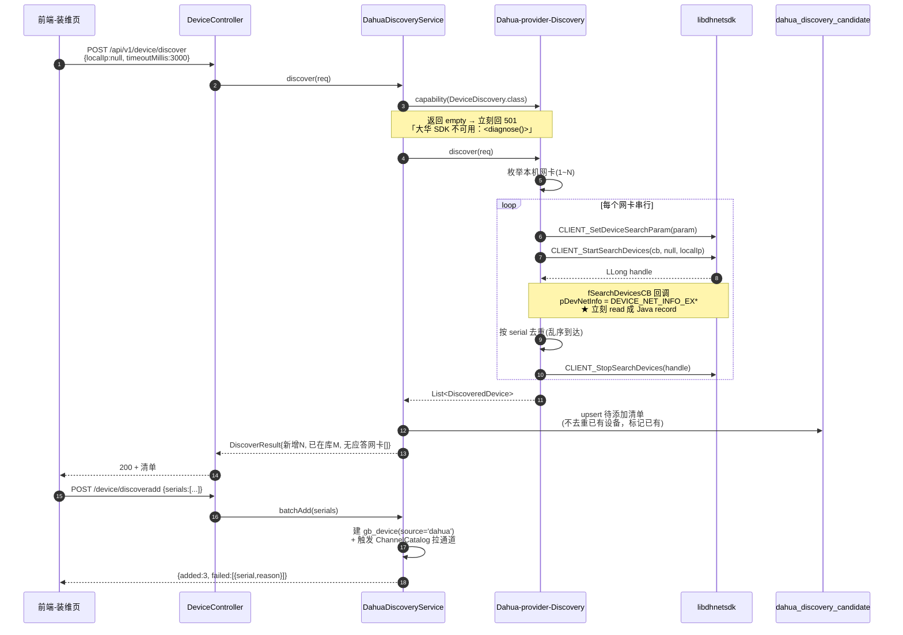

### 4.2 设备主动注册（公网）→ 建会话 → 取通道

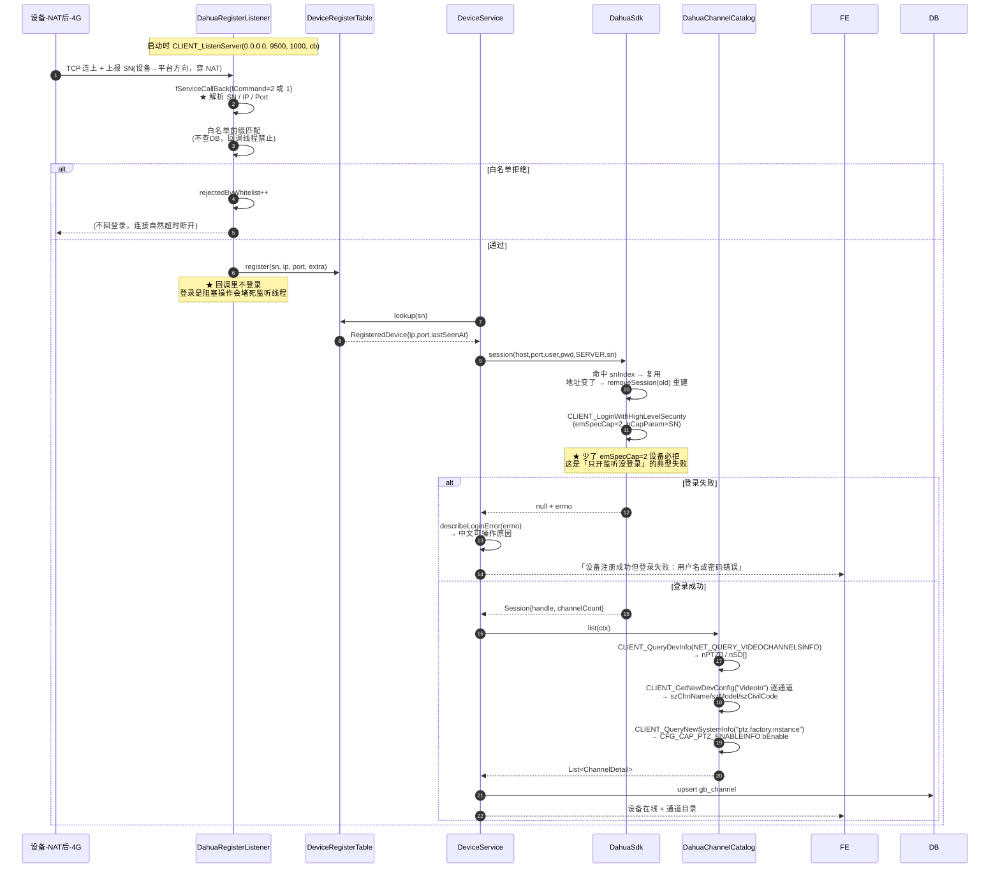

### 4.3 实时预览（RTSP 地址 → 媒体服务拉流）

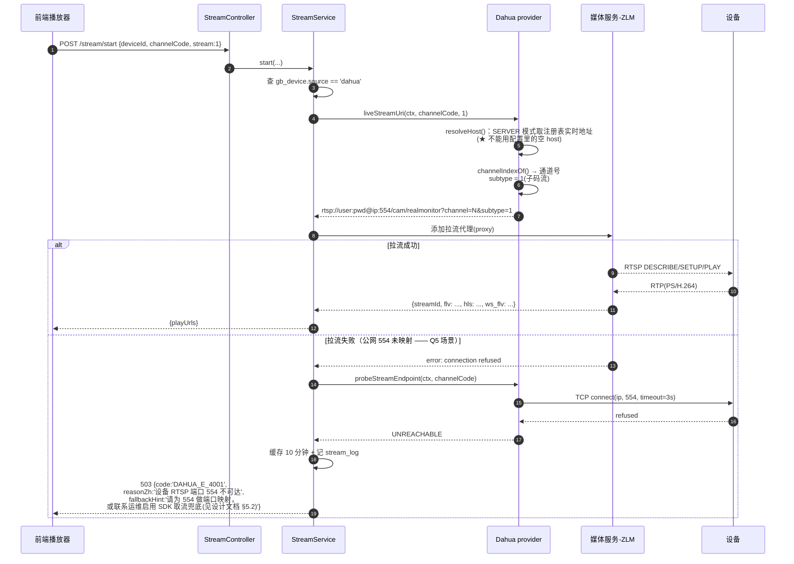

### 4.4 预置位调用（含异步到位反馈）

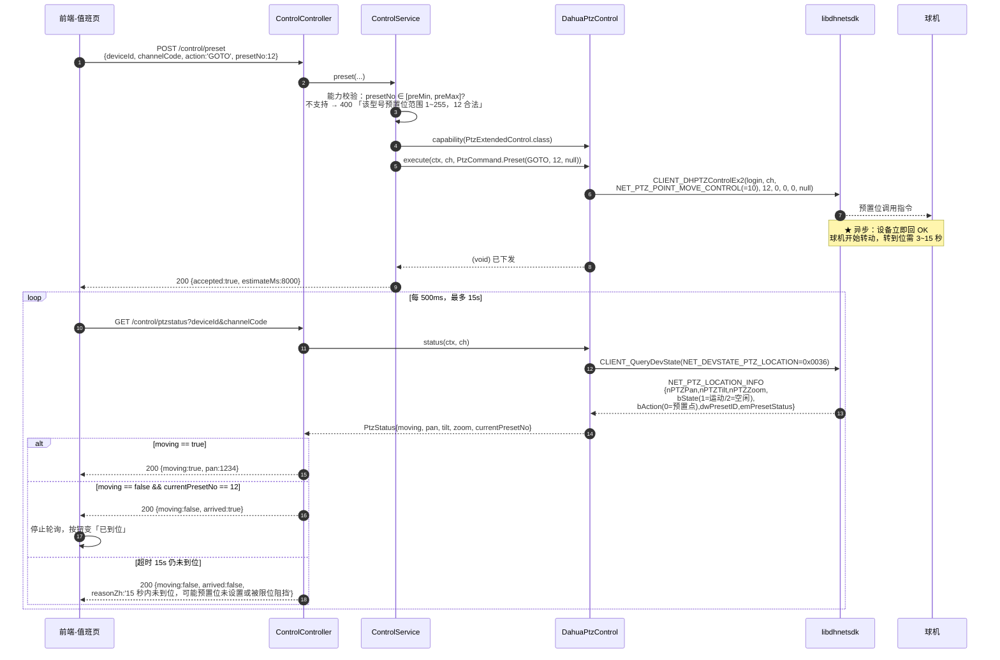

### 4.5 抓图直传（路径 A：设备 HTTP 上传）

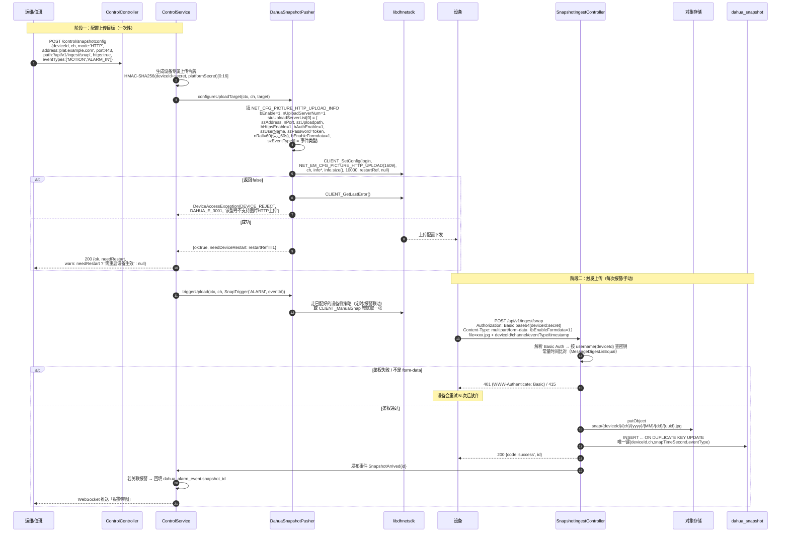

### 4.6 报警接收 → 联动抓图 → 推送

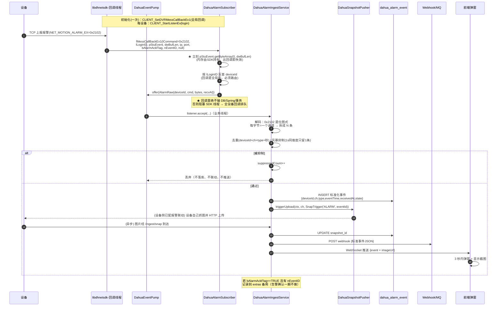

### 4.7 设备断线重连 → 订阅自动恢复（易漏点补强）

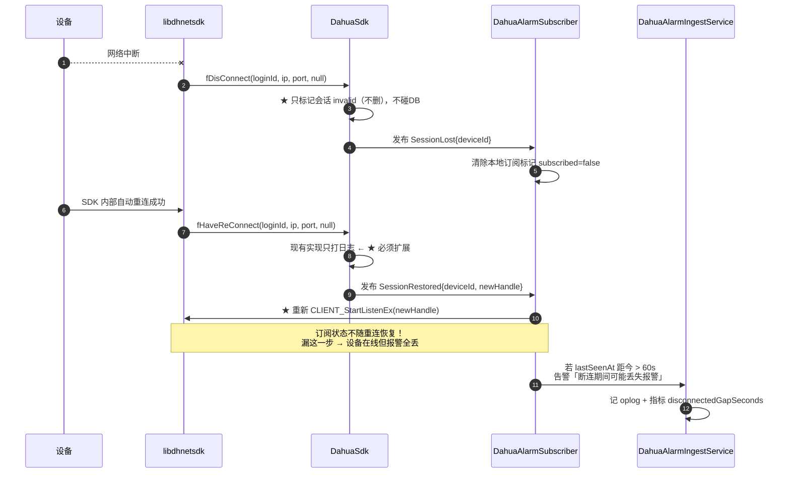

---

## 5. 两种部署场景的差异实现

### 5.1 代码层面的差异点

| 环节 | CLIENT | SERVER | 实现位置 |
|---|---|---|---|
| 会话键 | `host:port` | **SN**（地址会变） | `DahuaSdk.clientSession` / `serverSession`（现有已实现） |
| 地址来源 | `DeviceContext.host`（配置） | `DeviceRegisterTable.lookup(sn).ip` | `DahuaDeviceAccessProvider.resolveHost`（现有已实现） |
| 登录方式 | `emSpecCap=0` | `emSpecCap=2` + `pCapParam=SN` | `DahuaSdk.login(..., autoRegistered=true)`（现有已实现） |
| 需要先起监听 | 否 | **是**（`CLIENT_ListenServer`） | `DahuaRegisterListener.start` |
| `connectable()` 判据 | `host && port>0` | `serial != null`（host 可空） | `DeviceContext.connectable()`（现有已实现） |
| 设备发现 | ✅ 可用 | ❌ 不可用（组播不跨网段） | 前端按 `connectMode` 隐藏按钮 |
| 报警回调通道 | 平台→设备那条 TCP | 设备→平台那条 TCP（**天然穿 NAT**） | 同一套 `CLIENT_StartListenEx`，代码无差异 |
| 抓图上传方向 | 设备 → 平台（同网段，直连） | 设备 → 平台（需设备能访问平台 HTTP/FTP） | 需在配置上传目标时**用平台公网地址**，不能用内网 IP |
| 音频通道 | 走已建连接 | 走已建连接（**天然穿 NAT**） | 代码无差异 |
| 云台指令 | 低 RTT，可"按住转" | RTT 高 → 必须指令合并 + 前端节流 | `ControlService` 指令合并器 |
| 录像下载 | 可批量并发 | 受设备上行带宽限制 → 限速 + 串行 | `RecordDownloadService` |
| RTSP | 直连 554 可用 | ⚠️ **高风险**（见 §5.2） | `probeStreamEndpoint` |

**代码组织结论**：**不为两种模式写两套实现类**。差异全部收敛在
①`DahuaSdk.session()` 的分支、②`resolveHost()`、③`DahuaRegisterListener` 的有无、④配置项（超时/限速/并发）。
这 4 处加起来不超过 100 行，两套实现类会带来 100% 的维护翻倍。

**混合部署**（一个平台同时开 CLIENT 与 SERVER）：允许。监听端口是**全局唯一资源**，只起一份；设备粒度按 `gb_device.connect_mode` 选路。

### 5.2 ★ Q5 回答：公网 SERVER 模式下 RTSP 554 不可达怎么办

#### 5.2.1 先明确一个前提：这个问题现在**无法用数据回答**

| 事实 | 后果 |
|---|---|
| 现网 `gb_device.source` 只有 `device`（3 台，全部 GB28181 接入） | 没有任何大华 NetSDK 直连设备 |
| 那台"温泉县坝 @Dahua"是**国标接入的大华品牌设备**（`manufacturer=Dahua`，走 SIP/RTP） | 「大华设备」≠「NetSDK 直连」，不能拿它的 RTSP 表现推断直连场景 |
| 因此 554 在 NAT 后是否可达，**没有生产数据可证伪** | 任何「我觉得大概率通/不通」的判断都是猜测 |

**所以本节不给"结论"，给的是「判断依据 + 阈值 + 代价」。** 决策需要等 §5.3 的 V3 实测结果。

#### 5.2.2 三级方案（含完整代价）

> **✅ 已拍板（主理人决议）**
>
> 1. **接受 L1，但限定为「兜底」，不作为主路径。** 默认部署仍走 RTSP（L0）。
> 2. **L1 必须先由 §8.5 的 V3（`CLIENT_RealPlayByDataType` 能否拿 PS）验证通过，才允许排期。** 不验证就实现 = 为一个可能不存在的问题写代码。
> 3. 认同「L1 没有推翻『平台不解析 PS 流』共识」——它只做**透传转发**，不解复用/不解码/不重封装，媒体服务侧零改动。这与「在 sdk-dahua 里解 PS 再封 FLV」是两件不同量级的事。
> 4. **★ 失败即必修（兜底条款，不可再讨论）**：若 §8.5 的 **V3**（`CLIENT_RealPlayByDataType` 能否拿 PS 格式码流 —— 即上游所称的「PS 取流验证」，本条编号对应见 §8.5 门禁 G3）**实测失败**，或 §5.3 的 **V6（RTSP 554 在 NAT 后可达性，`nc -zv ip 554`）实测确认不可达**，则 **L1 自动升级为二期必修项**，不再走「再评估/再讨论」流程。
>
>     **为什么要写死这一条**：否则公网场景会长期停在「知道会坏、但没人排期修」的状态 —— 这是技术债最典型的死亡方式。运维在客户现场发现问题、上报、然后被推动"看情况"、最后不了了之。
>
>     **触发条件（任一满足即触发）**：
>     ```
>     V3 失败（拿不到 PS 流 → L1 成本升至 13 人日，仍必修）
>     或
>     V6 失败（目标客户的 NAT 后设备 554 实测不可达）
>     ```
>     **触发后的动作**：直接进入二期排期，无需二次评审；若因 PS 不可得导致成本超预算，则在二期评审时**必须给出明确的"降级交付范围"**（例如只支持重点点位、限制并发路数），而不是再次推迟。

| 级别 | 方案 | 技术做法 | 人日 | 运行时代价 | 破共识程度 | 何时选 |
|---|---|---|---|---|---|---|
| **L0** | **设备侧端口映射** | 在客户路由器/防火墙上把设备 554 转发出来；平台按 `gb_device.rtsp_port` 拼地址 | **0.5**（只在装维手册加一节 + `probeStreamEndpoint` 诊断） | 零 | **不破** | **永远先做**（默认路径）。30 分钟就能在目标环境得出结论 |
| **L1（兜底）** | **SDK 取 PS 流 → RTP 打包 → 灌入 ZLM 已有的 GB28181 收流端口** | 独立组件（不进 `sdk-dahua`）：<br/>① `CLIENT_RealPlayByDataType(login, NET_IN_REALPLAY_BY_DATA_TYPE*, OUT*, wait)` 拿码流回调<br/>② `fDataCallBack` 里按 GB/T 28181 附录的 RTP 封装规则打包<br/>③ 推到 ZLM 的 `openRtpServer` 端口<br/>④ ZLM 侧完全复用国标入流 → FLV/HLS/WebRTC 全自动可用 | **10**（PS 可直接取）<br/>**13**（只出裸 ES，需自己加 PS 头） | **每路常驻 2~4 Mbps 设备上行**；SDK 会话 +1/路；4G 设备只能撑 1~2 路 | **有限度破**：只做 PS 透传，**不解复用、不转码、不解析帧** | **仅在 V3 验证通过 且 §5.2.3 四条判据全满足时** |
| **L2** | 平台内解 PS → 重封装 FLV/HLS | 自己写 PS demux + H264 分帧 + FLV mux + 时间戳重排 | **50+** | 同上 + CPU | **彻底破** | **永不选**（L1 覆盖同样场景，成本 1/5） |

**L1 的准入门禁（硬条件，缺一不可）**

```
[ ] V3 已验证：CLIENT_RealPlayByDataType 能拿到 PS 格式码流
[ ] §5.2.3 的 C1 满足：NAT 后设备占比 ≥ 30%
[ ] §5.2.3 的 C2 满足：同时观看路数 ≤ 设备上行承载能力
[ ] §5.2.3 的 C4 判定：客户诉求是「看实时画面」而非仅「报警带图」
[ ] 现有 3 件低成本措施（探测/装维前置/抓图直传）已上线
```

#### 5.2.3 ★ 判断依据：什么时候 L1 值得做

**L1 值不值得做，取决于 4 个可测量的问题。全部满足才做，缺一条都不做。**

| # | 判据 | 怎么测 | 阈值 | 若不满足的后果 |
|---|---|---|---|---|
| **C1** | 目标客户里 **NAT 后设备占比** | 统计接入清单：有多少设备无法做 554 端口映射（4G/无固定出口/客户不允许改防火墙） | **≥ 30%** 才值得 | < 30% 时，L0 的 0.5 人日就能解决，花 10 人日做 L1 是浪费 |
| **C2** | 这些设备的**同时观看路数** | 问客户：NAT 后设备里，平均同时看几路？峰值几路？ | **≤ 设备上行能承载的路数**（4G 上行 2~10 Mbps → 1~3 路） | 若客户要「NAT 后设备全部上墙 16 路」，**L1 根本做不到**——带宽物理不够。这时正确做法是推动客户做端口映射或专线，而不是写代码 |
| **C3** | `CLIENT_RealPlayByDataType` 能否直接拿 **PS 格式** | 一台真机 + 遍历 `EM_REAL_DATA_TYPE` 枚举（§8.5 V3） | 能拿到 PS | 只能拿裸 ES → 成本 +3 人日，且 PS 头字段各型号不一致，长期维护成本高 → 门槛提高 |
| **C4** | 是否有**非 RTSP 的替代路径**能满足业务 | 评估 `CLIENT_AttachSnap`（抓图直传，已可穿 NAT）+ 报警推送能否覆盖「公网设备的主要诉求」 | 若客户诉求是**「看实时画面」** → L1 必要<br/>若诉求是**「报警带图 + 状态可视」** → L1 不必要（抓图直传已够） | 这是最容易判断错的一条。**PRD 的 G4/G5 两个目标其实都不需要实时视频**，只有 G1「值班员看画面」需要 |

**我的判断（供参考，非结论）**：

> 从 PRD 的 5 个目标看，G2/G3/G4/G5（接入、装维、抓图、报警）**全部不需要实时视频**。只有 G1「值班员不必登录设备 Web」里的「看画面」需要。
> 而公网 4G 设备的现实是：即使 RTSP 通了，上行带宽也只够 1~2 路，值班员看不了 16 路。
> **所以 L1 的真实价值不是「让公网设备能看」，而是「让少量重点公网设备能看」。**
> 如果客户的公网设备是"分散的少量重点点位"，L1 值得（10 人日换一个可演示的闭环）。
> 如果客户的公网设备是"大批量 4G 设备"，L1 不值得，应该推端口映射或专线。

#### 5.2.4 为什么 L1 是「灌 ZLM」而不是「自己起 RTSP Server」

```
方案 X（不选）：SDK 取流 → 自己实现 RTSP Server → 让 ZLM 来拉
  要实现 DESCRIBE/SETUP/PLAY/PAUSE/TEARDOWN + RTP/RTCP + SDP 生成 + 端口管理
  等于自己写半个流媒体服务器。

方案 Y（选）：SDK 取流 → RTP 打包 → 直接推给 ZLM 已有的 GB28181 收流端口
  ZLM 已实现「收 RTP(PS) → 解复用 → 转 FLV/HLS/WebRTC」整条链路，
  且这条链路已被本项目的国标接入生产验证过（3 台现网设备在跑）。
  RTP 打包规则是 GB/T 28181 附录的公开标准，实现量约 300 行。
```

#### 5.2.5 无论 L1 做不做，这三件事都必须做

| 措施 | 成本 | 价值 |
|---|---|---|
| **① `probeStreamEndpoint` 端口可达性探测** | 0.5 人日 | 把「黑盒失败」变成「可诊断」。点播失败时返回 `DAHUA_E_4001` + 「设备 RTSP 端口 554 不可达」+ 处置建议，而不是一个 500 |
| **② 装维向导里前置探测** | 0.5 人日 | 新设备接入时**主动**测 554，把问题暴露在装维阶段（有人在场、能改防火墙），而不是值班时（半夜、没人能动网络） |
| **③ 抓图直传作为公网场景的默认截帧方案** | 已在一期范围 | 公网设备「要看到图」这个最高频诉求，用 `CLIENT_AttachSnap`/HTTP 上传就能满足，**完全不依赖 RTSP** |

**这三件事加起来 1 人日，能解决公网场景 80% 的实际诉求。** 在它们做完之前讨论 L1 是本末倒置。

---

### 5.3 ★ 首批设备接入验证 Checklist（现网 0 台直连设备，必须逐环验证）

#### 5.3.1 为什么必须是 Checklist 而不是「直接试」

13 个环节里任何一环失败，表现出来的现象都是"连不上"或"没画面"。没有分级诊断的话，现场只能靠猜——而现场往往没有第二次机会（客户在旁边看着）。

**这个 Checklist 的设计原则：每个环节都有一个「可独立验证的产物」，失败时立刻知道停在哪一环。**

#### 5.3.2 完整验证链（13 环）

| 环 | 验证项 | 具体操作 | 通过的判据 | 失败时的中文原因（error code） | 排查方向 |
|---|---|---|---|---|---|
| **V0** | 原生库就绪 | 启动平台，看日志 | `[DAHUA] 大华 NetSDK 初始化完成（平台目录 linux64）` | `DAHUA_E_0001` 大华原生库缺失 | 用 `-Dnetsdk.platform=linux64` 重构建；查 `DahuaNativeLibrary.diagnose()` |
| **V1** | **网络可达性（SDK 端口）** | `nc -zv <device_ip> 37777` | TCP 三次握手成功 | `DAHUA_E_0006` 登录超时：设备不可达或被防火墙拦截 | 先解决"能不能连到 37777"，其它都是空的 |
| **V2** | **账号密码正确** | 用大华客户端或 `probe()` 登录 | 登录返回非 0 句柄 | `DAHUA_E_0003` 用户名或密码错误 | 确认设备侧已建专用账号；确认没被锁定（`DAHUA_E_0004`） |
| **V3** | **CLIENT 模式地址来源正确** | 确认 `gb_device.access_host` / `access_port` 已填（**不是 `remote_ip`**） | `probe()` 返回 true | `DAHUA_E_0010` CLIENT 模式缺少 access_host | **这是最容易错的一步**：把 `remote_ip`（SIP 注册来源）当连接目标用，必然失败 |
| **V4** | 通道目录正确 | `GET /device/fetchcatalog` | 返回的通道数 = 设备实际通道数，且**通道名不是"通道1..N"** | 返回 `通道1/通道2` 说明还在走 v1.0 的假数据 | 检查 `CFG_CMD_VIDEOIN` 是否返回了 `szChnName` |
| **V5** | 能力位可读 | `POST /device/capability/refresh` 后 `GET /device/capability` | `writableKeys` 非空、`stale=false` | `DAHUA_E_6001` 该型号不支持参数 X | 若全空 → 检查 `EM_NEW_QUERY_SYSTEM_INFO` 的 JSON 解析是否生效（§3.0.2 的技术债） |
| **V6** | **RTSP 端口可达性（★ Q5 的核心一环）** | `nc -zv <device_ip> 554` **从平台所在主机发起** | TCP 三次握手成功 | `DAHUA_E_4001` 设备 RTSP 端口 554 不可达 | **这一步决定 Q5 走 L0 还是 L1**。CLIENT 内网场景通常通过；SERVER 公网场景大概率失败 |
| **V7** | RTSP 鉴权与路径正确 | 用 ffplay/vlc 直接拉 `rtsp://user:pwd@ip:554/cam/realmonitor?channel=1&subtype=0` | 出画面 | `DAHUA_E_4002` RTSP 鉴权失败 | 密码含特殊字符 → 确认 URL 编码生效；`channel` 号从 1 开始 |
| **V8** | 媒体服务拉流成功 | `POST /stream/start` | 返回 `playUrls` 且前端能播 | 见 V6/V7 | 若 V6/V7 都通过但这里失败 → 查 ZLM 的 `proxy` 配置 |
| **V9** | 云台指令生效 | `POST /control/ptz` 方向指令，肉眼观察球机 | 球机转动，`/control/ptzstatus` 的 `moving=true` | `DAHUA_E_5005` 云台指令被设备拒绝 | 设备是否在菜单模式/自检中；通道号是否从 1 开始 |
| **V10** | **预置位闭环（含异步到位）** | ① `SET` 预置位 1 ② `LIST` 确认存在 ③ `GOTO` 预置位 1 ④ 轮询 `ptzstatus` | ① 设置成功 ② 列表里出现 `nIndex=1` ③ 球机转动 ④ `arrival=REACH` 且 `currentPresetNo=1` | 超时 → 「设备未在 {nArriveTimeout} 秒内到位」 | 先读 `NET_PRESET_INFO.nArriveTimeout` 看设备自己报多少秒，别用平台默认值误判 |
| **V11** | **抓图直传闭环** | ① 配 HTTP 上传目标 ② 触发抓图 ③ 看平台接收日志与对象存储 | 对象存储里出现 `snap/{deviceId}/.../*.jpg`，`dahua_snapshot` 有记录 | `DAHUA_E_3001/3002/3005/3006` | 逐子项查：设备能否访问平台 HTTP？Basic Auth 对不对？`bEnableFormdata` 是否配 1？令牌是否一致？ |
| **V12** | 报警订阅到达 | `POST /control/devicesubscribe` 后在镜头前走动 | `dahua_alarm_event` 出现记录，前端弹窗 | `DAHUA_E_7001/7002` | 确认设备侧「事件 → 普通事件 → 移动侦测」已使能（布防）；确认订阅已开（`CLIENT_StartListenEx`） |
| **V13** | **SERVER 模式全链路（公网设备）** | 设备侧配平台地址+注册端口 → 平台看 `registerstatus` | `status.running=true`、`pendingBindCount≥1`；绑定后 `probe()`=true | `DAHUA_E_1001~1004`、`DAHUA_E_2001` 端口占用 | 确认 `emSpecCap=2`（现有已实现）；确认白名单没拒掉；**注册成功后回到 V6 验证 RTSP** |

#### 5.3.3 三种部署形态的验证顺序

| 形态 | 验证顺序 | 重点风险 |
|---|---|---|
| **局域网 CLIENT（IPC 直连）** | V0 → V1 → V2 → V3 → V4 → V5 → V6 → V7 → V8 → V9 → V10 → V11 → V12 | 风险最低，应作为**第一条验证线**。V6 通常直接通过 |
| **局域网 CLIENT（NVR 下挂 IPC）** | 同上，额外验证：`is_remote_channel` 正确、`upper_device_id` 正确、子码流通道号映射 | NVR 的通道号规则与 IPC 不同；喊话是否走 NVR 转发待实测 |
| **公网 SERVER（4G/ NAT 后）** | V0 → **V13（注册）** → V2 → V3 → V4 → V5 → **V6（关键）** → V11 → V12 | **V6 大概率失败** → 触发 Q5 决策（§5.2.3） |

#### 5.3.4 建议的验证节奏（给主理人排期用）

| 阶段 | 内容 | 时长 | 产出 |
|---|---|---|---|
| **第 1 天上午** | 拿到 1 台局域网大华球机（必须有云台 + 扬声器），跑 V0~V5 | 半天 | 确认 SDK 基础链路可用；确认 §8.5 的 V1/V3 两个技术债的真实状态 |
| **第 1 天下午** | 跑 V6~V10 | 半天 | 确认 RTSP + 云台 + 预置位闭环。**这时已经能演示"转预置位"了** |
| **第 2 天** | 跑 V11~V12（抓图 + 报警） | 1 天 | 确认"报警带图"闭环。**这是最有商业价值的演示** |
| **第 3 天** | 模拟公网：把设备接到一台做了 NAT 的路由器后面，跑 V13 + V6 | 1 天 | **得到 Q5 的实测数据**，据此决策 L1 做不做 |
| **前置条件** | 必须有一台**带云台、带扬声器、支持 SD 卡/抓图**的球机。纯枪机验证不了云台和预置位 | — | 设备选型建议：大华 SD 系列球机（支持 `CFG_PTZ_PROTOCOL_CAPS_INFO` 能力集） |

> **不要用客户生产设备做首次验证。** 首次验证会有大量试错（改配置、重启、反复登录），在客户设备上做既危险又难看。

---

## 6. 数据模型

> **前提**：provider **不写库**（契约红线）。以下表全部由平台 Service 层维护。命名前缀 `dahua_` 用于与国标表区分；`gb_device` / `gb_channel` 复用现有表，只加字段。

### 6.1 对现有表的增量

#### ⚠️ 先解决一个语义冲突：CLIENT 模式的地址没有地方放

**现场事实**：`gb_device` 表**没有 CLIENT 专用的 host/port 字段**，只有 `remote_ip` / `remote_port`。

**这两个字段的语义与 CLIENT 需求正好相反**：

| 字段 | 国标语义（现值） | NetSDK CLIENT 模式需要什么 |
|---|---|---|
| `remote_ip` | 设备**主动注册上来**时平台看到的来源 IP（"你从哪来"） | 平台**要主动连过去**的目标 IP（"我要去哪"） |
| `remote_port` | 国标 SIP 注册端口（通常 5060 / 设备侧端口） | 设备 **SDK 端口**（大华默认 **37777**） |

**结论：不能复用。** 复用会造成四个具体问题：

1. **端口语义错**：`remote_port` 是 SIP 端口（5060），直接拿去连 37777 必失败。
2. **方向语义错**：`remote_ip` 是"设备来的地址"（可能是 NAT 后的公网出口 IP），不一定是"能连回去的地址"（NAT 后通常连不回去）。
3. **互相踩踏**：同一台大华设备**可能同时**走国标（`remote_ip` = SIP 注册地址）和 NetSDK 直连（`access_host` = 内网 IP）。这是混合部署的常见形态（国标看画面、NetSDK 调云台）。共用一个字段就必然互相覆盖。
4. **审计困扰**：`remote_*` 是运行态观测值，`access_*` 是配置值。把配置写进观测字段会让「谁改了地址」无从追溯。

**方案：新增独立字段，与 `remote_*` 并存**

```sql
ALTER TABLE gb_device
  -- ── 接入方式 ──
  ADD COLUMN connect_mode    VARCHAR(16)  NOT NULL DEFAULT 'client'
      COMMENT 'client=平台主动连 / server=设备主动注册；仅 source=dahua 时有意义',
  ADD COLUMN register_sn     VARCHAR(64)  NULL
      COMMENT '大华设备序列号（大写归一化），server 模式的会话键；与 discovery 打通靠它',

  -- ── ★ CLIENT 模式的连接目标（配置值，不是观测值）──
  ADD COLUMN access_host     VARCHAR(255) NULL
      COMMENT '【CLIENT】平台要连过去的目标地址（IP 或域名）。与 remote_ip 语义不同：remote_ip 是设备来的地址',
  ADD COLUMN access_port     INT          NULL
      COMMENT '【CLIENT】设备 SDK 端口，大华默认 37777。与 remote_port(SIP 5060) 语义不同',

  -- ── 流媒体 ──
  ADD COLUMN rtsp_port       INT          NULL
      COMMENT '设备 RTSP 端口，NULL 用全局默认 554；公网场景常需单独映射',
  ADD COLUMN extra_json      TEXT         NULL
      COMMENT '扩展：型号/固件/时区/snapSecret/能力位失效标记等';

COMMENT ON COLUMN gb_device.remote_ip IS
  '【观测值·国标】设备主动注册时的来源 IP。NetSDK CLIENT 模式请用 access_host，不要读写本字段';
COMMENT ON COLUMN gb_device.remote_port IS
  '【观测值·国标】设备 SIP 注册端口。NetSDK 请用 access_port（SDK 端口，默认 37777）';

-- 一个 SN 只能绑一台设备
CREATE UNIQUE INDEX uk_device_register_sn
  ON gb_device(register_sn, source)
  WHERE register_sn IS NOT NULL AND deleted = 0;

-- 便于 CLIENT 设备巡检
CREATE INDEX idx_device_access ON gb_device(source, connect_mode, access_host);
```

**地址来源的单一判定表**（provider 里 `resolveHost()` 必须严格按此实现，否则会拼出 `rtsp://...@null:554`）

| `connect_mode` | 优先来源 | 兜底 | 绝不使用 |
|---|---|---|---|
| `CLIENT` | `access_host` | 无（`access_host` 为空 → `connectable()=false`，直接拒绝） | `remote_ip`（方向语义相反） |
| `SERVER` | `DeviceRegisterTable.lookup(register_sn).ip`（**每次实时取**） | 无（未注册 → `connectable()=false`） | `access_host`（配了也不用）、DB 里任何缓存地址 |

**为什么 SERVER 模式绝不把地址落库**：注册地址随设备换网/重拨号变化。落库后运维会看到一个"过期但看起来很真实"的地址，据此判断故障原因会彻底走偏。**地址只存内存注册表**（`DeviceRegisterTable` 的设计初衷，见其类注释）。

#### 其余字段增量

```sql
-- gb_channel 增字段（真实通道目录，模块二）
ALTER TABLE gb_channel
  ADD COLUMN sdk_index         INT          NULL COMMENT 'SDK 通道号（1起；0是设备自身）',
  ADD COLUMN ptz_supported     TINYINT(1)   DEFAULT 0 COMMENT 'CFG_CAP_PTZ_ENABLEINFO.bEnable',
  ADD COLUMN talk_supported    TINYINT(1)   DEFAULT 0 COMMENT '设备级对讲能力 && 本通道有伴音',
  ADD COLUMN talk_capability_source VARCHAR(32) NULL
      COMMENT '对讲能力判据来源：DEVICE_LEVEL / CHANNEL_AUDIO / BOTH —— 现场排障用',
  ADD COLUMN audio_in          TINYINT(1)   DEFAULT 0,
  ADD COLUMN is_remote_channel TINYINT(1)   DEFAULT 0 COMMENT 'NVR 下挂 IPC',
  ADD COLUMN upper_device_id   VARCHAR(64)  NULL,
  ADD COLUMN manufacturer      VARCHAR(64)  NULL  COMMENT 'CFG_VIDEO_IN_INFO.szManufacturer',
  ADD COLUMN model             VARCHAR(64)  NULL  COMMENT 'CFG_VIDEO_IN_INFO.szModel',
  ADD COLUMN civil_code        VARCHAR(32)  NULL  COMMENT 'CFG_VIDEO_IN_INFO.szCivilCode（行政区域）',
  ADD COLUMN install_address   VARCHAR(255) NULL  COMMENT 'CFG_VIDEO_IN_INFO.szAddress',
  ADD COLUMN preset_arrive_timeout_sec INT  NULL
      COMMENT 'NET_PRESET_INFO.nArriveTimeout（5~300秒，设备上报值）；NULL 用全局默认';
```

> **注意 `preset_arrive_timeout_sec`**：这是从设备读回来的「预置位到位超时」，属**通道级设备属性**，不是平台配置。单独一列存，前端展示「设备报告到位超时 30 秒」，运维据此判断「为什么点了预置位 20 秒还没到位」是正常的。


### 6.2 8 张新表

| 表名 | 用途 | 关键字段 | 索引 |
|---|---|---|---|
| `dahua_discovery_candidate` | 局域网发现待添加清单（Q7） | `serial`(uk), `ip`, `sdk_port`, `http_port`, `model`, `firmware`, `video_in_channels`, `local_ip`, `discovered_at`, `status`(NEW/ADDED/IGNORED) | `uk(serial)`；`idx(discovered_at)`；`idx(status)` |
| `dahua_device_capability` | 能力位快照（P0 横切） | `device_id`, `channel_index`, `firmware_version`, `report_json`, `probed_at`, `probe_source`(CAPS/CONFIG/FAILCACHE) | `uk(device_id, channel_index, firmware_version)`；`idx(probed_at)` |
| `dahua_preset` | **预置位名称备注表**（清单本身可从 `CFG_CMD_PTZ_PRESET` 直接读出，此表只补 SDK 不返回的名称 + 平台侧备注） | `id`, `device_id`, `channel_index`, `preset_no`, `name`(平台自定义备注), `stay_time`(缓存的 `nStayTime`), `remark`, `created_at`, `updated_at`, `deleted` | `uk(device_id, channel_index, preset_no)`；`idx(device_id, deleted)` |
| `dahua_patrol` | 巡航组 | `id`, `device_id`, `channel_index`, `tour_no`, `name`, `enabled`, `point_count`, `revision`(乐观锁), `updated_at` | `uk(device_id, channel_index, tour_no)` |
| `dahua_patrol_point` | 巡航组点位 | `id`, `patrol_id`(fk), `seq`, `preset_no`, `stay_seconds`, `speed`, `focus_enabled` | `uk(patrol_id, seq)`；`idx(preset_no)`（用于删除预置位时的一致性校验） |
| `dahua_snapshot` | 抓图元数据（Q1） | `id`(uuid), `device_id`, `channel_index`, `object_key`, `file_size`, `mime_type`, `snap_time`(秒精度), `event_type`, `alarm_event_id`, `trigger_type`(MANUAL/TIMER/ALARM), `source`(HTTP/FTP/ATTACH/MANUAL), **`source_server_index`**(设备侧 `stuUploadServerList` 下标，0=主 1=备), **`received_count`**(同图重复到达次数，多服务器同传时 >1，监控用), **`format_verified`**(魔数校验是否通过), `created_at` | **`uk(device_id, channel_index, snap_time, event_type)`**（去重，**不含 server_index**）；`idx(alarm_event_id)`；`idx(created_at)`；`idx(device_id, created_at)` |
| `dahua_alarm_event` | 报警事件（Q2，热表 90 天） | `id`(uuid), `device_id`, `channel_index`, `alarm_type`, `raw_command`(hex), `event_time`, `received_time`, `state`(START/STOP), `description`, `snapshot_id`, `suppressed_count`, `acked`, `created_at` | `idx(device_id, created_at)`；`idx(alarm_type, created_at)`；`idx(snapshot_id)`；`idx(created_at)`（归档用） |
| `dahua_download_task` | 录像下载任务 | `id`(uuid), `device_id`, `channel_index`, `start_time`, `end_time`, `target_path`, `total_bytes`, `downloaded_bytes`, `percent`, `state`(QUEUED/RUNNING/DONE/FAILED/CANCELLED), `reason_zh`, `created_at`, `finished_at` | `idx(device_id, state)`；`idx(state, created_at)` |

**另外两张运营表（非必须但建议）**

| 表名 | 用途 |
|---|---|
| `dahua_talk_session` | 喊话会话审计：`id`, `device_id`, `channel_index`, `user_id`, `started_at`, `ended_at`, `duration_seconds`, `bytes_up`, `bytes_down`, `end_reason`（用于追责与资源分析；**不存音频内容**） |
| `dahua_sdk_call_log` | SDK 调用审计（可选，量大时只留慢调用）：`id`, `device_id`, `method`, `elapsed_ms`, `sdk_error`, `success`, `created_at` |

### 6.3 表关系

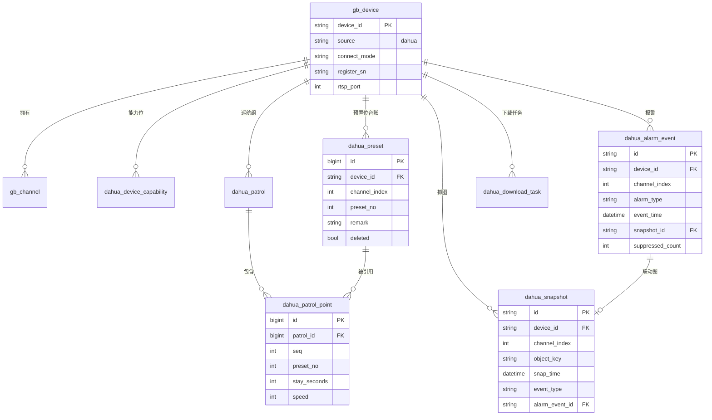

### 6.4 一致性校验落地（预置位 ↔ 巡航组）

**删除预置位前**（`ControlService.preset(DELETE)`）：

```sql
SELECT p.tour_no, p.name
FROM dahua_patrol p
JOIN dahua_patrol_point pp ON pp.patrol_id = p.id
WHERE p.device_id = ? AND p.channel_index = ? AND pp.preset_no = ?
  AND p.enabled = 1
```

有结果 → 抛 `CONFLICT`：「预置位 12 正被巡航组「夜间巡检」引用，请先修改巡航组」。**不做级联删除**（理由见 §3.3.3）。

**写入巡航组前**（`ControlService.patrol(WRITE)`）：校验所有 `preset_no` 在 `dahua_preset` 里存在且未删除，否则 `PARAM`：「引用了不存在的预置位 15」。

**双重校验**：DB 校验之外，写入设备前再读一次 `CFG_CMD_PTZTOUR`，避免多人同时改（`dahua_patrol.revision` 乐观锁）。

---

## 7. 异常处理与可观测性

### 7.1 统一错误码清单

**编码规则**：`DAHUA_E_<模块1位><序号3位>`

| 码 | 模块 | Kind | 中文原因（面向运维） | 处置建议 |
|---|---|---|---|---|
| `DAHUA_E_0001` | 全局 | UNAVAILABLE | 大华原生库不可用：{platformDir 缺失详情} | 用正确 profile 重新构建，见 `docs/原生库打包.md` |
| `DAHUA_E_0002` | 全局 | UNAVAILABLE | 大华 NetSDK 初始化失败：{CLIENT_Init 返回 false} | 检查是否有其他进程占用 SDK，重启平台 |
| `DAHUA_E_0003` | 全局 | AUTH | 用户名或密码错误 | 核对设备侧专用账号 |
| `DAHUA_E_0004` | 全局 | AUTH | 账号被锁定 / 已在别处登录 | 等待锁定解除或改用其他账号 |
| `DAHUA_E_0005` | 全局 | AUTH | 设备要求国密 TLS 登录 | 该型号需专用固件，本期不支持 |
| `DAHUA_E_0006` | 全局 | TIMEOUT | 登录超时：设备不可达或被防火墙拦截 | 检查网络与端口 |
| `DAHUA_E_0007` | 全局 | CONFLICT | 会话数已达上限（{current}/{max}） | 提高 `dahua.max-sessions` 或分批操作 |
| `DAHUA_E_1001` | 注册 | CONFLICT | 该 SN 已绑定到设备 {deviceId} | 先解绑 |
| `DAHUA_E_1002` | 注册 | AUTH | 注册被白名单拒绝（SN={sn}） | 在白名单里加该 SN 前缀 |
| `DAHUA_E_2001` | 发现 | TIMEOUT | 局域网发现端口 {port} 被占用 | 关闭其他大华客户端 |
| `DAHUA_E_2002` | 发现 | UNAVAILABLE | 无可用网卡 | 检查主机网络 |
| `DAHUA_E_3001` | 抓图 | UNSUPPORTED | 该型号不支持图片 HTTP 上传 | 改用 FTP 或 SDK 订阅方式 |
| `DAHUA_E_3002` | 抓图 | DEVICE_REJECT | 设备无法连接到上传地址 {host}:{port} | 检查网络与令牌 |
| `DAHUA_E_3003` | 抓图 | TIMEOUT | 设备未在 {n} ms 内返回图片 | 检查镜头/码流状态 |
| `DAHUA_E_3004` | 抓图 | UNSUPPORTED | 抓图订阅失败：通道 {ch} 不支持抓图 | 该通道无抓图能力 |
| `DAHUA_E_3005` | 抓图 | AUTH | 上传令牌无效（Basic Auth 失败） | 重新下发抓图配置；核对 `szUserName`/`szPassword` |
| `DAHUA_E_3006` | 抓图 | PARAM | 只接受 `multipart/form-data` 或 `multipart/x-mixed-replace` | 检查设备侧 `bEnableFormdata`；确认 Content-Type |
| `DAHUA_E_3007` | 抓图 | PARAM | 上传文件超过 16MB 上限（HTTP 413） | 检查 Spring `max-file-size` 与 nginx `client_max_body_size` 是否一致；降低设备抓图画质 |
| `DAHUA_E_3008` | 抓图 | UNAVAILABLE | 抓图暂存区已满（>10GB），拒绝接收 | 清理 `data/snap-backlog/`；检查对象存储连通性 |
| `DAHUA_E_4001` | 流 | UNAVAILABLE | 设备 RTSP 端口 554 不可达 | 为 554 做映射，或启用 SDK 取流兜底（§5.2） |
| `DAHUA_E_4002` | 流 | AUTH | RTSP 鉴权失败 | 核对账号密码是否含特殊字符（已 URL 编码） |
| `DAHUA_E_5001` | 云台 | UNSUPPORTED | 预置位号 {no} 超出该型号范围 [{min},{max}] | 用范围内的号 |
| `DAHUA_E_5002` | 云台 | CONFLICT | 预置位 {no} 正被巡航组「{name}」引用 | 先修改巡航组 |
| `DAHUA_E_5003` | 云台 | UNSUPPORTED | 该通道不支持云台（ptzSupported=false） | 换通道 |
| `DAHUA_E_5004` | 云台 | PARAM | 当前角度 {pan} 不在新限位区间 [{l},{r}] 内 | 先转到区间内再设 |
| `DAHUA_E_5005` | 云台 | DEVICE_REJECT | 云台指令被设备拒绝（指令={cmd}，错误码={errno}） | 查看设备是否在菜单模式/自检中 |
| `DAHUA_E_6001` | 配置 | UNSUPPORTED | 该型号不支持参数 {key} | 前端应隐藏该项（能力位问题） |
| `DAHUA_E_6002` | 配置 | PARAM | 参数 {key} 的值 {v} 超出范围 [{min},{max}] | 用范围内值 |
| `DAHUA_E_6003` | 配置 | DEVICE_REJECT | 写入需重启设备才生效 | 提供「立即重启」按钮（二次确认） |
| `DAHUA_E_7001` | 报警 | UNSUPPORTED | 该设备不支持报警订阅 | — |
| `DAHUA_E_7002` | 报警 | DEVICE_REJECT | 报警订阅失败（错误码 {errno}） | 检查设备会话是否有效 |
| `DAHUA_E_8001` | 音频 | CONFLICT | 该设备正在被 {user} 使用喊话（剩余 {n} 秒） | 等待或强制释放（需权限） |
| `DAHUA_E_8002` | 音频 | UNSUPPORTED | 设备不支持音频编码 {codec}，支持：{list} | — |
| `DAHUA_E_8003` | 音频 | TIMEOUT | 喊话会话超时关闭（{max} 秒） | 重新发起 |
| `DAHUA_E_9001` | 下载 | PARAM | 磁盘剩余空间不足（{free} < {need}） | 清理或改目标路径 |

### 7.2 日志规范：每次 SDK 调用记录什么

**`DahuaCallGuard` 统一包装**（避免每个调用点各写一遍）：

```java
public final class DahuaCallGuard {

    /**
     * 包装一次 SDK 调用。
     *
     * @param desc  调用描述（如 "PTZ.Preset.GOTO ch=1 no=12"）
     * @param deviceId 设备编号
     * @param call  SDK 调用（返回 boolean 的）
     */
    public static boolean call(String deviceId, String desc, BooleanSupplier call) { ... }
```

**INFO 级别（正常）** —— 一行，结构化（便于 grep/采集）：

```
[DAHUA] op=PTZ.PRESET.GOTO dev=3402...0001 ch=1 no=12 ok=true elapsed=8ms sdkErr=0
[DAHUA] op=CFG.READ dev=... ch=1 keys=6 ok=true elapsed=1240ms sdkErr=0
[DAHUA] op=SNAP.ATTACH dev=... ch=1 interval=60 ok=true handle=0x7f3a... elapsed=15ms
[DAHUA] op=ALARM.RECV dev=... cmd=0x2102 chs=[1,3] recvDelay=42ms
```

**WARN 级别（失败但可恢复）**：

```
[DAHUA] op=PTZ.PRESET.GOTO dev=... ch=1 no=12 ok=false elapsed=3001ms sdkErr=7
         reason="云台指令被设备拒绝：设备正在执行开机自检" retryable=true
```

**ERROR 级别（需要人介入）**：

```
[DAHUA] op=SDK.INIT ok=false reason="原生库缺失（linux/amd64，期望 jar 内有 linux64/）"
         action="用 -Dnetsdk.platform=linux64 重新构建"
```

**必须记录的六要素**（缺一不可，否则现场无法定位）：

| 要素 | 例 | 为什么 |
|---|---|---|
| `op` | `PTZ.PRESET.GOTO` | 知道在做什么 |
| `dev` | 设备编号 | 知道哪台 |
| `ch` | 通道号 | 多通道设备必需要 |
| `elapsed` | `8ms` / `3001ms` | 区分「设备拒绝」与「超时」 |
| `sdkErr` | `CLIENT_GetLastError()` 的值 | 查厂商手册的唯一线索 |
| `ok` | true/false | 可聚合出成功率指标 |

**禁止记录的**：密码、SN 完整值（前 4 后 4）、音频内容、图片内容、RTSP URL 里的密码。

### 7.3 降级策略

| 场景 | 降级行为 | 用户可见 |
|---|---|---|
| **原生库缺失** | 所有大华能力 `capability()` 返回 empty；`probe()` 返回 false | `/device/list` 里大华设备显示「SDK 不可用」；点任何大华操作返回 `DAHUA_E_0001` + `diagnose()` 全文。**国标链路完全不受影响** |
| **SDK 回调超时**（如 `CLIENT_ManualSnap` 8s 未返回） | 抛 `TIMEOUT`；**不重试**（抓图重试会叠加设备负载）；记 `sdk_call_log` | 前端提示「抓图超时，请稍后重试」 |
| **设备掉线** | 会话标记失效 → 下次取会话自动重登；重登失败则 `probe` 返回 false，设备标离线 | 通道变灰；操作返回 `DAHUA_E_0006` |
| **注册端口被占用** | 监听不启动，`RegisterStatus.portConflictCode > 0` | `/device/registerstatus` 明确显示「端口被占用」+ 中文建议；**不影响 CLIENT 模式设备** |
| **事件泵队列满** | 报警：降级同步轻量落库；抓图/音频：丢弃并计数 | 指标 `dahua_pump_dropped_total{type}`；超过阈值（100/分钟）告警 |
| **对象存储不可用** | 抓图暂存本地 `data/snap-backlog/`，后台重试（最多 3 次，指数退避）；本地 backlog > 10GB 则拒绝新抓图 | 告警「抓图存储异常，已转本地暂存」 |
| **能力位探测超时** | 返回「上次成功的能力位」+ `stale=true` | 前端显示「能力位为 {N} 小时前数据，点击刷新」 |
| **媒体服务不可用** | 点播直接失败（不降级到 SDK 取流，除非 L1 已启用） | `DAHUA_E_4001` |

### 7.4 可观测性指标（暴露给现有 `/api/v1/system/metrics`）

| 指标 | 类型 | 说明 |
|---|---|---|
| `dahua_sdk_available` | Gauge | 0/1 |
| `dahua_sessions_active` | Gauge | 当前会话数 |
| `dahua_attach_handles` | Gauge | 当前 attach 句柄数（泄漏检测：持续增长即漏） |
| `dahua_call_total{op,ok}` | Counter | 按操作与结果 |
| `dahua_call_elapsed_ms{op}` | Histogram | P50/P95/P99，用于发现慢型号 |
| `dahua_pump_queue_size` | Gauge | 事件泵积压 |
| `dahua_pump_dropped_total{type}` | Counter | 丢弃计数 |
| `dahua_register_active` | Gauge | 当前活跃注册设备数 |
| `dahua_register_rejected_total` | Counter | 白名单拒绝数 |
| `dahua_alarm_received_total{type}` | Counter | 报警接收量（突增=风暴） |
| `dahua_alarm_suppressed_total` | Counter | 抑制量（抑制率过高说明设备灵敏度需调） |
| `dahua_alarm_delivery_delay_ms` | Histogram | `receivedTime - eventTime`（判定设备时钟漂移） |
| `dahua_snapshot_received_total{source}` | Counter | 按路径统计（判断哪条路径在生效） |
| `dahua_talk_sessions_active` | Gauge | 喊话并发数 |

---

## 8. 任务分解

> **说明**：本工程是 45 功能点（✅4 + ⚠️1 + ❌40；P0=17 / P1=17 / P2=8）/ 3 期交付，无法用 5 个任务覆盖。以下按**期**分解，**每期内遵守「≤5 任务、每任务 ≥3 文件、第一任务为基础设施」的硬约束**。三期的任务之间是**串行**关系（二期依赖一期基建）。

### 8.1 一期（P0，**18 项**）—— 5 个任务

> **P0 由 17 → 18**：抓图**平台侧 HTTP 接收端点**从 P1 提升为 P0。理由：抓图直传的验收标准是「报警 → 平台收到图 → 能查到」，**不是「设备配置下发成功」**——没有端点只能验到配置写入。这是 18 项 P0 里**唯一的平台侧新增组件**（其余 17 项复用现有 Spring 栈），已并入 T04。

| Task | 名称 | 交付文件 | 依赖 | 优先级 |
|---|---|---|---|---|
| **T01** | **契约层与基建（含两项基础设施）** | `deviceaccess/DeviceAccessProvider.java`(改)<br/>`DeviceCapability.java`<br/>`DeviceAccessException.java`<br/>`capability/` 下 11 个能力接口（Discovery/Registrar/ChannelCatalog/CapabilityReporter/PtzExtendedControl/PtzCommand/SnapshotPusher/AudioTalk/DeviceConfigurator/AlarmSubscriber/RecordDownloader）<br/>`model/*.java`（12 个 DTO record）<br/>**`internal/cfg/StructCfgAccessor.java`**（§3.0.1）<br/>**`internal/cfg/CfgSpec.java`**<br/>**`internal/cfg/DahuaCfgSpecs.java`**（初始 12 条）<br/>**`internal/capability/CapabilityProber.java`**（§3.0.2）<br/>`internal/DahuaEventPump.java`<br/>`internal/DahuaCallGuard.java`<br/>`internal/DahuaErrorCode.java`<br/>`internal/DahuaStructures.java`<br/>`src/test/.../StructureAuditTest.java`（§8.5 的结构体审计测试） | — | P0 |
| **T02** | **设备接入补强**（模块一全部 + 模块二通道目录 + 能力位落地） | `capability/DahuaDiscovery.java`<br/>`capability/DahuaChannelCatalog.java`<br/>`capability/DahuaCapabilityReporter.java`<br/>`DahuaRegisterListener.java`(改：白名单/计数/待绑定清单)<br/>`internal/DahuaSdk.java`(改：attach 句柄池/探活/会话上限/**`onEndpointChanged` 事件**)<br/>`internal/DahuaNativeLibrary.java`(改：新增中文提示项)<br/>平台：`DahuaProperties.java`(改)、`DahuaCapabilityService.java`、`DahuaDiscoveryService.java`、`DeviceRegistrationService.java`（新增：SN↔deviceId 绑定）、`DeviceController.java`(改)、`sql/V*__dahua_01.sql`（含 `access_host`/`access_port`/`register_sn`） | T01 | P0 |
| **T03** | **通道目录入库 + 云台（预置位完整闭环）** | `capability/DahuaPtzControl.java`（含 `CFG_CMD_PTZ_PRESET` 读写、`NET_EXTPTZ_GOTOPRESET`、到位判定）<br/>`capability/DahuaConfigurator.java`（骨架，仅读能力位）<br/>平台：`ControlService.java`(改：`PtzCommand` 分发 + 能力校验 + 预置位一致性校验 + 指令合并)<br/>`ControlController.java`(改：`/control/ptz` 扩 action、`/control/ptzstatus`)<br/>`entity/DahuaPreset.java` + `mapper/DahuaPresetMapper.java`<br/>`sql/V*__dahua_02.sql` | T02 | P0 |
| **T04** | **抓图直传 + 报警接收**（含**平台侧 HTTP 接收端点 —— 18 项 P0 中唯一的平台侧新增组件**） | `capability/DahuaSnapshotPusher.java`<br/>`capability/DahuaAlarmSubscriber.java`<br/>平台：`DahuaSnapshotIngestService.java`<br/>`DahuaAlarmIngestService.java`<br/>**`SnapshotIngestController.java`（双路 Content-Type 分流 + Basic Auth）**<br/>**`StreamingPartReader.java`（x-mixed-replace 流式解析器）**<br/>**`SnapTokenService.java`（每设备密钥 + 常量时间比对）**<br/>**`SaTokenConfiguration.java`(改：exclude `/api/v1/ingest/**` × 3 个拦截器)**<br/>**`application.yml`(改：multipart 上限 16MB/32MB)**<br/>**`deploy/nginx`(改：`client_max_body_size 32m` + 关闭 request buffering)**<br/>`entity/DahuaSnapshot.java` `DahuaAlarmEvent.java` + mapper<br/>`AlarmController.java`(改)<br/>`sql/V*__dahua_03.sql`（含 `source_server_index` / `received_count`） | T01, T02 | P0 |
| **T05** | **喊话 + 集成联调 + 文档** | `capability/DahuaAudioTalk.java`<br/>平台：`AudioTalkBridge.java`<br/>`TalkWebSocketHandler.java`<br/>`entity/DahuaTalkSession.java` + mapper<br/>`docs/大华接入装维手册.md`（新：SN 配置、端口映射、白名单、能力位限制）<br/>`docs/故障排查-大华.md`（新） | T03, T04 | P0 |

**一期 Mermaid 依赖图**

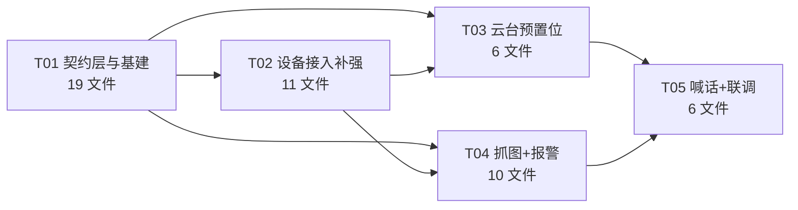

### 8.2 二期（P1，17 项）—— 4 个任务

| Task | 名称 | 交付文件 | 依赖 | 优先级 |
|---|---|---|---|---|
| **T06** | **录像检索与下载** | `capability/DahuaRecordDownloader.java`<br/>平台：`RecordDownloadService.java`、`PlaybackController.java`(改)<br/>`entity/DahuaDownloadTask.java` + mapper<br/>`sql/V*__dahua_04.sql` | 一期 | P1 |
| **T07** | **云台完整（限位/水平旋转/巡航组/速度/重启）** | `capability/DahuaPtzControl.java`(补 6 个子功能 + 预置位双路径 + `CFG_CMD_PTZ_AUTO_MOVEMENT` 的空闲/定时)<br/>平台：`ControlService.java`(补巡航组 CRUD + 乐观锁 + 一致性)<br/>`entity/DahuaPatrol.java` `DahuaPatrolPoint.java` + mapper<br/>`sql/V*__dahua_05.sql` | T03, T06 | P1 |
| **T08** | **相机配置完整（曝光/背光/白平衡/日夜）+ 一键套用** | `capability/DahuaConfigurator.java`(补 8 项 + cloneFrom)<br/>`internal/cfg/DahuaCfgSpecs.java`(补 CfgSpec)<br/>平台：`DeviceConfigService.java`、`DeviceController.java`(改：`/device/capability`、`/device/configclone`)<br/>`entity/DahuaDeviceCapability.java` + mapper | T07 | P1 |
| **T09** | **报警联动 + 布撤防 + 落库保留期 + 双工对讲** | `capability/DahuaAlarmSubscriber.java`(补 arm/armState)<br/>`capability/DahuaAudioTalk.java`(补 DUPLEX + 抖动缓冲)<br/>平台：`DahuaAlarmRetentionJob.java`、`WebhookDispatcher.java`、`AudioTalkBridge.java`(补双工)<br/>`docs/报警排查四步法.md`（新） | T05, T08 | P1 |

### 8.3 三期（P2，8 项）—— 3 个任务

| Task | 名称 | 交付文件 | 依赖 | 优先级 |
|---|---|---|---|---|
| **T10** | **巡迹 + 开机/空闲动作** | `capability/DahuaPtzControl.java`(补 Trace/PowerOn/Idle)<br/>平台：`ControlService.java`(补二次确认流程)<br/>前端：`ptz-advanced.vue`（新） | 二期 | P2 |
| **T11** | **聚焦/数字变倍/补光灯/透雾** | `capability/DahuaConfigurator.java`(补 4 项)<br/>`internal/cfg/DahuaCfgSpecs.java`(补 CfgSpec)<br/>前端：`image-advanced.vue`（新） | T08 | P2 |
| **T12** | **定时任务（`PtzCommand.Schedule` + `PtzMovement`/`PtzAutoMovement`）+ 端到端回归** | 平台：`DahuaScheduleTaskService.java`、`sql/V*__dahua_06.sql`<br/>`docs/大华能力矩阵-实测结果.md`（新：逐型号验证表） | T10, T11 | P2 |

### 8.4 全期依赖图

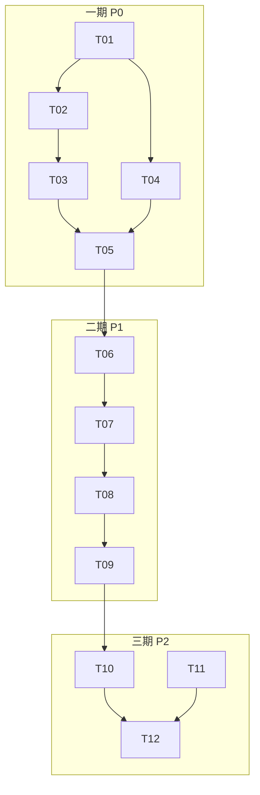

### 8.5 ★ 一期开工前置门禁：4 个验证（未通过则对应模块不开工）

> **✅ 已拍板（主理人决议）**：本节的验证项作为**一期开工前置门禁**。**门禁未通过前，对应模块不允许开工。**
>
> 其中 **G1 已拍板解决**（JSON 容错解析，+2 人日）；**G2 / G3 未通过则对应模块禁止开工**；G4 属三期，可延后。
>
> **G3（V3）同时决定 Q5 是否需要 L1** —— 必须先验证，不能先实现。且 **V3 失败即触发 L1 升为二期必修项**（§5.2.2 兜底条款第 4 条）。

**门禁规则（硬约束，写进项目启动清单）**

| 门禁 | 验证项 | 未通过则**禁止开工**的模块 | 通过判据 |
|---|---|---|---|
| **G1** | V1（能力集结构体缺失的补救路径） | T02（能力位落地）、T08（相机配置完整） | **已拍板：走 JSON 容错解析（+2 人日，计入一期）**；不阻塞一期。须同时落地「能力位未知」的只读降级策略（§3.0.2） |
| **G2** | V2（5 个结构体/方法缺失的兜底） | T03（预置位）、T07（云台完整）、T11（聚焦/日夜/透光） | 确认每项走 JSON 兜底路径，或确认降级/不做 |
| **G3** | V3（`CLIENT_RealPlayByDataType` 能否拿 PS） | **L1 组件（Q5 兜底）完全不开工** | 能拿到 PS 格式码流 → L1 成本 10 人日<br/>**拿不到 → L1 成本 13 人日，但仍是二期必修项**（不是「再评估」，见 §5.2.2 第 4 条兜底条款） |
| **G4** | V4（`emFuncType` 枚举值） | T10 / T12 里的定时任务部分 | 实测出 `emFuncType` 取值 ← **P2 项，可延后到三期开工前** |

> **编号对照（避免与历史版本混淆）**：上游早前提到的「V1/V2/V3」对应本表为 —— 旧 V1（结构体缺失）→ 本表 **V2**；旧 V2（喊话模式参数）→ **已解决，移出清单**（真实 API `CLIENT_SetDeviceMode`，见 §3.5.2）；旧 V3（PS 格式）→ 本表 **V3**（编号不变）。

| # | 验证项 | 方法 | 现状（已 grep 预核） | 若失败的影响与兜底 |
|---|---|---|---|---|
| **V1** | **能力集结构体缺失的补救**：`CFG_CAP_VIDEOINPUT_INFO` / `CFG_CAP_VIDEOINPUT_INFO_EX` / `CFG_CAP_SPEAK` / `CFG_CAP_RECORD_INFO` 四个类**在本 SDK 版本不存在**（枚举 `EM_NEW_QUERY_SYSTEM_INFO` 里有命令字符串，但 `structure/` 里没有对应类） | 用 `CLIENT_QueryNewSystemInfo(login, "devVideoInput.getCaps", ...)` 拿 `byte[]`，打印成字符串看是否是 JSON | **已确认缺失**；**✅ 已拍板：走 JSON 容错解析（+2 人日）** | 若返回 JSON → 容错解析取所需 key（**已选定方案**）<br/>若实测发现不是 JSON → 退回 §3.0.2 第 2 级「配置项存在性探测」，并**必须**启用「能力位未知 → 只读」降级（§3.0.2），不得让前端猜测 |
| **V2** | **5 个结构体/方法是否在本 SDK 版本存在**：`NET_VIDEOIN_DAYNIGHT_INFO`、`NET_VIDEOIN_IMAGEENHANCEMENT_INFO`（锐度）、`NET_VIDEOIN_EXPOSURE_SHUTTER_INFO`、`CLIENT_AlarmAck`、`CLIENT_Reboot` | 编译期引用 + IDE 跳转 | **已确认全部缺失**（`structure/` 与 `NetSDKLib.java` 均未找到） | 图像参数改走 `CLIENT_GetNewDevConfig("VideoInOptions")` JSON 路径（§3.6.2 已给兜底，`CFG_VIDEO_IN_OPTIONS` 的 `byDayNightColor`/`byGlareInhibition` 等字段已核实存在）；告警确认与云台重启一期不做真实下发 |
| **V3** | `CLIENT_RealPlayByDataType` 能否拿到 **PS 格式**码流 | 一台真机 + 遍历 `EM_REAL_DATA_TYPE` 枚举 | 未验证 | 决定 Q5 的 L1 成本：能拿 PS → 10 人日；只能拿裸 ES → +3 人日（§5.2.3 C3） |
| **V4** | `emFuncType` 的枚举值（`CFG_PTZ_FUNC_TYPE`）**在 SDK 中无类定义**（只有注释提到 `FUNC_TYPE_PRE`） | 一台真机 + 读一次 `CFG_CMD_PTZ_AUTO_MOVEMENT`，观察设备回填的 `emFuncType` 值 | **已确认类缺失** | 从 `CFG_PTZ_PROTOCOL_CAPS_INFO` 推断可用动作类型；`emFuncType` 用实测值硬编码为常量（P2 项，不阻塞一期） |

> **已从本清单移除的项**：v1.0 的「V2：`CLIENT_StartTalkByDataType` 能否指定喊话模式」——**已解决**。真实 API 是 `CLIENT_SetDeviceMode(login, EM_USEDEV_MODE.NET_TALK_SPEAK_PARAM, NET_SPEAK_PARAM*)`，已核实存在（§3.5.2）。不再有架构级不确定性，只剩型号级实测。
>
> **新增必做**：`STRUCTURE-AUDIT` —— 把本文附录 A 里所有引用的结构体类名做一次批量编译期引用，一次性暴露全部「枚举值存在但结构体缺失」的情况，而不是边开发边踩。**建议写成单元测试**：

```java
@ParameterizedTest
@ValueSource(strings = {
    "com.netsdk.lib.structure.NET_PRESET_INFO",
    "com.netsdk.lib.structure.NET_CFG_PICTURE_HTTP_UPLOAD_INFO",
    "com.netsdk.lib.structure.CFG_PTZ_PROTOCOL_CAPS_INFO",
    "com.netsdk.lib.structure.CFG_PTZ_AUTOMOVE_INFO",
    "com.netsdk.lib.structure.NET_VIDEOIN_COLOR_INFO",
    "com.netsdk.lib.structure.NET_VIDEOIN_IMAGE_INFO",
    "com.netsdk.lib.structure.NET_VIDEOIN_BACKLIGHT_INFO",
    "com.netsdk.lib.structure.NET_VIDEOIN_DEFOG_INFO",
    "com.netsdk.lib.structure.NET_VIDEOIN_LIGHTING_INFO",
    "com.netsdk.lib.structure.NET_VIDEOIN_FOCUSMODE_INFO",
    "com.netsdk.lib.structure.NET_AUDIO_DECODE_FORMAT",
    "com.netsdk.lib.structure.NET_AUDIO_DATA_CB_INFO",
    // 预期缺失，用 assertThrows 单独断言，作为"已知技术债"护栏
})
void structureMustExist(String className) throws Exception {
    assertNotNull(Class.forName(className), className + " 不在当前 SDK 版本，需改走 JSON 兜底");
}
```

**这个测试的价值**：以后升级 SDK 版本时，它会立刻告诉你「哪些技术债被厂商修了」或「哪些原本有的结构体没了」。


---

## 附录 A：SDK 事实核对表（供开发直接查）

> 全部方法名与结构体已在 `NetSDKLib.java` / `structure/` 中 grep 核实。**带 ⚠️ 为待确认**。

| 能力 | 方法签名 | 结构体 | 行号参考 |
|---|---|---|---|
| 初始化 | `CLIENT_Init(Callback, Pointer)` | — | — |
| 设备发现 | `CLIENT_StartSearchDevices(Callback cb, Pointer user, String szLocalIp)` → `LLong` | 回调 `fSearchDevicesCB(Pointer, Pointer)`<br/>出参 `DEVICE_NET_INFO_EX` | 26133 / 25786 / 8803 |
| 停止发现 | `CLIENT_StopSearchDevices(LLong)` | — | 26136 |
| 搜索参数 | `CLIENT_SetDeviceSearchParam(NET_DEVICE_SEARCH_PARAM)` | `NET_DEVICE_SEARCH_PARAM` | 25986 / 1506 |
| 按 IP 段搜索 | `CLIENT_SearchDevicesByIPs(DEVICE_IP_SEARCH_INFO, Callback, Pointer, String, int)` | `DEVICE_IP_SEARCH_INFO` | 36542 |
| 主动注册监听 | `CLIENT_ListenServer(String ip, int port, int timeout, Callback cb, Pointer user)` → `LLong` | 回调 `fServiceCallBack(LLong, String, int, int, Pointer, int, Pointer)` | 26738 / 25884 |
| 停止监听 | `CLIENT_StopListenServer(LLong)` | — | 26741 |
| 登录 | `CLIENT_LoginWithHighLevelSecurity(NET_IN_..., NET_OUT_...)` → `LLong` | `NET_IN_LOGIN_WITH_HIGHLEVEL_SECURITY` | 现有已用 |
| 登出 | `CLIENT_Logout(LLong)` | — | — |
| 云台 | `CLIENT_DHPTZControlEx2(LLong, int nChannelID, int dwPTZCommand, int lParam1, int lParam2, int lParam3, int dwStop, Pointer param4)` | `NET_PTZ_ControlType` / `NET_EXTPTZ_ControlType` | 26283 / 9226 / 9245 |
| 加软巡航点 | `CLIENT_AddSoftTourPoint(LLong, Pointer in, Pointer out, int wait)` | `NET_IN_ADD_SOFT_TOUR_POINT_INFO` | 39003 |
| 删软巡航点 | `CLIENT_RemoveTourPoint(LLong, Pointer in, Pointer out, int wait)` | `NET_IN_REMOVE_SOFT_TOUR_POINT_INFO` | 39015 |
| 启动巡航 | `CLIENT_PTZStartTour(LLong, Pointer in, Pointer out, int wait)` | `NET_IN_PTZ_START_TOUR` | 41109 |
| 停止巡航 | `CLIENT_PTZStopTour(LLong, Pointer in, Pointer out, int wait)` | `NET_IN_PTZ_STOP_TOUR` | 41116 |
| 聚焦 | `CLIENT_FocusControl(LLong, int ch, int cmd, double nFocus, double nZoom, Pointer res, int wait)` | — | 36568 |
| 连续聚焦 | `CLIENT_FocusPTZContinuously(LLong, Pointer in, Pointer out, int wait)` | — | 40154 |
| 手动抓图 | `CLIENT_ManualSnap(LLong, NET_IN_MANUAL_SNAP, NET_OUT_MANUAL_SNAP, int wait)` | `NET_IN/OUT_MANUAL_SNAP` | 34772 |
| 订阅抓图 | `CLIENT_AttachSnap(LLong, NET_IN_ATTACH_INTER_SNAP, NET_OUT_ATTACH_INTER_SNAP)` → `LLong` | 回调 `fAttachSnapRev(LLong, NET_CB_ATTACH_SNAP_INFO, Pointer)` | 34815 / 34788 |
| 取消订阅抓图 | `CLIENT_DetachSnap(LLong)` | — | 34818 |
| 全局抓图回调 | `CLIENT_SetSnapRevCallBack(Callback, Pointer)` | 回调 `fSnapRev` | 26127 |
| 抓图请求 | `CLIENT_SnapPictureEx(LLong, SNAP_PARAMS, IntByReference)` | `SNAP_PARAMS` | 26130 / 8787 |
| 喊话启动 | `CLIENT_StartTalkEx(LLong lLoginID, Callback pfcb, Pointer user)` → `LLong` | 回调 `pfAudioDataCallBack(LLong, Pointer, int, byte byAudioFlag, Pointer)` | 26414 / 25817 |
| 喊话送数据 | `CLIENT_TalkSendData(LLong lTalkHandle, Pointer buf, int size)` → `LLong` | — | 26433 |
| 喊话停止 | `CLIENT_StopTalkEx(LLong lTalkHandle)` | — | 26417 |
| 喊话(裸数据) ⚠️ | `CLIENT_StartTalkByDataType(LLong, Pointer in, Pointer out, int wait)` → `LLong` | 回调 `fAudioDataCallBackEx` | 26477 / 26508 |
| 对讲格式查询 | `CLIENT_QueryDevState(LLong, int NET_DEVSTATE_TALK_ECTYPE /*0x0009*/, Pointer buf, int len, IntByReference retLen, int wait)` | `NETDEV_TALKFORMAT_LIST` / `NETDEV_TALKDECODE_INFO` | 26301 / 11426 |
| 读配置(枚举) | `CLIENT_GetConfig(LLong, int emCfgOpType, int ch, Pointer out, int outSize, int wait, Pointer res)` | 各 `NET_EM_CFG_*` 对应结构体 | 26859 |
| 写配置(枚举) | `CLIENT_SetConfig(LLong, int emCfgOpType, int ch, Pointer in, int inSize, int wait, IntByReference restart, Pointer res)` | 同上 | 26862 |
| 读配置(命令) | `CLIENT_GetNewDevConfig(LLong, String cmd, int ch, byte[] out, int outSize, IntByReference err, int wait, Pointer res)` | `CFG_CMD_*` 对应结构体（JSON） | 26003 |
| 写配置(命令) | `CLIENT_SetNewDevConfig(LLong, String cmd, int ch, byte[] in, int inSize, IntByReference err, IntByReference restart, int wait)` | 同上 | 26006 |
| 查系统信息 | `CLIENT_QueryNewSystemInfo(LLong, String cmd, int ch, byte[] out, int outSize, IntByReference err, int wait)` | `CFG_CAP_CMD_*` | 26315 |
| 查设备信息 | `CLIENT_QueryDevInfo(LLong, int nQueryType, Pointer in, Pointer out, Pointer res, int wait)` | `NET_QUERY_VIDEOCHANNELSINFO`=0x15 | 26544 / 1416 |
| 查设备能力 | `CLIENT_GetDevCaps(LLong, int nType, Pointer in, Pointer out, int wait)` | `NET_SNAP_CFG_CAPS`=0x0c 等 | 26309 / 1447 |
| 报警回调设置 | `CLIENT_SetDVRMessCallBackEx1(fMessCallBackEx1 cb, Pointer user)` | `fMessCallBackEx1` | 26024 / 25762 |
| 订阅报警 | `CLIENT_StartListenEx(LLong)` | — | 26027 |
| 取消订阅 | `CLIENT_StopListen(LLong)` | — | 26030 |
| 报警用户 | `CLIENT_AddAlarmUser(LLong, Pointer in, Pointer out, int wait)` | — | 38586 |
| 告警确认 ⚠️ | `CLIENT_AlarmAck` — **本 SDK 版本未 grep 到** | — | 仅注释提及 |
| 录像检索 | `CLIENT_FindFileEx(LLong, int emType /*4=NET_FILE_QUERY_FILE*/, Pointer cond, Pointer res, int wait)` → `LLong` | `NET_IN_MEDIA_QUERY_FILE` | 26109 / 15670 |
| 检索下一页 | `CLIENT_FindNextFileEx(LLong, int count, Pointer out, int maxlen, Pointer res, int wait)` → `int` | `NET_OUT_MEDIA_QUERY_FILE` | 26114 / 15703 |
| 关闭检索 | `CLIENT_FindCloseEx(LLong)` | — | 26117 |
| 按时间下载 | `CLIENT_DownloadByTimeEx(LLong, int ch, int type, NET_TIME start, NET_TIME end, String path, Callback posCb, Pointer user, Callback dataCb, Pointer dataUser, Pointer res)` → `LLong` | 回调 `fTimeDownLoadPosCallBack` | 26207 / 25791 |
| 停止下载 | `CLIENT_StopDownload(LLong)` | — | 26210 |
| 自动重连 | `CLIENT_SetAutoReconnect(Callback, Pointer)` | 回调 `fHaveReConnect` | — |
| 断线回调 | `CLIENT_Init(DisconnectCallback, ...)` | 回调 `fDisConnect(LLong, String, int, Pointer)` | — |
| 连接超时 | `CLIENT_SetConnectTime(int wait, int retry)` | — | — |
| 最后错误码 | `CLIENT_GetLastError()` → `int` | — | — |
| 释放 | `CLIENT_Cleanup()` | — | — |
| **设置使用模式（对讲参数统一入口）** | **`CLIENT_SetDeviceMode(LLong lLoginID, int emType, Pointer pValue)`** | `EM_USEDEV_MODE`（13 项，含 `NET_TALK_ENCODE_TYPE=2` / `NET_TALK_TALK_CHANNEL=5` / `NET_TALK_SPEAK_PARAM=7`） | **26340** |
| **能力集查询** | `CLIENT_QueryNewSystemInfo(LLong, String cmd, int ch, byte[] out, int size, IntByReference err, int wait)` | 命令来自 `EM_NEW_QUERY_SYSTEM_INFO`（**47 项**） | 26315 |
| 云台能力集 | 同上，cmd = **`"ptz.getCurrentProtocolCaps"`** | **`CFG_PTZ_PROTOCOL_CAPS_INFO`**（含 `bPreset`/`bTour`/`bPattern`/`bAutoPan`/`bAutoScan`/`bSupportLimit` + 全部号段 `wPresetMin/Max` 等） | 枚举 `EM_NEW_QUERY_SYSTEM_INFO:135` |
| 云台是否支持 | 同上，cmd = `"ptz.factory.instance"` | `CFG_CAP_PTZ_ENABLEINFO{bEnable}` | 1250 / 23371 |
| 编码能力集 | 同上，cmd = `"encode.getCaps"` | `CFG_ENCODECAP` | `EM_NEW_QUERY_SYSTEM_INFO:139` |
| 报警能力集 | 同上，cmd = `"alarm.getAlarmCaps"` | `CFG_CAP_ALARM_INFO` | `EM_NEW_QUERY_SYSTEM_INFO:98` |
| 图像能力集 ⚠️ | 同上，cmd = `"devVideoInput.getCaps"` | ⚠️ **`CFG_CAP_VIDEOINPUT_INFO` 结构体在本 SDK 缺失** → 需 JSON 解析（§8.5 V1） | `EM_NEW_QUERY_SYSTEM_INFO:66` |
| 扬声器能力集 ⚠️ | 同上，cmd = `"speak.getCaps"` | ⚠️ **`CFG_CAP_SPEAK` 结构体缺失** | `EM_NEW_QUERY_SYSTEM_INFO:163` |
| 预置位读/写 | `CLIENT_GetNewDevConfig` / `SetNewDevConfig`，cmd = `CFG_CMD_PTZ_PRESET` (`"PtzPreset"`) | **`NET_PRESET_INFO`**（`pstList`→`NET_PRESET_CONFIG_LIST_INFO[]{nIndex, nStayTime}`，**`nArriveTimeout` 5~300s**） | 1213 |
| 预置位调用 | `CLIENT_DHPTZControlEx2(login, ch, NET_EXTPTZ_GOTOPRESET, 0,0,0,0, param4)` | `param4` = `PTZ_CONTROL_GOTOPRESET{nPresetIndex, PTZ_SPEED_UNIT stuSpeed}` | 9300 / 10291 / 10266 |
| 转预置位并抓图 | 同上，指令码 `NET_EXTPTZ_GOTOPRESETSNAP` = `0x80` | — | 9324 |
| 预置点到位状态 | 包含在 `NET_PTZ_LOCATION_INFO.emPresetStatus` | **`EM_DH_PTZ_PRESET_STATUS`**：`UNKNOWN=0 / REACH=1 / UNREACH=2` | 18833 |
| 云台定时/空闲/开机**任务定义** | **`CLIENT_GetConfig` / `SetConfig`，`NET_EM_CFG_PTZ_MOVEMENT` = 7008** | **`NET_CFG_PTZ_MOVEMENT_INFO{emFunction, nIndex, emTaskName}`** | `enumeration/NET_EM_CFG_OPERATE_TYPE.java:345` |
| 任务类型枚举 | — | **`EM_PTZ_TASK_NAME`**：`AUTOMOVEMENT=1(定时任务)` / `IDLEMOTION=2(空闲任务)` / **`POWERUP=3(开机动作)`** / `LINK=4` / `INTELIGENCE=5` / `MANUAL=6` | `enumeration/` |
| 云台功能枚举 | — | **`EM_PTZ_FUNCTION`**：`NONE=1` / `SCAN=2` / `PATTERN=3(巡迹)` / `TOUR=4` / `AUTOPAN=5` / `PRESET=6` / `HEATMAP=7` / `PATROL=8` | `enumeration/` |
| 云台定时动作**参数** | `CLIENT_GetNewDevConfig` / `SetNewDevConfig`，cmd = `CFG_CMD_PTZ_AUTO_MOVEMENT` (`"PtzAutoMovement"`) | **`CFG_PTZ_AUTOMOVE_INFO`** → `CFG_PTZ_ALL_AUTOMOVE_INFO` → `CFG_PTZ_PER_AUTOMOVE_INFO`（含 `emFuncType`/`nTourId`/`nPatternId`/`nPresetId`/`nScanId`/`stAutoHoming`/`stTimeSchedule`） | 1222 |
| 自动归位（空闲阈值） | 同上（`CFG_PTZ_PER_AUTOMOVE_INFO.stAutoHoming`） | **`CFG_AUTO_HOMING{bEnable, nTime(秒)}`** | structure |
| 播放/对讲编码 | `CLIENT_QueryDevState(NET_DEVSTATE_TALK_ECTYPE=0x0009)` | `NETDEV_TALKFORMAT_LIST` → `NETDEV_TALKDECODE_INFO{encodeType, nAudioBit, dwSampleRate, nPacketPeriod(只能25)}` | 1274 / 11426 |
| 音频格式/音量 | — | `NET_AUDIO_DECODE_FORMAT` / `NET_AUDIO_DATA_CB_INFO` / `NET_AUDIOOUT_VOLUME_INFO` 均已核实存在 | structure |
| **不存在的方法（勿引用）** | ~~`CLIENT_AlarmAck`~~ ~~`CLIENT_Reboot`~~ ~~`CLIENT_*Preset*`~~ ~~`EXTPTZ_SETPRESET`~~ | 全文 grep 均未找到 | — |


## 附录 B：配置项常量速查

| `CFG_CMD_*` / `NET_EM_CFG_*` | 值 | 结构体 | 用途 |
|---|---|---|---|
| `CFG_CMD_VIDEOIN` | `"VideoIn"` | `CFG_VIDEO_IN_INFO` | 通道名称/型号/厂商/行政区域/上下级 |
| `CFG_CMD_VIDEOINOPTIONS` | `"VideoInOptions"` | `CFG_VIDEO_IN_OPTIONS` | 图像前端选项（备路径） |
| `CFG_CMD_ENCODE` | `"Encode"` | `CFG_ENCODE_INFO` | 码流/抓图/颜色（`stuSnapFormat`、`stuVideoColor`） |
| `CFG_CMD_NASEX` | `"NAS"` | `CFG_NAS_INFO_EX` | FTP/NAS 上传目标（抓图路径 B） |
| `CFG_CMD_PTZ` | `"Ptz"` | `CFG_PTZ_INFO` | 云台协议/串口/空闲归位（`stuPresetHoming`） |
| `CFG_CMD_PTZTOUR` | `"PtzTour"` | `CFG_PTZTOUR_INFO` | **巡航组整体读写** |
| `CFG_CMD_ALARMINPUT` | `"Alarm"` | `CFG_ALARMIN_INFO` | 报警输入配置 |
| **`CFG_CMD_PTZ_PRESET`** | **`"PtzPreset"`** | **`NET_PRESET_INFO`** → `NET_PRESET_CONFIG_LIST_INFO[]` | **预置位清单读/写 + `nArriveTimeout`** |
| **`CFG_CMD_PTZ_AUTO_MOVEMENT`** | **`"PtzAutoMovement"`** | **`CFG_PTZ_AUTOMOVE_INFO`** → `CFG_PTZ_PER_AUTOMOVE_INFO` | **空闲动作 / 定时任务** |
| `CFG_CAP_CMD_PTZ_ENABLE` | `"ptz.factory.instance"` | `CFG_CAP_PTZ_ENABLEINFO` | 通道是否支持云台 |
| **`CFG_CAP_CMD_PTZ`** | **`"ptz.getCurrentProtocolCaps"`** | **`CFG_PTZ_PROTOCOL_CAPS_INFO`** | **云台 11 子功能能力位 + 全部号段范围** |
| `CFG_CMD_ENCODE_GETCAPS` | `"encode.getCaps"` | `CFG_ENCODECAP` | 编码能力 |
| `CFG_CAP_ALARM` | `"alarm.getAlarmCaps"` | `CFG_CAP_ALARM_INFO` | 报警类型能力 |
| `CFG_CAP_CMD_VIDEOINPUT` ⚠️ | `"devVideoInput.getCaps"` | ⚠️ `CFG_CAP_VIDEOINPUT_INFO` 缺失 | 19 项图像能力（走 JSON 解析兜底） |
| `CFG_CAP_CMD_VIDEOINPUT_EX` ⚠️ | `"devVideoInput.getCapsEx"` | ⚠️ 缺失 | 同上（扩展） |
| `CFG_CAP_CMD_SPEAK` ⚠️ | `"speak.getCaps"` | ⚠️ `CFG_CAP_SPEAK` 缺失 | 扬声器能力 |
| `NET_EM_CFG_VIDEOIN_COLOR` | `1301` | `NET_VIDEOIN_COLOR_INFO` | 亮度/对比度/饱和度/伽马/色调/色彩抑制 |
| `NET_EM_CFG_VIDEOIN_IMAGE_OPT` | `1302` | `NET_VIDEOIN_IMAGE_INFO` | 镜像/翻转/旋转90（视角组合） |
| `NET_EM_CFG_VIDEOIN_EXPOSURE_NORMAL` | `1306` | `NET_VIDEOIN_EXPOSURE_NORMAL_INFO` | 曝光通用 |
| `NET_EM_CFG_VIDEOIN_EXPOSURE_OTHER` | `1307` | ⚠️ | 其他曝光 |
| `NET_EM_CFG_VIDEOIN_EXPOSURE_SHUTTER` | `1308` | ⚠️ 结构体缺失 | 快门 |
| `NET_EM_CFG_VIDEOIN_BACKLIGHT` | `1309` | `NET_VIDEOIN_BACKLIGHT_INFO` | 背光/宽动态/强光抑制（互斥） |
| `NET_EM_CFG_VIDEOIN_LIGHTING` | `1311` | `NET_VIDEOIN_LIGHTING_INFO` | 补光灯 |
| `NET_EM_CFG_VIDEOIN_DEFOG` | `1312` | `NET_VIDEOIN_DEFOG_INFO` | 透雾 |
| `NET_EM_CFG_VIDEOIN_FOCUSMODE` | `1313` | `NET_VIDEOIN_FOCUSMODE_INFO` | 聚焦模式 |
| `NET_EM_CFG_VIDEOIN_DAYNIGHT` | `1316` | ⚠️ 结构体缺失 | 日夜模式 |
| `NET_EM_CFG_PICTURE_HTTP_UPLOAD` | `1609` | `NET_CFG_PICTURE_HTTP_UPLOAD_INFO` | **图片 HTTP 上传目标（抓图路径 A）** |
| `NET_EM_CFG_NAS` | `1700` | `NET_NAS_INFO` | NAS（备） |
| `NET_EM_CFG_AUTO_PAN` | `71` | `NET_CFG_AUTO_PAN_INFO` | 水平旋转设置 |
| **`NET_EM_CFG_PTZ_MOVEMENT`** | **`7008`**（`enumeration/NET_EM_CFG_OPERATE_TYPE.java:345`，**不在 `NetSDKLib.java` 里**） | **`NET_CFG_PTZ_MOVEMENT_INFO`** ✅ 存在（`{emFunction, nIndex, emTaskName}`） | **开机动作 / 空闲动作 / 定时任务的任务定义**（`emTaskName` 区分三种）—— 见 §3.3.4 |
| `NET_EM_CFG_ENCODE_SNAP_INFO` | `1106` | `NET_ENCODE_SNAP_INFO` ⚠️ | 编码抓图配置 |

### 附录 B.2：对讲 / 音频常量速查

| 类别 | 常量 | 值 |
|---|---|---|
| 使用模式 `EM_USEDEV_MODE` | `NET_TALK_CLIENT_MODE` / `NET_TALK_SERVER_MODE` / **`NET_TALK_ENCODE_TYPE`** / `NET_TALK_TALK_CHANNEL` / **`NET_TALK_SPEAK_PARAM`** / `NET_TALK_MODE3` / `NET_TALK_TRANSFER_MODE` | 0 / 1 / **2** / **5** / **7** / 9 / 11 |
| 编码类型 `NET_TALK_CODING_TYPE` | `DEFAULT`(无头PCM) / `PCM` / **`G711a`** / `AMR` / **`G711u`** / **`G726`** / `G723_53` / `G723_63` / `AAC` / `OGG` / `G729` / `MPEG2` / `MPEG2_Layer2` / `G722_1` / **`ADPCM`** / `MP3` | 0 / 1 / **2** / 3 / **4** / **5** / 6 / 7 / 8 / 9 / 10 / 11 / 12 / 13 / **21** / 22 |
| 本方案协商优先级 | G711a(2) → G711u(4) → G726(5) → PCM(1) → ADPCM(21) → AAC(8) | — |
| 音频标志（回调 `byAudioFlag`） | 0 = 本地录音库采集（下行），1 = 设备上行 | — |
| 预览数据标志 | `REALDATA_FLAG_PCM_AUDIO_DATA` | `0x08` |

### 附录 B.3：预置位 / 云台状态常量速查

| 类别 | 常量 | 值 |
|---|---|---|
| 预置位到位 `EM_DH_PTZ_PRESET_STATUS` | `UNKNOWN` / **`REACH`** / **`UNREACH`** | 0 / 1 / 2 |
| 云台动作 `NET_PTZ_LOCATION_INFO.bAction` | 0=预置点 1=线扫 2=巡航 3=巡迹 4=水平旋转 5=普通移动 6=巡迹录制 7=全景扫描 **12=云台重启** | — |
| 云台运动 `bState` | 1=运动 2=空闲 | — |
| 基础云台指令 `NET_PTZ_ControlType` | `POINT_MOVE`=10 / `POINT_SET`=11 / `POINT_DEL`=12 / `POINT_LOOP`=13 / `LAMP`=14 | — |
| 扩展云台指令 `NET_EXTPTZ_ControlType` | `LEFTTOP`=0x20 … `RIGHTDOWN`=0x23 / `ADDTOLOOP`=0x24 / `DELFROMLOOP`=0x25 / `CLOSELOOP`=0x26 / `STARTPANCRUISE`=0x27 / `STOPPANCRUISE`=0x28 / `SETLEFTBORDER`=0x29 / `SETRIGHTBORDER`=0x2A / `STARTLINESCAN`=0x2B / `CLOSELINESCAN`=0x2C / **`GOTOPRESETSNAP`=0x80** | — |

---

## 附录 C：变更记录（供评审对照）

### C.1 v1.1 → v1.2（本轮）

| # | 变更 | 触发来源 | 性质 |
|---|---|---|---|
| 1 | **`PtzCommand` 补 `Schedule` record**（定时任务）+ 新增共用 `PtzActionType` 枚举 | 上游指出「T12 有定时任务但接口层是空的」，**判断正确** | **补缺口** |
| 2 | **`NET_EM_CFG_PTZ_MOVEMENT = 7008` 确认存在**（`enumeration/NET_EM_CFG_OPERATE_TYPE.java:345`），`NET_CFG_PTZ_MOVEMENT_INFO` 亦存在 | 上游称「不存在」，**实际是 grep 范围不全**（该枚举不在 `NetSDKLib.java`） | **纠正上游** |
| 3 | **开机动作从「不可实现」改为「可实现」** | 顺 `NET_CFG_PTZ_MOVEMENT_INFO` 注释找到 `EM_PTZ_TASK_NAME`，其中 `POWERUP=3("开机动作")` | **推翻 v1.1 自己的结论** |
| 4 | 三种动作改为**「`PtzMovement` + `PtzAutoMovement` 两个命令协作」**模型 | 同上 | 模型修正 |
| 5 | `Preset(LIST)` 补**三级降级链**（DEVICE → PLATFORM_LEDGER → MERGED）+ `listSource` 字段 | 上游建议「别一开始就接受缺陷」 | 改进 |
| 6 | **Q5 决议落档**：接受 L1 但限定兜底，且**必须先过 V3 才允许排期**；给出 5 条准入硬门禁 | 上游拍板 | 决策落档 |
| 7 | **Q1 决议落档**：设备 HTTP 直传为默认路径，FTP 降兜底 | 上游拍板 | 决策落档 |
| 8 | **§8.5 升级为「一期开工前置门禁」**（G1~G4），未通过则对应模块禁止开工；附旧新编号对照表 | 上游要求 | 流程约束 |
| 9 | 附录 A/B 补 `EM_PTZ_TASK_NAME` / `EM_PTZ_FUNCTION` / `NET_CFG_PTZ_MOVEMENT_INFO` | 核查结果 | 事实补全 |
| **10** | **Q5 补「失败即必修」兜底条款**：V3 或 V6 任一实测失败 → **L1 自动升级为二期必修项**，不再走"再讨论" | 上游要求「否则公网场景会停在知道会坏但没人修」 | **决策落档** |
| **11** | **能力位「未知」状态明确二选一：默认只读 + 一键探测**（附状态机 + `ProbeState` 枚举 + 3 条实现约束） | 上游要求「必须二选一并说清，不能让前端自己猜」 | **决策落档** |
| **12** | `CapabilityReport` 增 `state` / `unknownReasonZh` 字段，让前端不必推断 | 同上 | 契约补全 |
| **13** | `CFG_CAP_VIDEOINPUT_INFO` 缺失的补救**已拍板为 JSON 容错解析（+2 人日）**，并在 V1 行与门禁 G1 双处标注 | 上游同意 | **决策落档** |
| **14** | **P0 由 17 → 18**：抓图平台侧接收端点从 P1 提为 P0（验收口径：报警→平台收到图→能查到）。T04 补齐 6 个关联文件 | 产品经理 PRD 定稿 | 范围变更 |
| **15** | **新增端点职责边界（硬性）**：只做「接收 + 落盘 + 入库元数据」，**不含图片解码/缩略图/格式转换/内容校验/AI**；唯一允许的处理是 4 字节魔数检查。已核查全文无越界内容 | 产品经理 + team-lead 要求 | **约束入档** |
| **16** | **补齐「端口复用与鉴权链冲突」分析（6 处）**，全部基于现有代码核实：C1 Sa-Token 拦截 / C2 操作日志 / C3 写权限守卫 / C4 multipart 上限缺失 / C5 nginx TLS 与体积上限 / C6 ACL 不作用于 HTTP（无冲突） | 产品经理提问 | **新增分析** |
| **17** | **端点改为 Content-Type 双路分流**：`form-data` 走标准解析，**`x-mixed-replace` 走自写流式 boundary 解析**（标准解析器对它无效）。原设计「非 form-data 一律 415」已废弃 | 产品经理要求 | **设计修正** |
| **18** | **多服务器重复到达处理**：`dahua_snapshot` 增 `source_server_index` + `received_count`；**唯一键不含 server_index**（否则双活备份会入库两条一样的图），改用 `ON DUPLICATE KEY UPDATE received_count+1` | 产品经理提醒 | **新增设计** |
| **19** | 新增错误码 `DAHUA_E_3006/3007/3008`（415 / 413 / 暂存区满） | 上述变更配套 | 补全 |

### C.2 v1.0 → v1.1

| # | v1.0 的说法 | v1.1 的修正 | 性质 |
|---|---|---|---|
| 1 | 统计口径「46 功能点」 | **45 功能点**（✅4 + ⚠️1 + ❌40） | 对齐 PRD 最终版 |
| 2 | 「SDK 没有干净的预置位枚举接口」→ 设计平台台账 + 巡航组反推兜底 | **错。`CFG_CMD_PTZ_PRESET` + `NET_PRESET_INFO` 可直接整体读出预置位列表 + `nArriveTimeout`** | **推翻自己的结论** |
| 3 | `Preset(GOTO)` 用 `NET_PTZ_POINT_MOVE_CONTROL`=10 | 改用 **`NET_EXTPTZ_GOTOPRESET` + `PTZ_CONTROL_GOTOPRESET`**（可带速度） | 改进 |
| 4 | 抓图上传用自定义 Header `X-Snap-Token` | **设备只支持 HTTP Basic Auth**，改用 `szUserName`/`szPassword` | **纠错** |
| 5 | 喊话模式「待确认，一期先用默认对讲」 | **`CLIENT_SetDeviceMode(..., NET_TALK_SPEAK_PARAM, NET_SPEAK_PARAM*)` 已核实**，可直接实现 | **消除不确定性** |
| 6 | 音频编码「首选 G.711A」 | 给出**完整协商链**（6 种编码优先级）+ `NET_TALK_G711a=2` 已核实 | 完善 |
| 7 | 开机/空闲/定时动作「三个独立设计」 | 空闲 + 定时共享 `CFG_CMD_PTZ_AUTO_MOVEMENT`；开机动作当时**误判为无入口**（v1.2 已推翻） | 收敛（部分待 v1.2 修正） |
| 8 | 无统一的结构体读写抽象 | **新增 §3.0.1 `StructCfgAccessor`**（patch 语义 + 通道级写锁） | **新增基础设施** |
| 9 | 能力位散在 §3.6.3 | **提升为 §3.0.2 独立基础设施**（三级探测 + 缓存策略 + 前端渲染约定） | **新增基础设施** |
| 10 | 未提 CLIENT 模式地址字段 | **新增 `access_host`/`access_port`**，说明与 `remote_ip`/`remote_port` 的语义冲突 | **补缺口** |
| 11 | 注册 SN→deviceId「已设计」 | 补完整三段状态模型、交叉校验（型号一致性）、白名单层级、attach 句柄重订阅 | **补地基** |
| 12 | Q5 只给结论 | 改为**判断依据 C1~C4 + 阈值 + 完整代价** | 方法论修正 |
| 13 | 无首批接入验证 | **新增 §5.3 13 环验证 Checklist** | **补缺口** |

### C.3 给开发的检索纪律（本轮新增的重要经验）

> 查大华配置项枚举必须 grep **三个地方**，漏一个就会误判「不存在」：
>
> | 位置 | 内容 | 例 |
> |---|---|---|
> | `NetSDKLib.java` | `CFG_CMD_*` 字符串常量 | `CFG_CMD_PTZTOUR = "PtzTour"` |
> | **`enumeration/NET_EM_CFG_OPERATE_TYPE.java`** | **`NET_EM_CFG_*` 数字枚举（400+ 项）** | **`NET_EM_CFG_PTZ_MOVEMENT = 7008`** |
> | `structure/*.java` | 结构体定义（3129 个文件） | `NET_CFG_PTZ_MOVEMENT_INFO` |
>
> 本方案 v1.0 曾因只 grep 主文件，把 `NET_EM_CFG_VIDEOIN_COLOR=1301` 等一批值标成「待确认」；v1.2 又因同样的原因被上游误判 `7008` 不存在。**这是这套 SDK 最容易踩的检索陷阱。**

---

*本方案基于 `General_NetSDK_ChnEng_JAVA_Linux64_IS_V3.061.0000001.0.R.260826` 核实。所有 ⚠️ 标记项已列入 §8.5 的「开工前置门禁」。*
*现场事实：现网 0 台大华 NetSDK 直连设备，全部能力需按 §5.3 逐环验证。*


---

*本方案基于 `General_NetSDK_ChnEng_JAVA_Linux64_IS_V3.061.0000001.0.R.260826` 核实。所有 ⚠️ 标记项已列入 §8.5 的「开发第 1 天验证清单」。*
*现场事实：现网 0 台大华 NetSDK 直连设备，全部能力需按 §5.3 逐环验证。*
